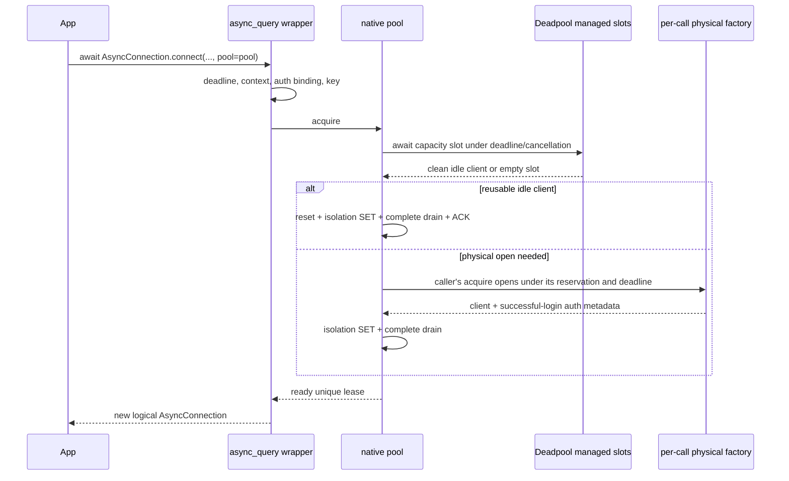

# Integrating Async Connection Pooling with mssql-python

This document (Doc 2) consumes the Rust pool specified
in [Doc 1](https://microsoft.sharepoint-df.com/teams/sqldevx/Shared%20Documents/Python%20Driver/Design%20Docs/Async%20Aware%20Connection%20Pooling/async-connection-pooling-mssql-rs.md). Both workstreams ship as one
feature; the existing sync ODBC pool is not changed.

**Pool core:** Doc 1 selects `deadpool::managed` as the preferred internal
capacity/storage component, subject to its proof-of-fit gates. The public Python
API does not expose Deadpool. The driver still implements SQL Server reuse policy,
AQE ownership, credential lifetimes and error mapping. See the
[build-versus-reuse analysis](./async-pool-core-build-vs-reuse.md) for the library
comparison and Doc 1 section 5.0 for the authoritative responsibility split.

## 1. Baseline, scope, and compatibility

### 1.1 Verified current surface

The current Python entry point is
`mssql_python.async_query.AsyncConnection.connect(...)`, not
`mssql_python.aio.connect_async`. It accepts the customer-facing connection
string and maps supported options into the core context. The preview currently
allows SQL password/trusted authentication and rejects other `Authentication=`
modes. Token-provider/Entra parity is **new work**, not existing async behavior.

`PyAsyncConnection::connect` directly creates a TDS client. Cursors hold cloned
`Arc<Mutex<TdsClient>>` references. `AsyncConnectionState` has operation claims and
Open/Closing/Closed/Broken states; `begin_close` only changes lifecycle and is
**not** a barrier that joins all operations. Some cursor/fetch finalization uses
background work. The shared Tokio runtime already exists.

Current connection-level error mapping still includes `RuntimeError`, and
explicit close logs/swallows some cleanup errors. The required mapping and
error-reporting below are intentional preview improvements, not verified parity.

### 1.2 Required compatibility

Preserve the connection-string entry point and existing positional parameters.
Extend `async_query`; do not invent a separate `aio` implementation or require
customers to author a Rust configuration dictionary. Use existing parsers and
the bulk-copy context adaptation as prior art, but validate each option against
the async backend rather than assuming that adaptation supports everything.

An unsupported option must be rejected with a clear error before pooling or I/O,
not silently omitted. Sync and async use separate managers, clients, and
configuration; `mssql_python.pooling(...)` continues to control only sync pooling.

## 2. Proposed public API and ownership scope

### 2.1 Opt-in async manager

Proposed additions, subject to public API owner approval:

```python
from mssql_python.async_query import AsyncConnection, AsyncPool

async with AsyncPool(max_size=100, idle_timeout=600) as pool:
    connection = await AsyncConnection.connect(connection_string, pool=pool)
    async with connection:
        cursor = connection.cursor()
        # Existing async cursor API is unchanged.
```

The Python `AsyncPool` object wraps one Rust `AsyncPoolManager`, which owns
multiple per-key **Pools**. A **Pool** is the set of reusable physical TDS
connections for one complete connection/authentication key. Requests with the
same effective settings, authentication binding, and credential version can use
the same pool; different keys use separate pools and cannot share connections.

The **Pool Manager** selects the appropriate pool and coordinates their lifecycle.
Each pool has its own idle connections and capacity accounting. `max_size` is a
per-pool limit, not a manager-wide limit: with `max_size = 100`, two keys can
account for up to 200 physical connections across two pools. The `pool` variable
in the Python examples refers to the `AsyncPool` manager wrapper, not to an
individual Rust `Pool`; the proposed public API name is unchanged.

`AsyncPool` is created inside a running asyncio loop and is bound to that loop
and the process-wide AQE Tokio runtime. It cannot be passed to another loop or
interpreter. Separate managers have separate limits; this is not a global server
connection cap.

| Public operation | Contract |
|---|---|
| `AsyncPool(...)` | Validate Doc 1 configuration, bind current loop, construct and enable native manager |
| `pool.enable()` | Re-enable with the stored configuration; idempotent if enabled |
| `pool.disable()` | Synchronously stop admission, discard idle clients, cancel admitted acquisitions; checked-out connections remain usable |
| `await pool.aclose()` | Permanent graceful shutdown with Doc 1 deadline; release owned credential resources after active auth work settles |
| `async with pool` | Enter validates open/owning loop; exit awaits `aclose` |
| `AsyncConnection.connect(..., pool=None)` | Existing direct path by default |
| `AsyncConnection.connect(..., pool=pool)` | Pooled path; disabled-at-admission manager may take direct path |

Configuration values, provenance, and validation are defined once in Doc 1
section 4.1. The proposed inherited values are 100 connections/key, 600 seconds
idle timeout, and a 300-second token refresh margin. Acquisition, cleanup, and
shutdown timeout defaults are **TBD: team agreement and workload validation
required**. Constructor examples omitting those timeout arguments are illustrative
until the defaults are approved.

The constructor exposes these as keyword-only settings. Zero is valid for
`idle_timeout` and `token_refresh_margin`, but not for `max_size` or the three
timeout budgets. This design does not support changing pool settings while the manager is active. To use different settings, finish outstanding work, close the existing manager, and create a new one. Disable/re-enable of the same
manager retains old reservations.

Add keyword-only `max_waiting: int | None = None` to `AsyncPool`. It limits live
queued acquisitions independently for each per-key Pool. `None` means no queue
limit; a configured value must be a positive integer (not a boolean). Zero and
negative/non-integer values are invalid. No numeric limit is selected here.

Requests that cannot immediately receive a resource without bypassing older
waiters join the FIFO. If `max_waiting` is reached, raise `OperationalError` with
the native reason `WaitQueueFull`; do not open directly or consume a connection
reservation. Assigned grants, physical opens, checked-out leases, and Python auth
work before native admission are not queue entries. This is not a process-wide
memory/concurrency limit. FIFO means grant order, not connect-completion order.
A retry that gives up its previous grant and queues again goes to the tail and
is subject to the same limit; it may also raise `WaitQueueFull`. There is no
retry exemption that could exceed the configured bound or bypass queued callers.

Keep driver-created async credentials with the pool manager that uses them, rather than in a global cache. Use them on their owning asyncio event loop and close them before that loop shuts down. This prevents a later event loop from reusing credential resources tied to a closed loop.

### 2.2 Additive connect parameters

Add keyword-only `pool`, `acquire_timeout`, `isolation_level`, and, when the auth
milestone lands, `token_provider`/supported `attrs_before` handling. Preserve the
existing meanings of `autocommit`, `timeout`, and `python_logger`. Do not move
logger/autocommit positional slots in `PyAsyncConnection.connect`; native new
arguments must also be keyword-only after the existing parameters.
Omitted `isolation_level` resolves to READ COMMITTED. Pass a validated concrete
isolation enum to native code; omission is not the TDS "unspecified" value.

The low-level `client_context_dict` remains an internal translation seam, not a
replacement customer-facing API. The complete flow is:

```text
customer connection string + supported options
  -> existing parser and async option validation
  -> immutable effective context + authentication binding
  -> canonical opaque pool key + current-call physical-open factory
  -> native acquire or direct open
```

When configured, `acquire_timeout` applies to the complete async connect,
including Python credential/key preparation, capacity wait, login and isolation
initialization. With an explicit pool and no per-call override, use that manager's
configured acquisition budget; its numeric default is TBD in Doc 1 section 4.1.
Disabling that pool does not restart or remove an already-established deadline.

For `pool=None`, a positive finite per-call override supplies the total-connect
budget in addition to the login timeout. With no override, retain existing
direct-connect/login-timeout behavior; introducing an additional default
total-connect budget requires separate approval. Existing query `timeout=0`
continues to mean no query timeout, not infinite pool wait.

## 3. Physical ownership and cursor generations

### 3.1 One revocable logical lease cell

Doc 1's `PoolLease` owns `TdsClient` by value and exposes only a mutable borrow.
The binding must replace all escaped raw client Arcs:

```rust
enum ConnHandle {
    Direct(TdsClient),
    Pooled(PoolLease),
}

struct LogicalConnection {
    handle: tokio::sync::Mutex<Option<ConnHandle>>,
    state: AsyncConnectionState,
    // New tracked-operation/close coordination; not present in the baseline.
}
```

`PyAsyncConnection` and each native cursor hold a strong `Arc<LogicalConnection>`.
The Python `AsyncCursor` wrapper also retains its parent `AsyncConnection`,
matching the sync API's lifetime behavior. An in-flight operation retains the
logical parent until its client access is settled. Cursors do not independently
own a raw client or a second pool lease.

The logical connection tracks cursors weakly, if tracking is needed; do not add a
strong parent-to-cursor ownership cycle. Deleting the application's `conn`
variable does not close a connection still owned by a cursor. Explicit
`connection.close()` is different: it transitions the shared state to Closing,
settles operations, and takes the handle out of the cell before returning the
lease. Surviving cursors then fail through the closed-state checks and cannot
reach the physical client used by another borrower.

`cursor.close()` releases that cursor's result/statement resources, not the
parent's physical lease; it does not invalidate sibling cursors.

Each checkout creates fresh logical state, cursor IDs, default query timeout,
autocommit state, and tracing context. Closed/broken state is terminal and never
reset to Open for a new borrower. Reuse moves the physical client into an entirely
new logical cell. Old cursor objects and finalizers can refer only to the old,
closed, empty cell.

The native `PoolLease` wraps a checked-out Deadpool **capacity slot**, not an
exposed `deadpool::managed::Object<TdsClient>`. Its client remains uniquely owned
behind `ConnHandle`. A successful explicit release returns a clean client in its
slot; a last-owner Drop destroys the client before returning an empty slot.
Deadpool's normal Object Drop is not the AQE close protocol and must never bypass
this wrapper. Keep all Deadpool types private to the Rust pool module.

### 3.2 Operation admission and close barrier

Every execute, fetch variant, executemany, commit, rollback, cursor close, and
finalizer must obey the same protocol:

1. Atomically claim the operation in the logical state while Open.
2. Register any spawned task and its cancellation control **before** it can run.
3. Acquire the logical handle mutex.
4. Re-check lifecycle and operation identity after acquiring that mutex; reject a
   queued claim if close has already begun. Only an explicit internal close owner
   may access a Closing handle.
5. Borrow the client through `ConnHandle`; do not clone/extract it.
6. Drop client access before publishing operation completion; settle the claim.

The state mutex is not held while awaiting the handle mutex or I/O. The handle
mutex is the exclusive physical-access boundary. No GIL is held while waiting
for either mutex or performing TDS I/O.

Close performs one atomic Open/Broken -> Closing transition, preserving a sticky
broken/discard bit. New claims are rejected. Existing running operations are
cancelled and joined within the single cleanup budget; dormant unread-result
ownership is transferred to the close owner for draining, not waited on forever.
A stale cursor in a Fetching state is not necessarily an actively running task.

If an operation cannot settle cooperatively, abort its tracked Rust task and
await task destruction before moving the handle. Aborted/indeterminate I/O forces
discard; do not attempt to reuse it after acquiring the mutex. Never release a
lease while an operation can still access its client. This requires changes to
the existing AQE detached-operation/finalizer paths; `begin_close()` alone does
not implement it.

### 3.3 Concurrent close and finalization

Explicit close/context exit uses an exactly-once close coordinator shared by the
logical connection. The first caller owns teardown; concurrent callers await the
same completion and outcome, rather than returning success while teardown runs.
The handle is taken only after the close barrier, without borrowing a PyO3
`&mut self` across an await.

Cancelling a close caller does not reopen the object. The tracked teardown owner
continues within its original finite cleanup budget; timeout/abortion discards.
If awaitable construction fails, a synchronous guard invalidates the logical
state and arranges the same bounded discard path; no lease is silently stranded
in a taken local variable.

Dropping one wrapper or cursor releases only that owner's reference; it must not
implicitly close the logical connection while another cursor or operation still
owns it. In particular, parent-wrapper GC is not equivalent to explicit close.
The Python wrapper must not add a finalizer that calls close merely because its
own reference is being dropped.

When the last strong logical owner disappears, no other operation can still
borrow the handle. Final destruction discards any remaining client/lease; it
never commits, awaits cleanup, or returns an unquiesced client to idle. Active
operations hold their own references until settlement, and their cancellation
guards remain responsible for stopping their work. The task registry/coordinator
must not form a self-owning cycle that prevents final destruction.
Explicit awaited close is the reuse path; final-owner destruction still reclaims
capacity, but does so by discarding the physical connection.

After explicit close, old cursors may keep the closed, empty logical cell alive,
but not the physical client. During orderly runtime shutdown, stop/join tracked
work before destroying runtime resources. At interpreter/process finalization
only best-effort local destruction is promised; explicit `close`/`aclose` is the
reliable awaited cleanup path.

## 4. Connect, close, and transaction behavior

### 4.1 Connect sequence

1. Validate options and owning loop; establish the applicable configured
   acquisition deadline under section 2.2.
2. Resolve authentication binding and immutable effective context. Token-derived
   keys require a current token before lookup; stable bindings do not.
3. Build the key in Python exactly once and construct the per-call factory.
4. Call native `acquire(key, spec, factory, isolation, control)`.
   The native adapter checks out a Deadpool slot under the original deadline and
   generation cancellation. It must meet Doc 1 section 5.3's FIFO grant/claim
   contract and exact per-pool `max_waiting`; these are prototype acceptance gates,
   not guarantees obtained by counting calls to Deadpool's `get()`.
5. `Ok(Some(lease))` means reset/isolation work is already complete. Create a new
   logical cell owning that lease.
6. `Ok(None)` means disabled **at admission**: use the same factory to open
   directly, apply/drain requested isolation, and create a Direct handle.
7. Any error, deadline, or cancellation propagates without a bypass connection.

Pool capacity does not depend on whether a token callback was supplied.
SQL/trusted auth uses a native factory with no token callback, not a fabricated
Python credential echo function.

Acquisition remains **caller-owned**. The native dispatcher grants an idle
connection or permission to open one; it does not create a background connection
on behalf of the pool. Physical opening, reset, and any token fetch needed after
claim are owned by that caller's acquisition; exact-token key preparation may
already have fetched a token before queueing. Cancellation before claim reclaims
the grant through the registration guard; cancellation after claim stops that
caller's work and discards interrupted resources, not transfers an in-flight open
to another waiting caller. The original overall deadline covers both queueing
and initialization.

For an explicit `pool`, register a logical connect attempt with that pool before
the first credential/key-preparation await, even when it is currently disabled.
`aclose` prevents new registrations and cancels/joins registered attempts as well
as native acquisitions. This closes the pre-native authentication window that
the Rust manager cannot observe. Once a disabled-at-admission direct connection
has been delivered, it is application-owned, not a hidden pooled reservation.

Guard the lease across Python object construction and future-result delivery.
Failure/cancellation after successful Rust acquisition but before delivery
discards it and frees capacity. Do not count only the pre-lease cancellation
window.



The diagram omits the disabled-at-admission direct branch described above; it is
not a fallback for authentication, timeout, pool closure, or reset errors.

Deadpool manager hooks do not receive per-call factories, cancellation handles or
requested isolation. In the chosen slot adapter they create/recycle empty or
cached slots without TDS/Python I/O. The native acquire future explicitly invokes
the current call's factory and reset/isolation code after obtaining the slot.
Do not install the first caller's Python callable/TaskLocals on the per-key
Deadpool manager, share a mutable "current provider", or move login into a
background replenishment task. No task-local factory propagation is required.

### 4.2 Awaited close/context exit

After the section 3 close barrier, preserve the application's transaction intent:

| Exit | Transaction action after draining unread results |
|---|---|
| Explicit `close()` | Roll back any active transaction, irrespective of autocommit flag |
| Clean `__aexit__`, autocommit=false | Commit active transaction once |
| Exceptional `__aexit__` | Roll back active transaction; preserve original block exception |
| Clean `__aexit__`, autocommit=true | Never auto-commit raw explicit BEGIN; roll back any residual transaction on close |
| Broken/indeterminate connection | Discard; do not attempt a speculative commit |
| Last logical owner's GC/Drop | Discard, no commit; dropping one owner while cursors remain does not close the connection |

Drain first: the TDS transaction methods reject an open/unconsumed batch. A
delayed server error encountered while draining must prevent a clean-exit commit.
On commit failure/cancellation, outcome may be unknown; discard and report the
error without retrying the commit or claiming rollback undid it.

For a clean pooled handle, call `PoolLease::release().await`. Its own quiesce is a
safety net, not a second transaction policy or a commit. For a Direct handle,
close/discard the client. All stages share the **same** cleanup budget; entering
native release passes its remaining budget rather than restarting a full cleanup
budget. Use Doc 1 section 9.1's `release_with_deadline` with the original close
deadline; plain `release` uses the configured default.

The slot stays checked out through the entire close/return sequence. On reuse,
update the return timestamp and make the clean client available only after the
generation/acceptance check. On discard, destroy the client before releasing the
slot, including timeout/cancellation paths. The library cannot perform this async
cleanup from Drop; it neither commits nor rolls back on the driver's behalf.

With no pre-existing exception, awaited close/clean context exit reports
cleanup/commit failures. With a block exception or `CancelledError`, preserve it
as primary and attach/report redacted cleanup diagnostics without masking it.
Closed state prevents reuse regardless of which error is propagated.

## 5. Key construction and authentication binding

### 5.1 One key authority

Python's async context/key adapter is the **only** key builder; remove the
conflicting second Rust `build_pool_key` scheme from the earlier design.
The private native seam accepts a validated opaque key paired with its effective
spec; do not expose arbitrary keys as a new customer-facing bypass.

Canonical serialization must be versioned and length-delimited/structured. Parse
aliases, defaults, escaping, and duplicate-key semantics with the existing
parser; normalize only fields whose semantics permit it. Do not lowercase
passwords, database names, tokens, or case-sensitive application values.

Use a process-private random HMAC key to fingerprint the canonical descriptor.
No full descriptor or secret-bearing connection string may be logged. This is a
new internal key representation, not a statement that the existing sync pool
already strips credentials safely.

### 5.2 Fields that partition reuse

Include every effective field that changes physical connection establishment or
session defaults: endpoint/instance/port and routing intent, database, application
intent/name, encryption/trust/certificate validation, packet size, language and
other supported login/session defaults, authentication method, principal binding,
credential version, and any supported `attrs_before` influencing those settings.
Include authentication authority/cloud and credential-provider configuration.
The implementation must have an explicit field-to-key test for every accepted
connection option; this prose list is not a license to ignore newly added fields.

Autocommit, requested isolation, query timeout, and logger are per-logical-lease
settings if they are reliably reapplied/reset and have no hidden physical
effect. Isolation is always applied by native checkout. Keep unsupported
attributes rejected, rather than pooling while silently ignoring them.

| Authentication | Key binding and pre-lookup requirement |
|---|---|
| SQL password | Username/domain plus keyed fingerprint of password/credential version; changing either creates another pool |
| Trusted/integrated | Verified stable OS principal and supported credential context; impersonation-sensitive/unknown identity cannot be pooled |
| Managed identity | System versus user-assigned identity, client/resource selector, authority and provider configuration |
| Interactive/device-code | Trusted account ID only when actually supplied by the credential flow, plus tenant/authority and binding epoch |
| Service principal | Tenant/authority binding where known, client ID and secret/certificate version; handshake must validate intended authority |
| DefaultAzureCredential/custom provider/raw token | Exact raw token fingerprint unless an explicit, verified stable-identity binding contract exists |

Existing `acct:<home_account_id>` is conditional; async credentials do not
universally expose the same account API as synchronous credentials. Fall back to
exact-token binding rather than fabricating a stable account identity. Do not
derive authoritative identity by decoding an unverified JWT.

Account switch/sign-out/credential replacement changes a binding epoch **before
lookup**, preventing an old-key hit. A provider checked only on a miss cannot
enforce this. Caller-supplied stable bindings must explicitly support this
invalidation contract; otherwise use exact-token mode.

### 5.3 Lazy acquisition and exact-token exceptions

Stable bindings can skip credential acquisition on a healthy pool hit. Exact-token
mode resolves a token once per logical connect before keying, possibly from the
SDK cache, and captures that token for any physical miss. It does not call a
rotating provider again under the old key.

Thus "provider called only on physical open" applies to the **native factory**,
not to all Python work before pool lookup. Exact-token keying and guaranteed
zero token acquisition on every hit cannot both be promised.

Known expiry uses Doc 1's margin policy. Unknown raw-token expiry is explicit:
the driver cannot promise proactive expiry refresh; it may reuse an authenticated
session under the exact-token key and let the server decide a new login. No
sentinel `0` conflates this case with SQL auth.

## 6. Async credential and physical-open adapter

### 6.1 Preferred mechanism and GIL accuracy

Use `azure.identity.aio` for supported async credential flows. Keep the sync
`auth.py` contract intact; it currently rejects awaitables intentionally.
Add dedicated async adapters and reuse safe parsing/key helpers, not the
synchronous `get_token` call path.

A blocking Python call made on the asyncio loop blocks that loop even if its
network library releases the GIL. Conversely, not every synchronous HTTP call
holds the GIL throughout network I/O. The requirement is **no blocking work on
the event-loop or Tokio worker threads**, not the earlier universal GIL-freeze
claim.

Native Rust credential SDK migration is deferred. This design makes no SDK
version/GA assertion and does not require re-platforming the identity layer.

### 6.2 Pre-acquired and handshake authentication

Doc 1 supplies one `ConnectionFactory::open` seam. The concrete adapter supports:

1. **Pre-acquired/raw token:** obtain the current token where required for keying,
   or await a stable-binding credential only on physical open. Populate
   `ClientContext.access_token` with the **raw token string** and record expiry.
2. **FEDAUTHINFO callback:** install an async `EntraIdTokenFactory` into
   `ClientContext`. During LOGIN7/FedAuth, TDS supplies `(spn, sts_url, method)`;
   the adapter obtains a token and returns the UTF-16LE token bytes required by
   that trait. Record expiry and binding in an attempt-local slot.

An ODBC `ACCESSTOKEN` length-prefixed structure is **not** the raw string expected
by `ClientContext` or the byte payload returned by the TDS token factory. Decode
supported `attrs_before` tokens at the boundary and test the encoding once.

Service-principal auth can pre-acquire when a trusted tenant/authority is already
known. For the connection-string flow that omits it, server-driven FEDAUTHINFO is
the appropriate source. It is not universally impossible to pre-acquire a
service-principal token, nor is FEDAUTHINFO itself the PRELOGIN response.

Validate server-supplied HTTPS authority, allowed cloud/host, tenant and expected
SQL resource according to the authentication configuration **before sending
credentials or acquiring a token**. Never blindly use an arbitrary STS URL.
Normalize the resource before adding `/.default` to avoid duplicate slashes.
Do not change the caller's allowed principal/authority under an existing key.

### 6.3 Bridge shape and lifetime

The bridge owns an async callable and `pyo3_async_runtimes::TaskLocals` captured
while executing on the caller's running Python loop, including required
contextvars. It uses `into_future_with_locals`, not bare `into_future` from an
arbitrary Tokio worker.

Only short callable construction/result extraction runs under the GIL. Awaiting
credential/network work runs without it. Require an awaitable result from the
async adapter and validate token/expiry types before use.

For a TDS-retained callback, store only a weak reference to the per-open bridge.
The physical-open future holds the strong reference until login and metadata
extraction finish. The resulting idle client must not retain a strong Python
callable/credential/loop reference. Pooled transparent recovery is disabled per
Doc 1, so a later callback would be an invariant failure, not a reason to call
into a stale loop.

Authentication metadata is per open, not a global mutable "last expiry". If login
routes/retries internally, the returned metadata must belong to the successful
physical login. Provider errors preserve cause for the caller but are redacted
in telemetry; raw Python exception strings can themselves contain secrets.

### 6.4 Cancellation and synchronous-provider compatibility

Capture and track the Python Task for token work. Cancellation of the overall
connect must cancel that Task on its owning loop and prevent late results from
opening/publishing a client. Confirm the pinned PyO3 bridge's cancellation
behavior in integration tests; do not assume Rust future-drop cancels all
downstream Python work.

A custom synchronous provider is invoked on the owning loop's executor, not
under `Python::attach` on a Tokio worker. Bound concurrent submitted sync provider
jobs per manager (proposed default 4) and include queue time in acquisition's
deadline. Keep each job's slot until the **underlying thread actually completes**:
cancelled `asyncio.to_thread`/executor awaits do not stop a running thread.
Late results are ignored; a hung callback consumes one of these bounded slots,
not an unbounded stream of replacement threads. Surface provider saturation/
timeout. CPU-bound Python callbacks can still contend for the GIL.

The same async/native-auth mechanisms are used by disabled-at-admission direct
opens. Disabling pooling must not switch token HTTP back onto the event loop.
For `pool=None`, driver-created async credentials are scoped to the connect call,
and no pool/cache/manager-wide submission bound is implied. Caller-owned sync
callbacks still use the loop executor and cannot be forcibly stopped; applications
must bound concurrent direct connects. An explicit disabled pool can supply the
managed executor-job limit without pooling physical connections.

### 6.5 Credential cache and close

Credentials are cached by the owning `AsyncPool`/loop and complete authentication
configuration, including authority, tenant, identity selector and credential
version. Cache instance creation is short; no lock spans credential I/O.
Do not share aio credential objects with the sync pool or another event loop.

Driver-created credentials are closed by `pool.aclose()` after their tracked auth
tasks settle. Caller-owned credentials/providers are never closed implicitly.
Direct opens use scoped driver-owned credentials and close them after login;
for an explicit disabled pool, its owned cache may be used instead and is closed
by that pool. **New credential-backed async Entra flows disable transparent
session recovery in v1 even when direct.** They retain only the same weak per-open
callback, never a strong bridge to an expired login task. Reject an explicitly
requested nonzero recovery count for these flows; when omitted, supply zero.
Already-supported direct SQL/trusted flows keep their existing recovery policy.
This is a definite v1 restriction, not an unspecified fallback. Raw caller tokens
have no automatic token-refresh guarantee.

There is no general automatic async "event loop teardown" callback that the
design can rely on. Explicit closure is required. A cancelled/timed-out aclose
leaves the pool permanently non-accepting and reports incomplete shutdown;
do not close an owned credential while its executor job is still using it.
Subsequent aclose can join remaining work. Shutdown cannot forcibly stop arbitrary
user callback code.

### 6.6 Authentication rollout gate

Pool SQL authentication first. Trusted auth is enabled only for platforms where
its async login is actually nonblocking and its identity binding is stable.
Raw-token pooling requires the explicit adapter, encoding and key tests.

Built-in Entra modes are enabled individually only when async credential support,
authority validation, identity binding, expiry capture, cancellation and lifecycle
tests exist. No blanket "full sync auth parity" claim is permitted. An unsupported
mode fails clearly rather than invoking a sync path or silently pooling under the
bare connection string. The complete planned effort includes these adapters;
gating records dependencies rather than treating them as already implemented.

## 7. Cancellation and error mapping

Doc 1 owns physical resource settlement. The integration owns logical-operation
settlement and Python exception identity. Cancellation of acquire/execute/fetch
does not imply a clean protocol state or permission to retry.

| Condition | Public result |
|---|---|
| Python task cancellation | Preserve `asyncio.CancelledError` |
| Acquire/login/network/reset/cleanup timeout or transport failure | `OperationalError`, stage plus available server diagnostics |
| Configured waiter queue full (`WaitQueueFull`) | Immediate `OperationalError` identifying queue saturation, including retry re-entry; not a timeout, no direct fallback |
| Pool closed after admission, wrong loop, closed/broken logical connection | `InterfaceError` |
| Invalid option/configuration, incompatible auth arguments | Existing appropriate DB-API configuration error (`InterfaceError`); consistently documented |
| SQL server errors | Existing DB-API classification, preserving SQLSTATE/native error number |
| Auth/provider failure | `OperationalError` with preserved chained cause; no secret-bearing telemetry |
| Identity mismatch/expired known token | `OperationalError`; fail closed, no direct fallback |

A busy same-connection operation keeps AQE's documented single-owner behavior;
pooling does not turn multiple cursors into parallel MARS sessions. Error taxonomy
integration is a release dependency, not something to leave as a RuntimeError
catch-all after shipping.

Reset-carrier cancellation discards and terminates that acquisition; it does not
try another candidate after the user cancelled. An ordinary later execute has no
reset obligation. Application commit/query operations are never replayed by the
pool.

## 8. Implementation sequence and required evidence

### 8.1 Workstream B

Deadpool changes the pool's internal scheduling/storage implementation, not these
binding deliverables. Doc 1's slot/lifecycle proof is a prerequisite to enabling
reuse; B2/B3 and the credential gates remain mandatory.

| Milestone | Required change |
|---|---|
| B1 | Extend existing async_query wrapper and preserve connection-string/positional compatibility; add explicit AsyncPool and optional per-pool max_waiting |
| B2 | Replace raw client Arcs with strongly owned logical lease cells across every cursor/transaction/finalizer path; parent tracks cursors weakly |
| B3 | Add tracked operation/close coordination, deadline composition, result-delivery cleanup and DB-API mapping |
| B4 | Implement canonical complete keying and SQL/trusted/raw-token policy with proven encoding |
| B5 | Implement per-mode aio credential/factory bridges, authority validation, expiry capture and explicit cache close |
| B6 | Demonstrate end-to-end correctness and topology support before enabling each capability |

B2/B3 are prerequisites for safe reuse, not optional execution glue. The existing
claim model and a new stored PoolLease alone do not eliminate stale cursor I/O.

### 8.2 Required scenario matrix

| Area | Scenarios |
|---|---|
| API compatibility | Existing positional logger/autocommit and connection-string cases; no new aio namespace required; unsupported options rejected |
| Backpressure | Gather above max_size, event-loop ticker remains responsive, FIFO grant order with no newcomer bypass, timeout/cancellation removes a waiter |
| Queue limit | Unset and configured max_waiting, exact limit boundary, invalid zero/negative/non-integer values, retry re-entry when queue fills, immediate WaitQueueFull without bypass or consumed capacity, per-key scope |
| Return | Explicit close, clean/exceptional context exit, concurrent close, cancelled close, failed awaitable construction |
| Transactions | Unread multi-results then close/commit; raw BEGIN under autocommit=true; delayed error prevents commit; unknown commit outcome never retried |
| Ownership | Retained cursor remains usable after del conn; explicit connection close invalidates old cursors; cursor close does not close siblings; final logical-owner Drop discards; no strong reference cycles; old cursor/finalizer cannot touch next borrower's SPID |
| Cancellation | Before capacity, after assignment before claim, during credential/open/reset/drain, after acquisition before Python delivery, during shutdown; exact capacity, no lost grants and no pool-owned continuation of a cancelled caller's open |
| Auth/keying | Different SQL usernames/passwords, TLS/database/intent/attrs partition, account switch on hit, token rotation, unknown expiry, credential changes |
| Bridge | Contextvars propagation, callback from Tokio worker, FEDAUTHINFO expiry, ODBC-versus-TDS token encoding, malicious/unexpected authority rejected |
| Event loops | Cross-loop use rejected, repeated asyncio.run, manager/credential collection, no strong loop references in idle clients |
| Sync providers | Executor saturation, timed-out callbacks still running, no over-submission after cancellation, late results ignored |
| Shutdown | Borrowed leases remain after deadline, auth job cannot stop, subsequent aclose, no premature credential closure |
| Deadpool boundary | Empty versus client-bearing slots; final-owner Drop destroys client before slot return; no raw Object bypass; generation change between get and publication |
| Core proof gates | Exact queued-only max_waiting, cancelled assignment and retry-tail order; no cap overshoot across disable/re-enable or idle maintenance; fatal provider errors not hidden as recycle rejection |
| Separation | Sync settings affect only sync ODBC pool; async opt-in affects only native async pool |

Use pure-Rust Doc 1 tests for bookkeeping/protocol scripts and Python integration
tests for actual bridge semantics. Real SQL is required for SPID/session reset,
transaction effects, isolation, and supported server topology evidence.
Performance claims must include eager checkout SET/drain and check-in cleanup;
do not claim reset is free or piggybacks on the first user statement.

### 8.3 Developer ownership checklist

| Owner | Implementation responsibility |
|---|---|
| Rust pool developers | Deadpool slot adapter, per-key lifecycle/generations, exact admission policy, deadline/cancellation guards, physical accounting, reset/isolation/ACK, idle timestamps and shutdown evidence |
| AQE/PyO3 developers | Revocable logical lease cells; update every execute/fetch/transaction/cursor/finalizer path; close barrier and tracked tasks; result-delivery cleanup; no escaped raw client owners |
| Python API/auth developers | Existing async_query API compatibility, canonical complete key, current-call factory/TaskLocals, per-mode aio bridges, authority/binding validation, credential cache ownership and cancellation |
| Validation/release developers | Dependency/license review, pinned-version contract tests, Rust/mock/live-SQL evidence, Python event-loop tests, platform/topology gates and workload measurements |

These are areas of responsibility, not independent ownership silos: a release
requires evidence across all rows. Deadpool supplies generic pooling mechanisms,
not DB-API behavior, identity isolation, TDS reset correctness or cross-platform
certification.
