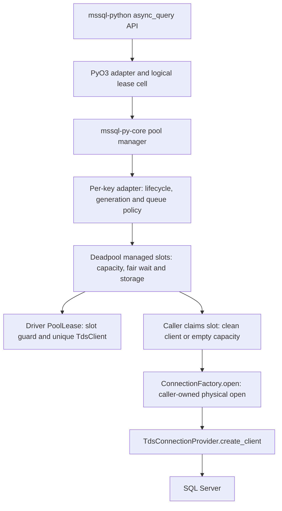

# Async-Aware Connection Pooling in mssql-py-core

This document (Doc 1) specifies a Python-free Rust/Tokio pool module in `mssql-py-core`, in the
`microsoft/mssql-rs` repository, backed by `mssql-tds`. [Doc 2](https://microsoft.sharepoint-df.com/teams/sqldevx/Shared%20Documents/Python%20Driver/Design%20Docs/Async%20Aware%20Connection%20Pooling/async-connection-pooling-mssql-python-integration.md) specifies its integration with
`mssql-python`. These are two workstreams of one deliverable. The sync connection pool on mssql-python remains separate and unchanged.

---

## 1. Scope and terminology

### 1.1 Scope and placement

The new `mssql_py_core::pool` module owns pooling, not the Global Interpreter Lock (GIL),
credential SDKs, connection-string parsing, or DB-API transaction policy. It contains no types
from PyO3, the Rust/Python binding library. The binding supplies a physical connection factory
and owns Python lifetimes. No new crate is required.

Basic pooling uses existing public Tabular Data Stream (TDS) reset, execution, drain, and
transaction APIs. This does **not** prove that every future capability needs no TDS change: new
reset-cache guarantees or additional protocol test hooks must be evaluated explicitly.
Extraction to a standalone Rust crate is deferred.

**Core implementation direction:** reuse `deadpool::managed` behind the module's own
types, rather than implement a second capacity semaphore, idle queue and FIFO dispatcher.
Deadpool is a scheduling/storage building block, not the SQL Server pool policy.
Section 5 defines the integration and developer responsibilities; the companion
[build-versus-reuse analysis](./async-pool-core-build-vs-reuse.md) records the comparison
with bb8 and the acceptance gates. This is a proposed design, not implemented or
benchmark-verified support.

Non-goals: Multiple Active Result Sets (MARS), cross-process pooling, sharing sync ODBC
connections, arbitrary cross-runtime reuse, retrying user statements, and refreshing
authentication on an already logged-in physical session.

### 1.2 Terms

#### Pooling and lifecycle

**Pool:** A per-key set of reusable physical TDS connections sharing one complete connection/authentication key, with its own capacity and idle-connection state.

**Pool Manager (manager):** The caller-owned `AsyncPoolManager` that maintains the `PoolKey -> Pool` map and coordinates configuration and lifecycle across its pools.

**Pool key (`PoolKey`):** An identifier representing the effective connection settings and authentication binding. Within a manager, only connections with the same key belong to the same pool.

**Physical connection / logical connection:** A physical connection is the actual network connection and authenticated SQL session. A logical connection is the application-facing connection object that temporarily uses it.

**Pool generation (`generation`):** The manager-assigned lifecycle epoch recorded by pools and leases. A lease from an older pool generation cannot return its connection to the current generation's idle list. This is not an individual logical connection's lifetime.

**Reservation:** One capacity unit, held from before physical opening until the client is destroyed, including idle and retirement.

**Lease:** Unique ownership of a checked-out client and its reservation.

**Checkout / acquire:** Obtaining exclusive use of a connection, either by reusing an eligible idle connection or opening a new one after capacity becomes available.

**Check-in / release:** Ending a lease and either returning the connection to idle after successful cleanup or discarding it.

**Pool hit / miss:** A hit successfully reuses an existing connection; a miss requires opening a new physical connection.

**Discard / retirement:** Permanently removing a connection from reuse. Its capacity reservation remains held until the local client is destroyed.

**Idle pruning / pool eviction:** Pruning removes expired idle connections; eviction removes an eligible, unused pool from the manager.

#### Async coordination and cleanup

**Backpressure:** Making acquisition await available capacity instead of opening connections beyond the pool limit or blocking an OS thread.

**Quiescent:** No running operation, unread batch, pending reset, or active transaction.

**Deadline:** Absolute monotonic instant, not a timeout restarted at each stage.

**RAII guard / `Drop`:** Resource Acquisition Is Initialization: Rust ownership-based cleanup in which a guard owns resources and settles them when destroyed. `Drop` cannot await asynchronous cleanup.

**Waiter / FIFO handoff:** A waiter is an acquisition queued for a connection or an opening reservation. Eligible queued requests receive grants in first-in, first-out order within their pool.

**Acquisition grant:** Exclusive assignment of either an idle connection with its existing reservation or a reservation for the caller to open a connection. Assignment is not yet a ready lease; the caller must claim and initialize the resource.

**Linearization point:** The single state transition that determines the ordering of concurrent actions, for example whether lease publication or pool disable wins a race.

**Cancellation token / `CancelHandle`:** Separate cancellation controls: the pool token signals acquisition cancellation; the TDS `CancelHandle` signals cancellation of supported TDS operations.

#### Session reset and authentication

**Drain:** Consuming all remaining response tokens and unread results from an outstanding request. Draining is not the same as rollback or session reset.

**Session reset (`RESETCONNECTION`):** A TDS request flag instructing SQL Server to reset session state before processing the request. The design separately restores transaction isolation.

**Carrier:** Pool-owned `SET TRANSACTION ISOLATION LEVEL` batch carrying the TDS reset bit.

**Reset acknowledgement:** The reset-specific `ENVCHANGE` response confirming server processing of the reset. Not every `ENVCHANGE` is a reset acknowledgement.

**Authentication binding:** The intended principal, credential version, and relevant authentication configuration associated with a pool key.

**Stable binding / exact-token binding:** Stable binding can retain its key across token rotation for the same bound identity; exact-token binding requires a new key when the token changes.

**`FEDAUTHINFO`:** Server-provided federated authentication information used during login to guide token acquisition.

**Authentication metadata:** Non-secret binding/expiry information for the successful physical login.

A **Pool** is the connection-reuse unit for one complete `PoolKey`. Requests with the same
effective connection settings, authentication binding, and credential version can use the same
pool. Requests with different keys use separate pools; they do not share physical connections.

The **Pool Manager** owns and selects these per-key pools. Each pool has its own idle
connections, capacity accounting, state mutex, and waiter notifications. `max_size` applies
independently to each pool, not to the manager's total: with `max_size = 100`, two different
keys can account for up to 200 physical connections across two pools. A **lease** temporarily
owns one checked-out connection from one pool; it is neither the pool nor the manager.

**Pool generation is distinct from logical connection lifetime.** Enabling a disabled manager
starts a new pool generation; an idempotent enable of an already enabled manager does not. An
ordinary checkout does not start a new pool generation: multiple successive logical connections
can use a pool during the same generation. The `generation` fields in the Rust sketches refer to
this pool lifecycle epoch, not to a cursor ID or a per-checkout counter.

---

## 2. Sync parity and deliberate differences

The sync implementation is a reference, not proof that its behavior should be copied blindly.

**Full pool**

- **Verified sync behavior:** Throws immediately; does not wait for a return
- **Proposed async behavior:** Queues eligible requests in FIFO grant order, subject to cancellation/deadline and an optional per-pool waiter limit

**Public configuration**

- **Verified sync behavior:** Defaults 100 connections/key and 600 seconds idle; first connection auto-enables unless explicitly disabled
- **Proposed async behavior:** Explicit opt-in manager; defaults 100/key and 600 seconds idle

**Capacity**

- **Verified sync behavior:** Counts idle, checked-out, and opening connections
- **Proposed async behavior:** Also counts retiring connections until local client destruction

**Key**

- **Verified sync behavior:** SQL auth includes the rebuilt connection string, including UID/PWD; token auth adds an identity discriminator
- **Proposed async behavior:** Complete canonical connection/auth fingerprint; no plaintext secrets in the key

**Reconfigure**

- ~~**Verified sync behavior:** Enabled enable-call is a no-op; native `call_once` retains first configuration~~
- ~~**Proposed async behavior:** Different configuration rejected while enabled or while old resources remain; no partial live resize~~
- **Verified sync behavior:** Keeps the first native configuration for the process; later configuration changes are ignored, even after disable/re-enable.
- **Proposed async behavior:** explicitly rejects changes while enabled or busy. Different settings can be applied after disabling and fully draining the Rust manager,

**Reset**

- **Verified sync behavior:** Reset/liveness at checkout; restore READ COMMITTED
- **Proposed async behavior:** Eager, fully drained reset/isolation carrier at checkout

**Close/context exit**

- ~~**Verified sync behavior:** Explicit close rolls back; clean non-autocommit context exit commits then closes~~
- ~~**Proposed async behavior:** Preserve transaction intent in Doc 2; pool itself never commits~~
- **Verified sync behavior:** explicitly skips rollback on close when autocommit is enabled.
- **Proposed async behavior:** same normal behavior, and the pool never commits. However, if the application explicitly started a transaction using SQL BEGIN TRANSACTION, cleanup must roll it back or discard the connection if cleanup fails before reuse, regardless of the autocommit setting

**Idle expiration**

- **Verified sync behavior:** Lazy checkout pruning plus opportunistic manager sweep
- **Proposed async behavior:** Same lazy model; no guaranteed wall-clock reclamation while fully idle

Waiting for capacity and network I/O must not park an OS thread. Short, non-awaiting bookkeeping
mutex sections are allowed; the design does not claim that those mutexes are contention-free or
that waiters consume no memory.

---

## 3. Required invariants

1. **Identity:** only requests with the same effective connection, authentication
   binding, and credential version can share a pool. Keys are opaque to the pool,
   but their construction is a mandatory caller contract, not optional metadata.

2. **Capacity:** for each key in one manager, across pool generations:

   ```text
   reserved = opening + validating + leased + returning + idle + assigned + retiring
   0 <= reserved <= max_size
   ```

   Every local physical client, and every in-progress open, owns exactly one
   reservation. Server-observed disconnected sessions may linger until TCP/server
   cleanup; that is not controllable by an in-process pool.
   `assigned` includes resources granted to a waiter but not yet claimed; those
   resources are already counted and cannot be granted to another caller.

3. **Ownership:** one lease owns one `TdsClient` by value. No API exposes a
   cloneable raw client `Arc`. A cancelled owner cannot leave another task using
   the client after it has become idle.

4. **Reuse:** a lease is published only after complete reset-carrier success,
   final response drain, and restored isolation; fresh opens also apply requested
   isolation before publication.

5. **Return:** a lease returns to reuse only after explicitly awaited, successful
   quiescence. Interrupted work that may have touched TDS, unknown protocol state,
   and lease-destructor fallback discard. Reclaiming an untouched assigned idle
   grant before claim may preserve its already-proven quiescent state under the
   eligibility rules in section 5.3; it is not a cancelled I/O operation.

6. **Atomicity:** close-versus-enqueue and disable-versus-publish are serialized by
   the same pool state lock. An atomic flag checked before an await is not enough.

7. **Cleanup:** destroying a client precedes releasing its physical reservation.
   No detached disconnect is required for capacity correctness.

8. **Errors:** timeout/cancellation/authentication/configuration failures do not
   silently fall back to unpooled operation. Only an explicitly disabled manager
   permits the direct path.

9. **Runtime:** a manager and its transports are used on one owning Tokio runtime
   for their lifetime. The module creates no runtime; executor independence does
   not imply transport portability across runtimes.

10. **Finite work:** pooled acquisition and release use configured positive,
    finite budgets; their numeric defaults remain TBD (section 4.1). No background
    task or Python interpreter-finalization callback is required to make a
    discarded lease release its capacity.

11. **Ordered handoff:** an arriving request cannot bypass older eligible queued
    requests. Assignment, claim, cancellation, and pool closure are serialized
    under the pool state lock; every grant has exactly one owner.

`max_size` is per key, per manager, not a process-wide database connection limit.
`max_waiting`, when configured, separately bounds live queued requests per pool.
Neither limit bounds the number of keys/managers or caller-side authentication
work before queue admission. Applications must still bound overall concurrency
and identity churn; do not advertise globally bounded memory.

---

## 4. Configuration and lifecycle

### 4.1 Proposed configuration

| Setting | Default / status | Validation and meaning |
| :--- | :--- | :--- |
| `max_size` | 100 | Positive integer; upper bound per key |
| `max_waiting` | `None` (unset) | Optional positive integer; maximum live queued acquisitions per pool; unset preserves unlimited queue length |
| `idle_timeout` | 600 seconds | Nonnegative finite duration; expire when elapsed >= timeout; zero makes idle connections immediately eligible for lazy pruning |
| `acquire_timeout` | TBD | Positive finite total acquisition budget; default requires team agreement and workload validation |
| `cleanup_timeout` | TBD | Positive finite total return/close-cleanup budget; default requires team agreement and workload validation |
| `shutdown_timeout` | TBD | Positive finite graceful-manager-shutdown budget; default requires team agreement and workload validation |
| `token_refresh_margin` | 300 seconds | Nonnegative finite duration; known token must remain valid beyond it |

**Source of inherited values:** `max_size = 100` and `idle_timeout = 600` are the
existing public sync defaults in `mssql_python/pooling.py`, proposed for reuse by
the async pool. `token_refresh_margin = 300` is derived from the sync pool's
`TOKEN_EXPIRY_THRESHOLD_SECS` in `mssql_python/pybind/connection/connection_pool.cpp`;
exposing that threshold as an async configuration setting is a new proposal.

**Open default decisions:** the acquisition, cleanup, and shutdown timeout defaults
are not established by the sync implementation or measured workloads. No numeric
default is specified for them here. The team must agree and validate these
defaults before implementation sign-off; the configured-budget rules below do
not settle their values.

**Validation is field-specific.** Reject zero for `max_size`, `acquire_timeout`,
`cleanup_timeout`, and `shutdown_timeout`. Allow zero for `idle_timeout` and
`token_refresh_margin`. Reject negative, non-finite, overflowing, wrong-type, or
otherwise invalid inputs with `InvalidConfig` before manager mutation.

`max_waiting` accepts `None` or a positive integer; reject zero, negative values,
booleans, and non-integers. No numeric queue limit is chosen by this design.
It counts only live `Queued` records, not assigned grants, opening connections,
or checked-out leases. If a request needs to queue and the limit is reached,
return `WaitQueueFull` immediately without consuming physical capacity or opening
a bypass connection. Cancellation, timeout, or assignment removes a request from
this queue count under the same lock. A request that can be granted a resource
immediately without bypassing older waiters does not consume a queue slot.

~~`idle_timeout = 0` is accepted by the sync API. In this async design it makes idle
connections immediately eligible for lazy pruning; it does not disable expiry or
interrupt checked-out leases. `token_refresh_margin = 0` removes the advance
refresh window, not the requirement that a known-expiry token still be valid.~~

`idle_timeout` controls how long a connection can remain unused after being returned to the pool. With `idle_timeout = 600`, it expires after 10 minutes of sitting idle. Each successful return starts the idle timer again. **Lazy pruning** means removing expired idle connections when someone next requests a connection, rather than running a background cleanup timer. Before reusing an idle connection, the pool checks whether it has expired. If it has, the connection is closed instead of reused.
The Pool Manager may also check other pools during a connection request and close their expired idle connections. These wider checks run no more often than once every `max(1 second, idle_timeout)`. This limits how frequently checks happen; it does not schedule automatic cleanup. If no further requests arrive, expired connections may remain open until another request or explicit pool closure.

The sync API accepts `idle_timeout = 0`. In this async design, zero means a connection becomes eligible for cleanup as soon as it is idle. It does **not** disable expiration or trigger immediate background cleanup. Connections currently borrowed by the application are not interrupted.

Separately, `token_refresh_margin = 0` means there is no advance-refresh window. A token with a known expiry must still be valid before the connection is handed out.

`None` on a per-call acquire-timeout override means the manager's configured
acquisition budget, **not** infinity or the login timeout. The login timeout is an
additional inner bound. An ordinary query timeout remains a query setting and
must not be repurposed as a pool-wait timeout.

Idle time uses a monotonic clock measured at successful check-in. Token expiration uses an
explicit UTC timestamp. Convert expiry to a conservative monotonic usable deadline when
recording it, and also check UTC on checkout: wall-clock rollback must not extend token reuse.

### 4.2 Enable, disable, and configuration

Manager state is `Disabled`, `Enabled`, `ShuttingDown`, or `Closed`; construction validates
configuration and starts `Disabled`.

`enable(cfg)` under the manager lock:

1. Reject `ShuttingDown`/`Closed`.

2. If already enabled with identical configuration, return success unchanged.

3. Reject a different configuration while enabled, or while any reservation,
   in-flight acquisition, or retiring pool generation remains.

4. Otherwise install configuration, increment the pool generation, and enable each
   retained pool for the new pool generation with a fresh generation cancellation
   token. Failed records from older generations cannot be assigned new resources.

`disable()` is synchronous, idempotent, and performs no network wait:

1. Under the manager lock, stop accepting.

2. Under each pool lock, mark that pool generation non-accepting, signal its
   cancellation token, fail its queued/unclaimed assigned records with `Closed`,
   and detach idle clients and unclaimed grants. Clear their FIFO entries.

3. Drop detached clients and grants **outside** all state locks, then signal the
   affected waiters. Their reservations remain counted until their clients have
   been destroyed; a grant with no client simply releases its reservation.

4. Existing published leases remain usable; their returns are discarded. All
   affected waiting acquisitions fail with `Closed`, not unpooled fallback.
   Already-claimed acquisitions own their guards and observe the generation's
   cancellation signal before publication; disable must not destroy their clients
   concurrently with their I/O.

Keep a pool with outstanding reservations in the manager map even when disabled. Re-enable with
the same configuration reuses its capacity accounting, but not its old pool generation's idle
sessions. Thus disable/re-enable cannot create a second allowance of `max_size` while old leases
remain checked out.

An acquisition that observes `Disabled` at manager admission returns `Ok(None)`; the integration
can open directly. Once admitted to a pool generation, closure is an error, including a race
after network I/O. At final publication under the pool lock, either the lease wins before
disable, or disable wins and it is discarded.

### 4.3 Shutdown and runtime ownership

`shutdown().await` permanently stops admission, discards idle clients, cancels pending
acquisitions, and waits for reservations/in-flight opens to settle up to `shutdown_timeout`. It
does not forcibly commit, revoke, or silently destroy published application leases.

On timeout return `ShutdownTimeout`; remain terminal/non-accepting. Outstanding leases are still
accounted and discarded when returned. A subsequent shutdown call may wait again but never
reopens admission. Cancellation of the shutdown wait must not undo closure or orphan
already-detached clients.

Manager `Drop` disables and discards idle resources synchronously; it cannot promise graceful
server logout or that outstanding application owners finish. Explicit shutdown before the owning
runtime exits is the supported lifecycle. No `block_on` in Drop, no GIL acquisition, and no
promises of awaited cleanup at interpreter/process finalization.

---

## 5. Architecture and ownership

### 5.0 Library decision and responsibility boundary

Use the reviewed `deadpool` **0.13.1 managed API** as the preferred core, subject to
the proof-of-fit gates below and dependency approval. Keep it private to the pool
module. Review the selected release and rerun contract tests on upgrades. It is
MIT OR Apache-2.0 licensed; follow normal dependency/license onboarding.

Both deadpool and bb8 support bounded async waiting and custom database adapters.
Deadpool is the closer fit because its create/recycle work runs in the acquiring
future, its semaphore provides fair admission, and its managed core does not
require background connection creation or a reaper. bb8 0.9.1 spawns connection
creation/replenishment, uses notification-based checkout competition, and has no
equivalent public pool-close operation. Disabling bb8's idle/lifetime timers does
not make connection creation caller-owned. This is a lifecycle/ownership decision,
not a claim that deadpool is faster.

| Area | Deadpool responsibility | Driver developer responsibility |
|---|---|---|
| Capacity and waiting | Bounded managed-object checkout, semaphore queue and RAII object accounting | Map slots to the physical-client invariant; exact `max_waiting`, cancellation and fairness integration tests |
| Storage and return | Keep returned objects and wake waiting acquisitions | Only return clean clients or empty slots; destroy discarded clients before making their slot available |
| Physical open | Invoke a manager's async hooks when configured | Current-call `ConnectionFactory`, credentials, TDS login, binding verification and expiry capture |
| Reuse | Supply an async checkout recycle hook | Liveness, idle/token eligibility, eager reset, isolation, ACK and complete drain |
| Async release | No awaited check-in hook | Close barrier, drain-before-rollback, cleanup deadline, observable errors and discard-on-cancellation |
| Keying | One managed pool has one manager/configuration | Complete canonical auth/security key; caller-owned map of per-key pools |
| Lifecycle | `close`, `retain`, `status`, and resize primitives | Generations, disable/re-enable, strict cross-generation capacity, off-lock destruction, shutdown and runtime ownership |
| Python/AQE | No Python or GIL integration | Logical lease cells, stale-cursor revocation, task supervision, TaskLocals, credential cancellation/cache ownership and DB-API mapping |
| Evidence | Upstream tests cover generic library behavior | Adapter contract tests, mock versus live SQL evidence, platform/topology coverage and benchmarks |

#### Chosen adaptation: managed capacity slots

The strict capacity invariant in section 3 is stronger than "no more than
`max_size` checked-out objects." Pool a **capacity slot containing zero or one
client**, not a raw `TdsClient` with unmodified library Drop semantics.

1. Deadpool owns at most `max_size` managed slots for a key. An idle slot may
   contain a clean `PooledConn`, or be empty following discard.
2. `Manager::create()` constructs an empty slot without network/Python work.
   `Manager::recycle()` performs only slot bookkeeping; it does not fetch tokens,
   reset TDS or report fatal authentication errors as candidate rejection.
3. After `get()` succeeds, immediately wrap the object in a driver acquisition
   guard before any await. The guard keeps the slot checked out throughout
   validation, opening, publication, use, return cleanup and retirement.
4. The current caller explicitly runs `ConnectionFactory::open` and section 6's
   reset/isolation policy while owning that slot. Per-call arguments remain
   explicit; no shared "current factory" field or first-caller credential cache
   is installed on Deadpool's manager.
5. On successful awaited return, store the clean client with `last_returned`,
   then return the slot. On failure/Drop, take and destroy the client first,
   then return the **empty** slot synchronously. A cancelled acquisition also
   destroys its open future/partial client before its slot can be reused.

This keeps Deadpool as the only capacity scheduler. An occupied slot is the
physical reservation; an empty slot carries no live-client reservation but still
belongs to Deadpool's bounded slot set. A connection is never detached from its
slot while I/O or retirement can continue. If an awaited graceful disconnect
fails or times out, local destruction still precedes slot return.

This intentionally differs from a conventional `Manager<Type = TdsClient>`
adapter. `recycle()` could execute reset in that simpler adapter, but has no
per-call arguments and Deadpool treats recycle errors as discard-and-retry.
That is unsuitable for propagating `IdentityMismatch`, preserving the exact
candidate retry budget, or applying each caller's isolation without additional
context machinery. A task-local is possible with inline manager execution, but
is **not needed or selected** for this slot-based design.

#### Library primitives that are not the complete contract

- Do not use `Object::take()` on a live client-bearing slot: it releases library
  capacity before the extracted client is destroyed. Do not retain discarded
  clients on the idle shelf until a future checkout; Drop must reclaim them now.
- Do not use `resize(0)` followed by growth, close/recreate the underlying slot
  pool, or allocate a replacement pool while old slots remain in use. Reversible
  disable uses the driver's admission gate and generation cancellation, retaining
  the same slot pool. `close()` is irreversible and cannot implement re-enable.
- Serialize slot claim/publication, idle maintenance and generation closure with
  the driver lifecycle state. Returning to Deadpool must not expose an old
  generation's client after disable. Cancelled/woken waiters recheck the driver
  generation before performing I/O or publishing a lease.
- Idle maintenance must not remove client-bearing slots with `retain()`, release
  their library capacity, and destroy clients later while acquisition continues.
  Keep the slots and detach/destroy idle clients under a maintenance admission
  barrier, or evict a fully inactive pool. Destroy clients outside locks; prevent
  new opens through affected empty slots until destruction finishes. The concrete
  idle-slot access/maintenance mechanism needs the A1 concurrency proof.
- `status()` counts library objects/users, not this design's physical clients,
  generations, Python auth tasks or completed shutdown. Keep explicit physical
  lifecycle observations and settlement notifications; do not poll `status()`
  and call that graceful shutdown.
- Deadpool timeouts are separate wait/create/recycle budgets. Use the single
  outer absolute deadline from section 8 across slot wait and all driver work.
- Deadpool metrics timestamp creation/recycling, not successful check-in. Keep
  `last_returned`; a long-held lease must not expire immediately after return.

#### Proof-of-fit gates before implementation sign-off

Fair semaphore admission is not proof of the complete section 5.3 contract.
Prototype exact queued-only `max_waiting` accounting, cancellation at assignment,
retry-tail ordering and maintenance/disable races against the pinned API.
Deadpool does not expose its internal queue transitions, so a simple counter
around `get()` or `status().waiting` is not sufficient. Do not silently count all
acquisitions, initialization work, or assigned objects as queued requests.

Also prove client-before-slot destruction during open/reset/release cancellation,
same-pool disable/re-enable with outstanding leases, bounded candidate retries,
off-lock idle destruction, no required background tasks, and shutdown completion.
If an exact guarantee cannot be expressed without a second full scheduler or an
unsupported library assumption, report the blocker and obtain a design decision:
retain the custom core or explicitly revise the contract. Do not claim reuse
alone proves these properties.

### 5.1 Components



The consumer does not receive `Arc<Mutex<TdsClient>>` from the pool. Doc 2 shares an
`Arc<Mutex<Option<ConnHandle>>>` **logical lease cell** instead; the physical client stays
inside the handle. Connections and cursors strongly retain the logical parent;
explicit close detaches its handle and revokes access for all old cursors.

### 5.2 Reference ownership model and implementation mapping

The sketches below describe the **custom-core reference model**, not a second
implementation to build alongside Deadpool. Under section 5.0, Deadpool replaces
`PoolState.idle`, the capacity scheduler and normal FIFO resource storage.
`CapacityReservation` maps to continued ownership of the managed slot; the
driver's guards still enforce client-before-slot destruction. Waiter/grant states
below specify observable ordering and cancellation requirements; they are not an
instruction to maintain a duplicate dispatch queue in addition to Deadpool.
The prototype must replace these reference internals with its reviewed slot and
lifecycle types before implementation sign-off. The public interface in section
9 remains unchanged.

The following are design signatures, not standalone compilable implementations. Pool-facing
types initially have crate visibility; `mssql-py-core` is currently a `cdylib`, not an
already-published Rust pooling library. In these signatures, `Instant` means
`tokio::time::Instant`; UTC token expiry is represented separately and is never compared
directly to that clock.

```rust
struct ManagerState {
    lifecycle: ManagerLifecycle,
    generation: u64,
    config: PoolConfig,
    pools: HashMap<PoolKey, Arc<Pool>>,
    in_flight_acquires: usize,
    last_sweep: Instant,
}

struct PoolState {
    generation: u64,
    accepting: bool,
    generation_cancel: CancellationToken,
    reserved: usize,
    idle: VecDeque<PooledConn>,
    waiting: VecDeque<WaiterId>,
    waiters: HashMap<WaiterId, WaiterRecord>,
    next_waiter_id: u64,
}

struct Pool {
    state: std::sync::Mutex<PoolState>,
    settled: tokio::sync::Notify, // shutdown/drain bookkeeping, not FIFO admission
    config: PoolConfig, // immutable until the manager is fully drained
}

type WaiterId = u64;

struct WaiterRecord {
    generation: u64,
    deadline: Instant,
    cancel: CancellationToken,
    state: WaiterState,
    signal: Option<tokio::sync::oneshot::Sender<()>>,
}

enum WaiterState {
    Queued,
    Assigned(AcquireGrant),
    Failed(PoolError),
}

enum AcquireGrant {
    Reuse(PooledConn),
    Open(CapacityReservation),
}

struct PooledConn {
    client: Option<TdsClient>,
    reservation: Option<CapacityReservation>,
    auth: AuthMetadata,
    last_returned: Instant,
}

struct PoolLease {
    conn: Option<PooledConn>,
    pool: Arc<Pool>,
    generation: u64,
    disposition: LeaseDisposition,
}
```

`CapacityReservation` is an exactly-once RAII guard. It decrements `reserved`
under the pool lock and invokes the same synchronous FIFO dispatcher used by
returns; waiter signals and shutdown/drain notifications on `settled` are sent
after unlocking. Its reference back to the pool must
be **weak**: idle entries and assigned grants are owned by the pool, so a strong
back-reference would create an ownership cycle. Leases/acquisition guards hold
a strong pool reference while active.

`PoolConfig.max_waiting` is an `Option<std::num::NonZeroUsize>`. A caller-owned
waiter-registration guard holds its pool and `WaiterId` from registration through
claim or failure. IDs are not reused while records remain. The FIFO contains only
`Queued` IDs; the map also retains `Assigned`/`Failed` records until the caller
claims, observes failure, or drops its guard. The signal carries notification
only, never the connection or reservation. No record strongly owns its pool.

`PooledConn` explicitly destroys `client` before `reservation`, including cancellation paths.
Opening guards destroy the entire connect future and any partial client before releasing the
reservation. No `mem::forget`, unmanaged client extraction, or success-shaped cleanup fallback
is allowed.

Only `TdsClient: Send` is required for an async mutex to make a shared logical cell thread-safe.
Assert the bounds actually used by the implementation; do not unnecessarily require `TdsClient:
Sync`. Pure-Rust logic can be tested without Python calls, but the containing crate's test
binary may still link libpython under its existing Cargo configuration.

### 5.3 Physical capacity and ordered waiting

This is the behavioral handoff contract, expressed using the reference states in
section 5.2. The Deadpool adapter must demonstrate equivalent behavior at its
public boundary, rather than copy this dispatcher alongside the library.
Keep physical reservations and avoid wake-all acquisition races. Ordering applies to **resource assignment within
one pool**, not to authentication work before key lookup or the order in which
network initialization completes. A later caller must not take an idle connection
or opening reservation while an older eligible request remains queued.

**Caller-owned acquisition stays unchanged.** The dispatcher does bookkeeping
only. It never starts a connect or token fetch. After claiming a grant, that
caller's `acquire()` future owns validation/opening and all associated cleanup.
Cancellation after claim stops that acquisition; its in-flight open is not
continued in the background for a different waiter.

**Admission and assignment**

1. Under the pool state lock, verify the generation, cancellation, and original
   deadline. Remove cancelled/expired FIFO entries and record their failures.
   Service older eligible waiters before considering a new arrival.

2. If no older waiter remains and a resource is available, move it directly into
   the caller's RAII acquisition guard. Otherwise enforce `max_waiting` and append
   a unique waiter record at the tail. Install its registration guard and one-shot
   receiver before the first await. This limit also applies to a retry that
   surrendered its earlier grant; prior admission does not reserve a queue slot.

3. Whenever a resource becomes available, the dispatcher selects the oldest
   eligible queued request. It assigns an idle `PooledConn` with its reservation,
   or increments `reserved` and assigns a new opening reservation if capacity
   permits. It removes the ID from the FIFO, sets `Assigned(grant)` in the map,
   and takes its signal for notification after unlocking. It can assign several
   independent resources in one pass without waiting for network I/O.

4. The caller awaits its notification, cancellation, or deadline. The one-shot
   retains notification if assignment happens before the await starts; no
   wake-all race or notification re-arming is needed. On wake, the caller locks
   state again and rechecks generation/cancellation/deadline before taking its
   assigned grant into the acquisition guard. Removing the now-empty record and
   disarming registration happen synchronously, with no await between them.

**Cancellation-safe handoff**

The registration guard settles under the same pool state lock on every exit:

- `Queued`: remove the FIFO entry and record; no physical reservation was held.
- `Assigned`, not claimed: take the grant out before removing the record. An
  untouched idle connection can be offered to the next eligible waiter, or kept
  idle, only if its generation and current reuse eligibility still permit it.
  Preserve its original idle timestamp. Otherwise destroy it outside the lock.
  An unused opening reservation is released outside the lock, allowing the
  dispatcher to reserve that capacity for the next waiter.
- Claimed: registration is already disarmed; the acquisition/lease guard owns
  the client and reservation. Interrupted validation/opening discards rather
  than forwarding a partially initialized client.

Pool closure changes queued/assigned records to `Failed(Closed)` and detaches
unclaimed grants under that lock. Caller cancellation and closure cannot reclaim
the same grant twice. A dropped notification receiver never owns a resource;
its registration guard performs the reclamation. Remove failed records when
their caller observes the error or is dropped. Unexpected channel closure is
reported as an internal error and runs the same guard cleanup.

**Return and capacity release**

A successful return first rechecks accepting/generation under the pool lock,
then offers the connection to the oldest eligible waiter; only with no eligible
waiter is it kept idle. Assignment transfers the existing reservation without
decrementing and incrementing it. All notifications, client destruction, and
reservation destruction occur outside state locks; take resources out of records
before removing records so their destructors cannot re-enter the held lock.

The dispatcher, record updates, and off-lock notifications form a synchronous
bookkeeping operation with no await between them. `notify_waiters()` may still
be used for shutdown/drain observers, but not for normal acquisition admission.
Timeouts bound waiting; FIFO assignment does not promise FIFO completion or
preempt an acquisition that already owns its resource.

### 5.4 Lock discipline

Lock order is manager state -> pool state. No code holding the pool lock may acquire the manager
lock. Reservation destruction and client destruction happen outside manager/pool locks to avoid
re-entry.

No state lock is held across any await, Python callback, logging callback, DNS, token fetch,
connect, drain, reset, transaction, or disconnect. A consumer's async lease-cell lock may span
TDS I/O to ensure exclusive access. Never hold the GIL while waiting for a Rust mutex. Lints
help but do not prove this discipline. If bookkeeping is poisoned/invariants fail, stop reuse
and surface an internal failure rather than recovering unchecked counters.

---

## 6. Checkout, reset, and return

### 6.1 Complete acquisition

Start the absolute deadline before caller-side authentication/key preparation (Doc 2), not after
it. Rust receives the remaining budget as an absolute local deadline. Do not restart the budget
after pruning, retry, login, or provider work.

1. Admit under manager state; register the in-flight acquisition with a guard.

2. Get/create the pool for that pool generation; perform bounded lazy pruning.

3. Obtain a candidate or opening reservation through the ordered handoff in
   section 5.3; propagate `WaitQueueFull` without bypassing the pool.

4. Discard known-dead, idle-expired, or policy-expired candidates.

5. For an eligible hit, perform the complete reset sequence in section 6.2.

6. If no eligible candidate remains, open once through `ConnectionFactory`,
   validate authentication metadata, and apply requested isolation without a reset.

7. Re-check cancellation/deadline, then under pool state verify pool generation and
   acceptance and publish the lease. Failed Python delivery must discard it.

A healthy hit has no login or token-provider call **inside the pool**. It does have one checkout
network round trip for reset/isolation. Token-derived keys may require credential acquisition
before lookup; they are not a zero-token-work hit.

Limit candidate retries to the idle-candidate count observed for this acquisition; do not chase
an endlessly replenished queue. At most one new physical open is attempted after candidates are
exhausted. A failed fresh open is returned to the caller, not automatically retried. All work
remains under the original deadline.

Retrying does not bypass FIFO admission: after discarding a candidate, return its
capacity and re-enter at the tail if another candidate will be attempted. For the
one final fresh-open attempt, the acquisition guard may retain that discarded
candidate's reservation while destroying its client, then open its replacement.
It must never retain that opening reservation while claiming a second candidate
and its reservation. No retry restarts the deadline or the candidate retry budget.
If a surrendered-grant retry needs to queue, it is subject to `max_waiting` and
may fail with `WaitQueueFull`, even though an earlier attempt was admitted.
For example, a new arrival can fill the queue after the old grant was surrendered
but before the retry is registered. Do not exempt retries from the limit or insert
them ahead of already-queued requests; FIFO order is based on each queue entry.

### 6.2 Exact reuse protocol

Only quiescent clients may enter idle. The checkout verifies that invariant; unexpected open
batches/transactions at checkout indicate a broken return path and cause discard, not a second
unbounded cleanup attempt.

For a reusable candidate, while holding exclusive client access:

1. Check `is_connection_dead()` and token reuse eligibility.

2. Call `prepare_reset_connection(false)`.

3. Execute `SET TRANSACTION ISOLATION LEVEL <validated level>` with an operation
   `CancelHandle` and remaining timeout.

4. Call `close_query().await` to consume the complete carrier response. An
   `execute()` result alone is not proof that all tokens/results were consumed.

5. Require success, `!reset_pending()`, `!is_connection_dead()`, no open batch,
   and `!has_active_transaction()` before publication.

The level is rendered from a closed enum (READ UNCOMMITTED, READ COMMITTED, REPEATABLE READ,
SERIALIZABLE, SNAPSHOT), never interpolated user SQL. The caller adapter resolves an omitted
setting to READ COMMITTED before invoking the pool. Invalid enum values, including an explicit
"unspecified" protocol enum, are rejected before I/O.

For fresh opens, issue and fully drain the same isolation SET without arming reset. V1
deliberately applies it even for READ COMMITTED rather than relying on assumed server/login
defaults. Both branches return the requested isolation.

This is an **eager pool-owned carrier**, not piggyback on the first user query. It avoids a
separate no-op reset batch but does not eliminate checkout latency. Deferred reset is out of
scope; there is no opt-in alternative in the v1 API.

`is_connection_dead() == false` means only "not known dead"; the carrier is the actual I/O
validation. Missing reset ENVCHANGE acknowledgement is fatal for that candidate. Never downgrade
it to advisory. A topology whose reset contract has not been demonstrated is not enabled for
pooled reuse.

### 6.3 Transaction and protocol cleanup on return

The binding first prevents new operations and waits for existing client users to settle (Doc 2).
The pool then owns the client exclusively and never commits.

Under one total `cleanup_timeout`:

1. Drain unread results/active batches with `close_query()`.

2. Only after the drain, inspect `has_active_transaction()`.

3. If active, call `rollback_transaction(None, None)` and verify no transaction
   remains. This includes raw SQL `BEGIN TRANSACTION` under autocommit=true.

4. Require no open batch, pending reset, or dead/broken state.

5. Under pool lock, return only if accepting and pool generation still matches;
   set `last_returned` and dispatch to the oldest eligible waiter, or enqueue idle
   if none is waiting. Otherwise discard. Transfer the reservation, do not free it
   while the returned client remains live.

Rollback before drain is invalid: the existing TDS transaction API rejects an unconsumed batch.
Never infer server transaction state solely from Python autocommit. Draining can surface a
delayed server error; any drain, rollback, deadline, or cancellation failure discards and is
reported by awaited release.

The binding's clean context-manager exit may have committed before this safety net, using the
same drain-before-transaction ordering. A failed/indeterminate commit is never retried and its
connection is discarded; a later rollback cannot prove that the commit did not happen.

### 6.4 Destructor and release cancellation

`release(self).await` moves the connection into a settlement guard before the first await.
That guard remains armed until successful transfer to an assigned waiter or the idle list,
or complete discard. Transfer and guard disarming occur under the pool lock without an await;
cancelling the returning task afterward must not reclaim the next caller's grant.
Cancelling release before transfer drops its client and reservation exactly once.

Unreleased `PoolLease::Drop` performs synchronous **discard only**. It never drains, rolls back,
enqueues, spawns required cleanup, or claims graceful logout. The baseline `TdsClient` has no
custom Drop implementation: dropping the uniquely owned value drops its transport fields. This
depends on preventing escaped owners.

Awaited discard may attempt `close_connection()` within the remaining cleanup budget, then
destroys the client regardless of the close result. Capacity is released only afterward. An
error is observable; it never makes a dirty client reusable. Server cleanup after local socket
destruction is not a hard deadline guarantee.

### 6.5 Recovery and cache boundaries

`TdsClient::execute` can transparently reconnect using retained `ClientContext`. That can
re-invoke an old credential callback, change token expiry or SPID, and recreate a session
outside the pool's accounting.

**V1 pooled physical sessions disable transparent session recovery**
(`connect_retry_count = 0` in the effective pooled context). The opt-in API must document this
difference; failures are returned, not retried as user statements. Reject an explicitly
requested nonzero recovery count when pooling is selected; when omitted, the pooled adapter
supplies zero rather than inheriting TDS's nonzero default. Login routing/redirect within a
single physical-open attempt still uses the current attempt's factory and deadline.
Direct/unpooled behavior retains its existing recovery policy for already-supported SQL/trusted
flows.

Newly added credential-backed async Entra flows also disable recovery in v1, including direct
opens: their per-open Python bridge cannot be reused after login (Doc 2 section 6.5). A future
credential-aware recovery design is separate work.

Reset invalidates prepared handles and per-handle Always Encrypted metadata, but the current
`clear_session_bound_caches` does not clear every query metadata cache. Do not claim otherwise.
No cursor-local prepared handle/result metadata survives the end of a logical connection's
lifetime. Pooling features whose cache/session isolation cannot be demonstrated, including
exposed Always Encrypted paths, stay gated off until the needed invalidation or cache-key proof
exists.

---

## 7. Authentication and complete keying

### 7.1 Key contract

Doc 2 is the sole owner of canonical key construction. The pool receives an opaque `PoolKey`
plus an immutable effective `ConnectSpec`; it must not infer identity by parsing labels such as
`msi:` or `acct:`.

A key partitions all effective login/transport/security settings and the intended principal
**and credential version**. Removing SQL username/password without an equivalent authentication
discriminator is incorrect: a caller with a wrong password must not obtain a previous caller's
authenticated SQL session.

Use a versioned, unambiguous canonical serialization and process-private keyed fingerprint; no
plaintext password/token in key bytes or diagnostics. Do not use a sanitized logging string,
delimiter concatenation of unescaped fields, or a public hash of a low-entropy password as the
canonical scheme. The factory must not change endpoint, database, TLS policy, principal, or
credential binding under the supplied key.

Stable identity keys require a trusted caller binding that is valid before lookup. A miss-only
provider cannot detect an account change on a hit. On sign-out, account switch, or credential
replacement, the integration changes its binding epoch/key and invalidates its old reuse
eligibility. Unknown identity uses an exact-token fingerprint, never unvalidated JWT claims.

### 7.2 Physical-open abstraction

The earlier `TokenProvider::fetch(base) -> (ClientContext, expiry)` cannot express both
pre-login token acquisition and a server-driven mid-login callback. Replace it with one
physical-open adapter:

```rust
struct ConnectSpec {
    context: ClientContext,
    // context.data_source is the only endpoint source of truth.
    expected_auth: AuthBinding,
}

struct OpenedConnection {
    client: TdsClient,
    auth: AuthMetadata,
}

#[async_trait::async_trait]
trait ConnectionFactory: Send + Sync {
    async fn open(
        &self,
        spec: &ConnectSpec,
        cancel: &CancelHandle,
    ) -> Result<OpenedConnection, OpenError>;
}
```

The pool reserves capacity first and invokes `open` only for a physical open. The production
adapter calls `TdsConnectionProvider::create_client(context, &datasource, Some(cancel))`. The
pool owns isolation/reset/return policy, not the factory. Deterministic tests inject a Rust
factory returning scripted clients.

The factory supports SQL/trusted auth, a raw pre-acquired token, or the public async
`EntraIdTokenFactory` installed in `ClientContext` for FEDAUTHINFO. That callback currently
returns token bytes only; **expiry capture is new adapter work**, using an attempt-local result
slot associated with the successful login. Do not imply `create_client` already returns expiry.

The adapter verifies the successful login's binding against `expected_auth`. A callback may
obtain a token during login; it must not silently move the result to another pool. Each attempt
owns its metadata; concurrent opens do not share one mutable "last token" field.

### 7.3 Expiry and rotation policy

Use a discriminated type, not `expiry=0` for both non-token and unknown:

| Authentication metadata | Reuse/open rule |
| :--- | :--- |
| Non-token | No token-expiry check |
| Token with known expiry | Eligible only while validity exceeds `token_refresh_margin`; check again immediately before publication |
| Opaque raw token, expiry unavailable | Exact-token binding; no invented expiry/refresh guarantee; server decides login acceptance |

For an expired/near-expiry **stable-binding** idle client, destroy it and open a new session
with the current caller's factory under the same capacity budget. There is no reauthentication
or "refresh in place" of the socket, and no token string comparison optimization.

For **exact-token** binding, the prepared request carries that same token on a miss. A different
token requires a different key. If a known-expiry token is already ineligible, fail with
`TokenExpired`; do not call a rotating provider under the old key. The Python layer resolves a
current token/key once per logical connect as needed, within the total acquisition deadline.

Expiry is a conservative reuse policy, not a claim that SQL Server disconnects an established
session exactly when its login token expires. An already published lease is not forcibly
interrupted by wall-clock token expiry. Do not parse unverified token claims to establish
identity or authoritative expiry.

### 7.4 Retained callbacks and secrets

Idle clients must not retain strong Python callable, event-loop, or credential references
through their cloned TDS contexts. Doc 2's factory adapter installs a Rust callback with a
**weak per-open bridge reference**, keeps that bridge alive only during login, and disables
pooled session recovery. Unexpected later callback invocation fails explicitly; it cannot target
a closed Python loop.

The pool stores expiry/binding metadata, not duplicate raw tokens for comparison. The TDS client
may retain authentication material internally; minimize lifetime and never derive Debug/log
output containing context credentials.

---

## 8. Cancellation, deadlines, and errors

### 8.1 Two cancellation mechanisms

Pool wait/provider work uses a public `tokio_util::sync::CancellationToken` owned by the
acquisition plus the pool-generation-closure signal, and structured future drop. Add the direct
dependency where needed; a transitive dependency is not an import contract.

`mssql_tds::core::CancelHandle` exposes `new`, `cancel(&self)`, and `child_handle`; it cannot
be awaited externally. A per-operation guard owns the root, passes children to TDS, and calls
`cancel()` on timeout/cancellation. Do not claim that receiving `CancelHandle` alone cancels a
FIFO handoff wait.

Race all acquisition stages against the **same** deadline and cancellation signals. On
cancellation, stop retrying immediately. Drop/abort and join any supervised Rust I/O task before
destroying its client or releasing capacity. Do not detach physical opens or protocol operations
from their reservation owner.

Cancellation of a Python credential awaitable is a bridge obligation (Doc 2); Rust future drop
alone is not proof that Python or an executor thread stopped. Late token results must not open
or publish a connection.

Cancellation during queueing or after assignment but before claim uses the
waiter-registration guard in section 5.3. After claim, cancellation remains
caller-owned: do not keep opening a connection for another waiter. Any transport
child tasks must stop/settle before their capacity is released; queue handoff is
not a substitute for supervising the TDS connection attempt.

### 8.2 Error contract

**Manager disabled at admission:** `Ok(None)`; direct path allowed

**Admitted pool generation closed:** `Closed`; no fallback

**Acquisition budget elapsed:** `AcquireTimeout`, with failing stage; no lease

**Configured waiter queue full:** `WaitQueueFull`; immediate admission error, including retry re-entry after surrendering a grant; no new reservation consumed and no direct fallback

**Explicit cancellation:** `Cancelled`; Python preserves `asyncio.CancelledError`

**Invalid config/context/auth combination:** `InvalidConfig`/`InvalidRequest`; no network work

**Factory/credential failure:** `Open`/`Provider`; preserve typed cause without logging secrets

**Identity or credential-binding mismatch:** `IdentityMismatch`; fail closed

**Known-expiry token ineligible:** `TokenExpired`; no tokenless or old-key reopen

**Dead/reset-invalid candidate:** Discard; bounded candidate retry, then at most one fresh open

**Invalid isolation SQL/server configuration on fresh open:** TDS error propagated; no endless retry

**Drain/rollback/return cleanup failure:** `Cleanup` or `CleanupTimeout`; discard

**Shutdown budget elapsed:** `ShutdownTimeout`; remain terminal

`PoolError` is owned by the new module and wraps the existing TDS error rather than inventing
new variants in `mssql_tds::error::Error`. Preserve SQLSTATE/server numbers where available. If
retries recover an internal candidate failure, emit redacted diagnostics/counters; if
acquisition ultimately fails, retain the relevant cause. Never replay application commands in
response to a pool error.

---

## 9. API and idle management

### 9.1 Authoritative interface shape

```rust
impl AsyncPoolManager {
    fn new(config: PoolConfig) -> PoolResult<Self>; // initially disabled
    fn enable(&self, config: PoolConfig) -> PoolResult<()>;
    fn disable(&self);
    fn is_enabled(&self) -> bool;
    async fn shutdown(&self) -> PoolResult<()>;

    async fn acquire(
        &self,
        key: PoolKey,
        spec: ConnectSpec,
        factory: Arc<dyn ConnectionFactory>,
        isolation: TransactionIsolationLevel,
        control: AcquireControl, // absolute deadline and CancellationToken
    ) -> PoolResult<Option<PoolLease>>;
}

impl PoolLease {
    fn client_mut(&mut self) -> &mut TdsClient;
    fn mark_discard(&mut self); // irreversible; no Discard -> Reuse setter
    async fn release(self) -> PoolResult<()>; // configured cleanup_timeout
    async fn release_with_deadline(self, deadline: Instant) -> PoolResult<()>;
}
```

`client_mut` cannot outlive its mutable lease borrow, and `TdsClient` is not cloneable through
this interface. In particular, `&Arc<TdsClient>` would still allow `Arc::clone`; that is **not**
a lifetime safety guarantee.

`PoolLease::Drop` and all intermediate settlement/open guards follow section 6.4. No result-less
`release()` signature that swallows rollback failure is allowed. `release` delegates to
`release_with_deadline` with now + configured `cleanup_timeout`. A binding that has already
started close uses `release_with_deadline` with that close's original deadline; the pool takes
the earlier of it and now + configured cleanup_timeout. An expired deadline discards immediately
and reports `CleanupTimeout`. These are the authoritative variants; Doc 2 uses them without
restarting its budget.

### 9.2 Lazy pruning and eviction

At checkout remove idle entries with elapsed idle time >= `idle_timeout`, including
when `idle_timeout = 0`. A manager sweep may visit other pools at most once per
`max(1 second, idle_timeout)`, matching the sync sweep's minimum interval and
avoiding an unthrottled sweep when the timeout is zero. Select victims under
manager -> pool locks and detach clients; destroy them outside locks. Acquisition
must not await unrelated pools' graceful teardown.

Evict a pool from the map only when its reservations, idle list, FIFO, and waiter-record map
are empty and no acquisition/waiter/lease holds an external strong reference. Selection and removal happen under
the manager lock, so a new acquirer cannot race the decision. Never evict a pool with an
opening, returning, or retiring client. This preserves capacity accounting over pool
generations.

No permanent background reaper ships in v1. A fully idle process can retain connections beyond
the idle timeout; explicit `disable`/`shutdown` releases them. A hard wall-clock reaper would
need separate lifecycle design. This preserves original FR-17/FR-18's lazy pruning and manager
sweep; the original design also made a background reaper optional, so no mandatory reaper was
removed.

With Deadpool, "remove idle entries" means retire the client while preserving its
slot until local destruction; it does not mean remove a client-bearing managed
object and immediately release its capacity. Apply section 5.0's maintenance
barrier for wider sweeps. Empty cached slots do not prevent eviction of a fully
inactive pool: exclude them from physical-reservation counts, close/drop that
pool only after lifecycle checks prevent concurrent acquisition, and never
replace a pool with live old-generation reservations.

## 10. Deadpool delivery and validation plan

| Milestone | Developer-owned deliverable and acceptance evidence |
|---|---|
| A1: fit prototype | Private slot adapter; exact queue/fairness contract or documented blocker; cancelled grant/open/reset destroys client before slot return; no second capacity scheduler |
| A2: lifecycle | Disable/re-enable, idle maintenance and shutdown under concurrency; old leases and retiring clients remain within the same per-key cap; no destruction under state locks |
| A3: SQL reuse | Factory injection; eager reset/ACK/drain/isolation; bounded candidate retries; fresh-open errors and identity failures propagated without retry masking |
| A4: return | Awaited drain/rollback, cleanup deadline, guard settlement, synchronous discard-only Drop; no dirty client returned by raw library Drop |
| A5: integration and evidence | Doc 2 ownership/auth bridges; deterministic Rust and mock-server tests; real SQL SPID/session/transaction/isolation tests; platform/topology matrix and measured workload |

Run the existing focused Rust nextest, formatting and clippy checks for the
implementation, including the separately built `mssql-py-core`. Generic upstream
pool tests do not establish TDS or Python correctness. Measure hit/miss latency,
eager carrier and return-cleanup cost, cancellation recovery and high-contention
tail latency; no relative performance or delivery-time estimate is established
by this design review.

### 10.1 A1 executable experiment

`mssql-py-core/src/pool/fit.rs` is a test-only, Python-free experiment against
Deadpool 0.13.1. It is not a production pool, does not expose a Python API,
and does not change direct AQE connections. A1 introduced Deadpool as a pinned
development dependency; A2 uses that same reviewed release in normal builds.

The adapter serializes admission, every slot-get poll, cancellation and slot
return. With fixed capacity and infallible, immediately-ready slot hooks,
live queued demand is `max(0, registered demand - max_size)`. Registered demand
includes checked-out leases and assigned-but-unpolled requests, not just
unfinished `get()` calls. Returning a slot removes its previous demand before
another admission can inspect the count. Deadpool remains the only FIFO
capacity scheduler and idle-slot store.

Only the bounded, non-I/O slot-get future bypasses Tokio's cooperative budget,
so an exhausted caller cannot defer slot acquisition or FIFO registration.
Physical opening, reset and cleanup must not inherit that exemption.

A registration map owns pending get futures and grants held behind maintenance
so disable and lazy deadline expiration can reclaim them without waiting for
their callers to resume.
It does not select grants or maintain another FIFO. Semaphore wakeups are
deferred until outside the admission lock. Idle maintenance retains slots,
extracts clients through interior mutability, and blocks lease publication
pool-wide until off-lock client destruction finishes. Admission and Deadpool
FIFO assignment continue during that barrier, preserving exact queue limits
and order even if callers resume in reverse order.

The tests cover exact queue boundaries, exhausted-budget acquisition and FIFO
admission, retry admission, cancellation,
deadline expiry, generation retention, idle age, maintenance, shutdown and
client-before-slot destruction, using instrumented fake clients. These lifecycle
experiments test feasibility only; they do not complete A2's production manager,
configuration, sweep, eviction or concurrency validation. The pool-wide barrier
is a deliberate prototype simplification, not a measured performance choice.
A two-worker Tokio test checks physical-cap observations under contention. These tests are
not evidence of TDS reset, rollback, actual transport-task settlement, Python
delivery or live SQL behavior. Those remain later-slice gates. The accounting
argument does not apply to asynchronous/fallible slot hooks, live resize or
uncontrolled raw Object access.

Run the pool contract tests and experiment from the repository root:

```powershell
cargo nextest run --manifest-path .\mssql-py-core\Cargo.toml --frozen --lib -E 'test(pool::)' --no-fail-fast
cargo fmt --manifest-path .\mssql-py-core\Cargo.toml -- --check
cargo clippy --manifest-path .\mssql-py-core\Cargo.toml --frozen --all-features --all-targets -- -D warnings
```

Measure coverage explicitly for this workspace-excluded crate:

```powershell
cargo llvm-cov nextest --manifest-path .\mssql-py-core\Cargo.toml --frozen --lib --no-fail-fast --show-missing-lines
```

Inspect the `pool/` files in the report rather than treating a filtered unit run
as repository-wide coverage. Their file totals include test code: deliberately
noncompleting futures and test-helper panic guards can remain uncovered.
Ownership-transfer tests use the existing `mssql-tds` `test-util` feature as a
development dependency only. Scripted token transports are not mock TCP or live
SQL evidence.

### 10.2 Compiled foundation and developer boundaries

The private `mssql-py-core/src/pool.rs` module is compiled in normal builds.
Its contracts are not connected to AQE or exposed to Python:

| Module | Implemented contract |
|---|---|
| `pool/config.rs` | Validated immutable settings, typed positive limits and explicit acquisition/cleanup/shutdown budgets; inherited defaults only for size, idle timeout and token margin |
| `pool/error.rs` | Pool-owned typed errors with acquisition stage and preserved TDS/provider causes; routine Display/Debug excludes source messages |
| `pool/control.rs` | One absolute Tokio deadline and explicit cancellation, including a final check before result delivery |
| `pool/connection.rs` | Opaque key/auth fingerprints, distinct token-expiry cases, immutable effective context and object-safe physical factory returning a uniquely owned `TdsClient` |
| `pool/fit.rs` | A1's test-only scheduler/slot experiment, now using the shared configuration contract |

`PoolConfig::new` requires all three timeout budgets. Owned `with_*` methods
construct a new configuration value; they do not reconfigure a running manager.
Capacity values exceeding Tokio's `Semaphore::MAX_PERMITS` are rejected before
constructing the selected slot scheduler; this is not a second semaphore.
Rust inputs are typed durations/integers. The later Python boundary must still
reject booleans, negative/non-finite values and conversion overflow.

`PoolKey` and `AuthBinding` accept opaque fingerprints only. This foundation
does not canonicalize connection strings, select a fingerprint algorithm,
verify a real login principal or implement token refresh. Doc 2 remains the
key authority; authentication adapters must supply verified login metadata.
`ConnectSpec` receives already-validated effective options, including the
pooled recovery restriction. No concrete physical factory is enabled yet.

`AcquireControl::run` drops its caller-owned future on cancellation/timeout.
It does not cancel a TDS `CancelHandle`, supervise detached transport work, or
join Python tasks. Those still require their owning operation guards. Its
final cancellation/deadline check is not the manager's generation/publication
lock or the AQE close barrier.

The module has a non-test `dead_code` expectation while these internal
contracts have no AQE consumers. Test builds do not suppress that lint.
Remove the expectation when production integration supplies the consumers.
Deadpool was development-only in A1; A2 promotes the same pinned dependency
for the compiled lifecycle adapter.

The core developer can build A2's manager and lifecycle behind these contracts.
The AQE developer can work on B2/B3's logical ownership and close coordination
on the existing direct path. There is no placeholder `PoolLease`, `ConnHandle` or Python `AsyncPool`.
A2's compiled manager is described below; ready SQL acquisition, the full
reset/return protocol, real SQL validation and platform matrix remain
subsequent approved slices.

### 10.3 A2 compiled lifecycle

`pool/manager.rs` implements the private `AsyncPoolManager` lifecycle and keyed
pool map. `pool/lifecycle.rs` implements the private Deadpool capacity-slot
adapter. Deadpool 0.13.1 is now an exact, normal dependency with only the managed
feature; the A1 experiment remains test-only. Dependency/license validation
still belongs to repository review.

The manager starts disabled, enables idempotently for identical configuration,
and retains the same per-key capacity allowance across disable/re-enable.
Changed configuration is rejected while enabled or while old acquisitions,
owners or retirement remain. Async operations validate the owning Tokio runtime
identity. Construction captures its current runtime handle; the module creates
no runtime, and that handle does not prevent its application owner from shutting
the runtime down. Explicit shutdown before runtime destruction remains required.

The internal `reserve` operation admits under the manager lock and obtains an
empty or cached capacity slot under the original acquisition control. It is
**not** section 9.1's complete `acquire`: no factory, reset carrier, isolation,
identity/expiry policy or Python delivery is enabled. Its default payload is an
`OpenedConnection`, which owns the physical `TdsClient` and auth metadata by value.
Tests use instrumented, Send-but-not-Sync payloads to observe destructor-time
capacity without requiring SQL.

Admission, every bounded slot-get poll and slot return are serialized per key,
using A1's fixed-capacity accounting argument. Only non-I/O slot-get polling
bypasses Tokio cooperativity. Generation closure, cancellation and deadlines
reclaim pending gets and untouched assigned grants; assigned idle timestamps are
preserved when still eligible. A maintenance barrier permits FIFO assignment
while preventing publication until detached clients have been destroyed off-lock.

Selected-key idle pruning runs at admission; wider sweeps and eviction scans
are throttled to `max(1 second, idle_timeout)`. Empty cached Deadpool slots do not prevent removal
of fully inactive pools. External owners and retiring clients do prevent removal.
There is no reaper or detached teardown task.

Shutdown permanently stops admission, cancels pending acquisition, discards idle
clients and waits on driver-owned settlement notifications. Published application
owners are not revoked. Timeout or cancellation of the wait cannot reopen the
manager; a later shutdown can wait again. Off-lock local retirement consumes the
same shutdown budget; it cannot be preempted by an async timer, but budget
overruns are reported rather than treated as timely success.

The slot guard drops its owned payload before returning empty capacity. Its
clean-return test seam is compiled only for tests: A4 must provide awaited
quiescence before a production check-in path exists. A3 must provide complete
initialization before publishing ready SQL leases. Existing AQE connections,
cursors, transactions, finalizers and Python APIs remain unchanged.

Run the A2 tests with the existing native runner:

```powershell
cargo nextest run --manifest-path .\mssql-py-core\Cargo.toml --frozen --lib -E 'test(pool::manager::)' --no-fail-fast
```

These tests are lifecycle and scripted-client evidence, not live pooled SQL,
transport-child-task settlement, Python bridge or performance certification.

### Upstream contracts reviewed

- [Deadpool 0.13.1 manager hooks](https://docs.rs/deadpool/0.13.1/deadpool/managed/trait.Manager.html)
- [Deadpool acquisition, return, retain, close and accounting source](https://docs.rs/deadpool/0.13.1/src/deadpool/managed/pool.rs.html)
- [Deadpool Object Drop and take](https://docs.rs/deadpool/0.13.1/src/deadpool/managed/object.rs.html)
- [Deadpool metrics](https://docs.rs/deadpool/0.13.1/src/deadpool/managed/metrics.rs.html)
- [Deadpool cancellation tests](https://docs.rs/crate/deadpool/0.13.1/source/tests/managed_cancellation.rs)
- [bb8 0.9.1 acquisition and spawned replenishment](https://docs.rs/bb8/0.9.1/src/bb8/inner.rs.html)
- [bb8 public pool operations](https://docs.rs/bb8/0.9.1/bb8/struct.Pool.html)
