# Async Query Execution Design for mssql-python
---
## Table of Contents

- [Async Query Execution Design for mssql-python](#async-query-execution-design-for-mssql-python)
  - [Table of Contents](#table-of-contents)
  - [Glossary](#glossary)
  - [1. Why "async"? The core idea](#1-why-async-the-core-idea)
  - [2. Problem statement \& goals](#2-problem-statement--goals)
    - [What's missing today](#whats-missing-today)
    - [Goals](#goals)
    - [Non-goals](#non-goals)
    - [Success criteria](#success-criteria)
  - [3. Background \& context](#3-background--context)
    - [Current architecture of `mssql-python`](#current-architecture-of-mssql-python)
    - [Complexities with asyncio + Tokio](#complexities-with-asyncio--tokio)
    - [Prior art](#prior-art)
  - [4. Proposed architecture / interop design](#4-proposed-architecture--interop-design)
  - [5. Design rules \& invariants](#5-design-rules--invariants)
  - [6. Mental model: tasks vs. threads](#6-mental-model-tasks-vs-threads)
  - [7. Async in Rust + Python](#7-async-in-rust--python)
    - [7.1 The core problem: two event loops](#71-the-core-problem-two-event-loops)
    - [7.2 The layered architecture](#72-the-layered-architecture)
      - [Understanding `pycore` vs. `pyo3-async-runtimes`](#understanding-pycore-vs-pyo3-async-runtimes)
    - [7.3 pyo3-async-runtimes as generic bridge plugin (the contract)](#73-pyo3-async-runtimes-as-generic-bridge-plugin-the-contract)
    - [7.4 Example Walkthrough - Two connections, two cursors (mssql-python)](#74-example-walkthrough---two-connections-two-cursors-mssql-python)
    - [7.5 When is a thread assigned? When is a task assigned? When is the GIL held?](#75-when-is-a-thread-assigned-when-is-a-task-assigned-when-is-the-gil-held)
      - [Native Rust — thread vs. task timeline](#native-rust--thread-vs-task-timeline)
      - [Python async — thread + task + GIL timeline](#python-async--thread--task--gil-timeline)
      - [GIL flow (Python)](#gil-flow-python)
    - [7.6 How PyO3 bridges the schedulers (and where it briefly blocks)](#76-how-pyo3-bridges-the-schedulers-and-where-it-briefly-blocks)
      - [The two schedulers PyO3 connects](#the-two-schedulers-pyo3-connects)
      - [Step-by-step: threads, tasks, and GIL at each crossing](#step-by-step-threads-tasks-and-gil-at-each-crossing)
      - [Where does momentary blocking actually happen?](#where-does-momentary-blocking-actually-happen)
      - [Two kinds of "blocking" — only one matters](#two-kinds-of-blocking--only-one-matters)
      - [The GIL is a lock on objects, not on a code layer](#the-gil-is-a-lock-on-objects-not-on-a-code-layer)
      - [The one place to watch: result materialization (point E)](#the-one-place-to-watch-result-materialization-point-e)
  - [8. Today vs. true async: what must change in pycore](#8-today-vs-true-async-what-must-change-in-pycore)
    - [8.1 The current (blocking) model](#81-the-current-blocking-model)
    - [8.2 The changes](#82-the-changes)
    - [8.3 The three things pycore must get right](#83-the-three-things-pycore-must-get-right)
  - [9. End-to-end walkthrough between Python and Rust](#9-end-to-end-walkthrough-between-python-and-rust)
  - [10. Rollout plan](#10-rollout-plan)
    - [Delivery: experimental namespace first](#delivery-experimental-namespace-first)
    - [Versioning \& deprecation](#versioning--deprecation)
    - [Documentation \& migration](#documentation--migration)
  - [11. Appendix](#11-appendix)
    - [11.1 How async works in native Rust (mssql-tds)](#111-how-async-works-in-native-rust-mssql-tds)
      - [11.1.1 The lifecycle of a query](#1111-the-lifecycle-of-a-query)
      - [11.1.2 Example Walkthrough: Two connections, two cursors (Async)](#1112-example-walkthrough-two-connections-two-cursors-async)
      - [11.1.3 What the Rust app looks like](#1113-what-the-rust-app-looks-like)
    - [11.2 Concurrency model: connections vs. cursors](#112-concurrency-model-connections-vs-cursors)

---

## Glossary

| Term                      | Meaning                                                                                                                        |
| ------------------------- | ------------------------------------------------------------------------------------------------------------------------------ |
| **Thread (OS thread)**    | Real kernel-scheduled worker. Few of them (~CPU count). Does CPU work.                                                         |
| **Task**                  | A cheap future/state machine describing a unit of async work. Many of them.                                                    |
| **Future**                | A value that will be ready later; polled to completion by the runtime.                                                         |
| **Tokio runtime**         | The async executor: a worker thread pool plus a reactor.                                                                       |
| **Reactor**               | The layer (epoll on Linux, IOCP on Windows) that watches sockets and wakes tasks when I/O is ready.                            |
| **`.await`**              | The point where a task can yield its thread while waiting.                                                                     |
| **MARS**                  | Multiple Active Result Sets — multiple in-flight requests on one connection. Parsed at login but **not yet implemented** here. |
| **GIL**                   | Python's Global Interpreter Lock — only one thread runs Python bytecode at a time. Released during Rust I/O.                   |
| **`pyo3-async-runtimes`** | Crate that bridges a Tokio future to a Python `asyncio` awaitable (`future_into_py`).                                          |
| **`block_on`**            | Blocking call that parks the current thread until a future completes — the opposite of true async.                             |
| **Statement handle**      | An `i32` returned by `sp_prepare`; identifies a server-side prepared plan.                                                     |

---

## 1. Why "async"? The core idea

A database query spends **almost all of its time waiting** for the network — the client sends a request, then waits for SQL Server to compute and stream back results. Traditional ("blocking") code glues a whole **OS thread** to that wait: the thread sits idle, doing nothing, until the bytes arrive.

**Async execution removes that waste.** Instead of parking a thread, the code *lets go* of the thread while it waits, so the thread can do other useful work. When the network data finally arrives, the work is picked back up.

**The single most important idea in this document:**

> **A query does NOT need its own thread. Waiting on the network should consume ZERO threads.**

That is what we mean by *true async*.

---

## 2. Problem statement & goals

### What's missing today

`mssql-python` executes queries today through **DDBC (Direct Database Connectivity)** — a bundled **C++ extension that drives the Microsoft ODBC Driver for SQL Server directly**, without an external driver manager. ODBC's execution model is **synchronous and blocking**: `SQLExecDirect` / `SQLFetch` block until the server responds. The C++ layer releases the GIL around the blocking call, but the **calling thread / coroutine is still parked** for the whole round-trip. Consequences:

- **No native `async` / `await`.** The DDBC/ODBC path has no integration with the `asyncio` event loop. Applications built on `asyncio` (FastAPI, aiohttp, async ETL) cannot `await` a query — they must offload every call to a **thread pool** (`run_in_executor`, `asyncio.to_thread`), a workaround rather than real async.
- **Thread-pool tax.** Concurrency is capped by the executor's thread count; each in-flight query consumes an OS thread that sits idle waiting on the network — exactly the waste async is meant to remove.
- **Event-loop stalls.** Any accidental direct (non-offloaded) call blocks the whole event loop, freezing unrelated tasks.
- **ODBC async mode is not a fit.** ODBC's optional async execution (`SQL_ATTR_ASYNC_ENABLE`) is polling-based and does not map cleanly onto `asyncio`'s awaitable model.
- **A Rust path already exists but is not async-exposed.** `mssql-python` is already adopting a Rust core, **`mssql-py-core`** (PyO3 bindings over the async `mssql-rs` / `mssql-tds` stack), currently used for select features such as bulk copy (BCP). That core is **fully async under the hood (Tokio)**, but its async capability is **not yet surfaced to Python** — and where it is used today it is driven **synchronously** via `runtime.block_on(...)`. So asyncio users still cannot `await` a query on either path.

### Goals

- Provide **native `async def` / `await`** APIs on connections and cursors that integrate with the running `asyncio` loop.
- **Never block the event loop** during a query — the loop stays free to run other coroutines while a query is in flight.
- **True concurrency across connections** without a thread-per-query model.
- Deliver async by **surfacing the async Rust path** (`mssql-py-core` over `mssql-tds`) to Python via the **`pyo3-async-runtimes`** bridge, rather than trying to make the synchronous ODBC path async or reinventing plumbing.
- Consolidate the Rust path onto **one shared Tokio runtime** for the whole process (instead of one runtime per connection).

### Non-goals

- **Not** rewriting or removing the existing **DDBC/ODBC sync** call path — it remains the default for sync consumers.
- **Not** changing **connection-pooling semantics** or transaction behavior.
- **Not** making the **ODBC path** itself async — async is delivered on the Rust (`mssql-py-core`) path.
- **Not** implementing **MARS** (multiple active result sets on one connection) — parallelism stays per-connection.
- **Not** redesigning the TDS protocol layer or the result-materialization format.

### Success criteria

- An `asyncio` app can run **N queries across N connections concurrently** with a single event-loop thread and **no `run_in_executor`** (meaning its natively async).
- While a query awaits the network, the event loop demonstrably **runs other coroutines** (no stall).
- The GIL is held only at the **argument-in / rows-out** boundaries (microsecond scale), never during the network round-trip.
- **No regression** in the existing sync API.

---

## 3. Background & context

### Current architecture of `mssql-python`

- **Primary path today — DDBC.** Query execution goes through **DDBC**, a **C++ extension** that drives the bundled **Microsoft ODBC Driver for SQL Server** directly (no external driver manager). Python `connect()`, `cursor.execute()`, and `fetchall()` map onto **synchronous ODBC calls**; the C++ layer releases the GIL around the blocking call, but the calling thread/coroutine is blocked for the round-trip.
- **Emerging path — `mssql-py-core` (Rust).** A newer Rust binding crate, `mssql-py-core`, exposes **PyO3 `#[pyclass]` types** (`PyCoreConnection`, `PyCoreCursor`) over the async `mssql-rs` (`mssql-tds`) stack. It is consumed by `mssql-python` for select features (e.g. BCP / bulk copy). Today it still bridges **synchronously** — each method reads its Python args (GIL held), then calls `runtime.block_on(...)` inside `py.detach()` — with `Arc<Mutex<TdsClient>>` for thread safety and, currently, a **Tokio runtime per connection**.
- **This design targets the Rust path.** Native asyncio support is delivered by evolving the `mssql-py-core` bridge to return awaitables; the ODBC path stays synchronous.

### Complexities with asyncio + Tokio

- **Two runtimes.** Python's `asyncio` and Rust's **Tokio** are independent schedulers, each with its own event loop and notion of "task."
- **Two threading models.** `asyncio` is **single-threaded cooperative**; Tokio is **multi-threaded work-stealing**. Values crossing the boundary must be thread-safe (`Send`).
- **The GIL.** Only one thread may touch Python objects at a time. The bridge must **release** the GIL during the query and **re-acquire** it only to build result objects and wake the loop — otherwise the "async" is fake.

### Prior art

| Project                                    | Approach                                                                    | Takeaway for us                                                                                   |
| ------------------------------------------ | --------------------------------------------------------------------------- | ------------------------------------------------------------------------------------------------- |
| **asyncpg**                                | Pure-Python asyncio Postgres driver with a C-accelerated protocol           | Shows the value of a first-class async API; but it is not a Rust-core binding.                    |
| **tokio-postgres**                         | Native Rust async Postgres driver on Tokio                                  | Confirms the Tokio `Future` + reactor model our core already uses.                                |
| **pyo3-asyncio / pyo3-async-runtimes**     | Generic crate bridging Rust futures to Python awaitables (`future_into_py`) | **The exact mechanism we adopt** — no need to hand-roll the asyncio↔Tokio bridge.                 |
| **`mssql-js` (MS owned - unreleased lib)** | NAPI binding exposing `#[napi] async fn` returning JS Promises              | In-repo proof that the async core bridges cleanly to a host runtime; the Python model mirrors it. |

---

## 4. Proposed architecture / interop design

This section is the **overview**; the detailed mechanics, mental models, and diagrams follow in **sections 4–11**.

- **Event-loop handoff (asyncio → Tokio).** A pycore method hands its Rust `Future` to **`pyo3-async-runtimes`** via `future_into_py`, which **spawns it on a shared, process-wide Tokio runtime** and returns a Python awaitable. One global runtime — not one per connection — so all connections share the worker pool. See [§7.1](#71-the-core-problem-two-event-loops)–[§7.3](#73-pyo3-async-runtimes-as-generic-bridge-plugin-the-contract) and [§8](#8-today-vs-true-async-what-must-change-in-pycore).
- **Future / coroutine bridging.** A Rust `async` block *is* a `Future`; the bridge converts it into an `asyncio.Future`. The contract is just **`Future` in → awaitable out** (plus `IntoPyObject` for the result). See [§7.3](#73-pyo3-async-runtimes-as-generic-bridge-plugin-the-contract).
- **GIL management.** The GIL is **held** only to read Python args in and build Python rows out; **released** for the whole network round-trip and TDS parsing. See [§7.5](#75-when-is-a-thread-assigned-when-is-a-task-assigned-when-is-the-gil-held)–[§7.6](#76-how-pyo3-bridges-the-schedulers-and-where-it-briefly-blocks).
- **Threading model (which thread runs what).** The **Python loop thread** runs coroutines; **Tokio worker threads** run queries; the **reactor** wakes tasks. Detailed timelines are in [§7.5](#75-when-is-a-thread-assigned-when-is-a-task-assigned-when-is-the-gil-held); the full crossing diagram is in [§7.6](#76-how-pyo3-bridges-the-schedulers-and-where-it-briefly-blocks).
- **Data flow for a single async query.** The end-to-end path (call → spawn → run → send → wake → build objects → resolve) is walked with diagrams in [§7.4](#74-example-walkthrough---two-connections-two-cursors-mssql-python) (two-connection view) and [§9](#9-end-to-end-walkthrough-between-python-and-rust) (single-query sequence).

---

## 5. Design rules & invariants

These hold for both native Rust and the Python bridge:

1. **Tasks, not threads, carry queries.** At every `.await` on the network, the thread is released and reused.
2. **The reactor (epoll/IOCP) wakes the right task** when the server's bytes arrive; any free worker thread resumes it.
3. **Parallelism scales with connections, not cursors.** One cursor per connection = zero lock contention. Multiple cursors on one connection are serialized until MARS is implemented.
4. **`Arc<Mutex<TdsClient>>` guards one connection's socket** so only one thread touches it at a time. It does **not** couple different connections.
5. **The statement handle is a plain server-side `i32`.** Keep it pinned to its originating connection; no synchronization concern.
6. **For Python true async:** one shared Tokio runtime + `future_into_py` (replacing per-connection `Runtime` + `block_on`), with the GIL held only at the data boundaries.
7. **The JS binding (`mssql-js`) is the working reference model** — its `#[napi] async fn` methods already return promises without blocking the Node.js event loop.

---

## 6. Mental model: tasks vs. threads

The whole system rests on distinguishing two things people often conflate.

| Concept                | What it is                                                                         | Cost                       | How many?                                      |
| ---------------------- | ---------------------------------------------------------------------------------- | -------------------------- | ---------------------------------------------- |
| **Thread (OS thread)** | A real worker scheduled by the OS kernel. Does actual CPU work.                    | Heavy (~MBs of stack)      | **Few** — Tokio uses ~one per CPU core, fixed. |
| **Task (Tokio task)**  | A *future* / state machine describing "what work to do and what it's waiting for." | Cheap (~hundreds of bytes) | **Many** — hundreds of thousands possible.     |

**Key takeaways:**
- A task is **not** a thread. A task is *a unit of work* that threads pick up, run for a bit, and put down.
- A thread is only tied to a task **while that task is actively running CPU work** (building a packet, parsing rows).
- **During the network wait — 99% of a query's life — no thread is assigned to the task at all.**

---

## 7. Async in Rust + Python

Python complicates things because it has **its own event loop** (`asyncio`), separate from Tokio. True async means making **two event loops cooperate** so neither blocks the other.

### 7.1 The core problem: two event loops

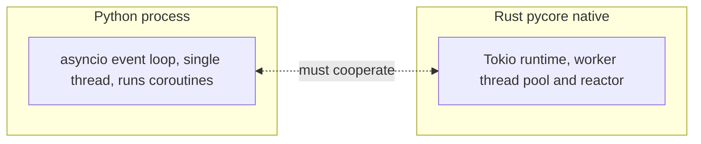

- **Python's asyncio loop** runs coroutines (`async def`) on **one thread**. If anything blocks it, the whole app freezes.
- **Tokio** runs tasks on its own worker threads (Section 6).
- The bridge's job: when Python does `await cursor.execute(...)`, hand the real work to **Tokio**, and give Python back an **awaitable** that resolves when Tokio finishes — **without blocking Python's loop**.

This is exactly what the **`pyo3-async-runtimes`** crate provides (via `future_into_py`). It is the missing piece versus today's `block_on` design.

### 7.2 The layered architecture

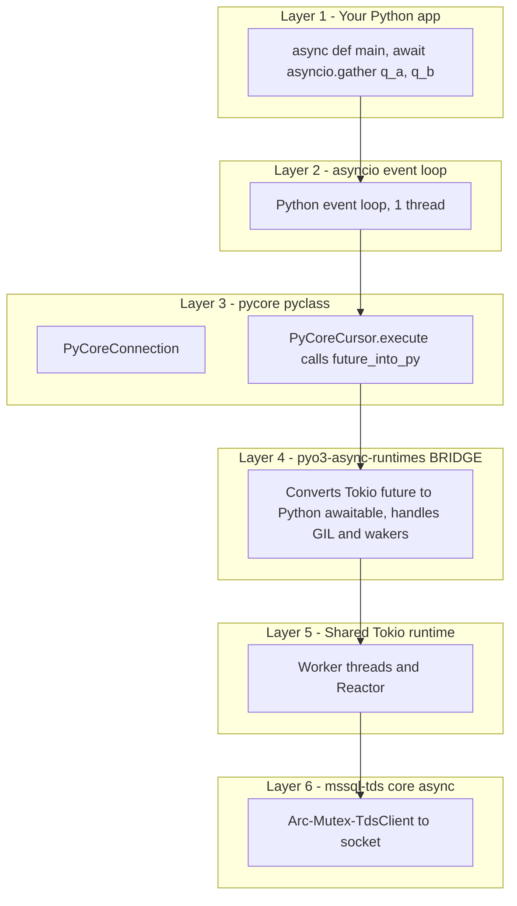

#### Understanding `pycore` vs. `pyo3-async-runtimes`

Layers 3 and 4 are **two different crates with different jobs**, and it's important not to conflate them:

|                 | **pycore** (`mssql-py-core`) — Layer 3                                                                                    | **pyo3-async-runtimes** — Layer 4                                            |
| --------------- | ------------------------------------------------------------------------------------------------------------------------- | ---------------------------------------------------------------------------- |
| **What it is**  | *Existing* crate in mssql-rs which is SQL-specific binding                                                                | A *generic* third-party library                                              |
| **Knows about** | TDS, `TdsClient`, connections, cursors, rows                                                                              | Nothing about databases — only futures & loops                               |
| **Contains**    | `#[pyclass] PyCoreConnection`, `PyCoreCursor.execute()`, arg reading, result → Python conversion, `Arc<Mutex<TdsClient>>` | `future_into_py`, the shared Tokio runtime, the Tokio↔asyncio waker plumbing |
| **Role**        | Defines *what* Python can call and *what* the query does                                                                  | Defines *how* a Rust future becomes an awaitable Python can `await`          |
| **Dependency**  | Uses pyo3-async-runtimes                                                                                                  | Used by pycore (and any other async binding)                                 |

**The relationship:** pycore is the **application layer**; pyo3-async-runtimes is the **generic bridge** it calls into. The Layer 3 line `PyCoreCursor.execute calls future_into_py` is exactly pycore (L3) reaching down into pyo3-async-runtimes (L4):

```rust
// pycore (Layer 3) — your code, knows about TDS
#[pymethods]
impl PyCoreCursor {
    fn execute<'p>(&self, py: Python<'p>, sql: String) -> PyResult<Bound<'p, PyAny>> {
        let client = self.tds_client.clone();
        // hand a Rust future to pyo3-async-runtimes (Layer 4) — generic bridge
        pyo3_async_runtimes::tokio::future_into_py(py, async move {
            let mut c = client.lock().await;
            c.execute(sql, None, None).await?;   // mssql-tds work (Layer 6)
            Ok(())
        })
    }
}
```

- **pycore** wrote everything except `future_into_py`.
- **pyo3-async-runtimes** provides *only* `future_into_py` (and the runtime/waker machinery behind it): it takes your Rust future, spawns it on Tokio, and returns a Python awaitable.

**Analogy:** pycore is the *chef* who knows the recipe (SQL/TDS); pyo3-async-runtimes is the *dumbwaiter* that carries the finished plate between the kitchen (Tokio) and the dining room (asyncio) — it doesn't cook, it just moves things across the boundary correctly.

### 7.3 pyo3-async-runtimes as generic bridge plugin (the contract)

You never modify `pyo3-async-runtimes` — you **add it as a dependency and call it**. A generic library like this works through a **contract** (Rust traits + a function signature), not domain knowledge. You conform to its interface; it does the rest.

**Import it** (in `mssql-py-core/Cargo.toml`):

```toml
[dependencies]
pyo3 = { version = "0.29.0", features = ["extension-module"] }
pyo3-async-runtimes = { version = "0.29.0", features = ["tokio-runtime"] }
tokio = { version = "1", features = ["full", "rt-multi-thread"] }
```

> Keep the `pyo3` and `pyo3-async-runtimes` **versions aligned** (both `0.29.x` here) — the bridge is pinned to a specific pyo3 version.

**The one-line deal:**

> You give it a Rust `Future`. It gives you back a Python awaitable.

It doesn't care whether that future runs a SQL query or downloads a file. Three generic mechanisms carry everything it needs:

| Mechanism                                  | What it is                             | How it conveys "what you need"                                                                                                                                 |
| ------------------------------------------ | -------------------------------------- | -------------------------------------------------------------------------------------------------------------------------------------------------------------- |
| **The `Future` trait**                     | Rust's standard async abstraction      | Your `async { client.execute(...).await }` block *is* a `Future`. The lib only needs "something pollable" and drives it to completion — it never looks inside. |
| **Trait bound `IntoPyObject`**             | "I know how to become a Python object" | This is how results get handed back. You (or pyo3's derive macros) provide the conversion; the lib just calls it.                                              |
| **A Cargo feature flag** (`tokio-runtime`) | Compile-time config                    | Tells the lib *which* async runtime to spawn on.                                                                                                               |

Plus one runtime detail: at call time it grabs the **currently running asyncio loop** (`get_running_loop`), so it knows where to schedule the wakeup.

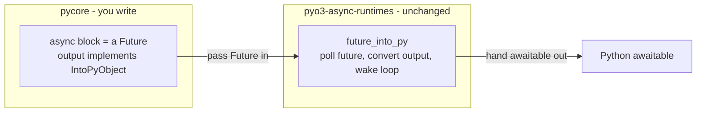

**What you write vs. what the library does:**

```rust
// ---- WHAT YOU WRITE (in pycore) ----
#[pymethods]
impl PyCoreCursor {
    fn execute<'p>(&self, py: Python<'p>, sql: String) -> PyResult<Bound<'p, PyAny>> {
        let client = self.tds_client.clone();
        // You hand it a Future. That is the entire handshake.
        pyo3_async_runtimes::tokio::future_into_py(py, async move {
            let mut c = client.lock().await;
            let rows = c.execute(sql, None, None).await?;
            Ok(rows)   // output must be convertible to a Python object
        })
    }
}
```

```text
// ---- WHAT THE LIBRARY DOES (unchanged, generic) ----
future_into_py(py, fut):
    1. loop      = get_running_loop(py)       // read the asyncio loop
    2. py_future = asyncio.Future()           // the awaitable it returns
    3. tokio::spawn(async {
           let result = fut.await;            // polls YOUR future
           Python::with_gil(|py| {            // acquires the GIL
               let obj = result.into_pyobject(py);    // uses YOUR conversion
               loop.call_soon_threadsafe(py_future.set_result, obj)
           })
       })
    4. return py_future                       // Python can now `await` it
```

**The plumbing is the trait boundary.** You and the library meet at exactly two points: `Future` (input) and `IntoPyObject` (output). Neither side knows the other's internals — no forking, no patching, no teaching it about TDS.

**Analogy:** a **power adapter**. It doesn't know if you plug in a laptop or a lamp; it just conforms to a standard plug (`Future`) on one side and a standard socket (asyncio `Future`) on the other. You make your code fit the plug; the adapter handles the conversion across the boundary.

**So, concretely, all you do:**
1. Add the dependency with the `tokio-runtime` feature (above).
2. Register/initialize the Tokio runtime once at module init.
3. In each `#[pymethods]` function, wrap the async work in `future_into_py(py, async { ... })`.
4. Make sure return types are pyo3-convertible (usually automatic via derives / built-in impls).

### 7.4 Example Walkthrough - Two connections, two cursors (mssql-python)


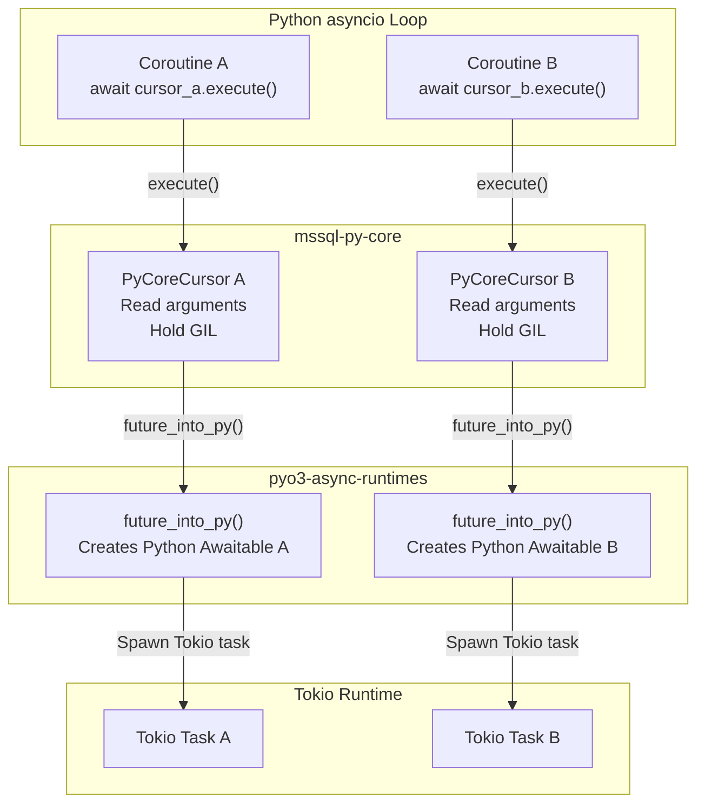

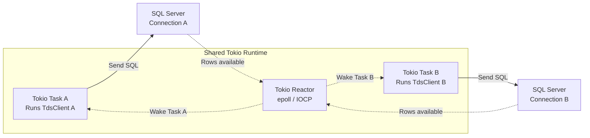

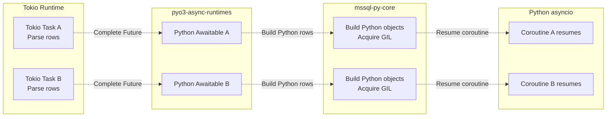

**Follow the workflow path** (shown for Query A; Query B mirrors it):

1. **call** — the coroutine `await`s `cursor.execute()`, entering **pycore**.
2. **spawn** — pycore reads the SQL/params (**GIL held** briefly), then hands a Rust future to **pyo3-async-runtimes**, which spawns it as a Tokio task and returns an awaitable.
3. **run** — the task runs on a **Tokio worker thread**.
4. **send SQL** — the task writes the query to SQL Server over **socket A** (pure Rust, **no GIL**), then `await`s the reply and **frees the thread**.
5. **rows** — SQL Server replies; the bytes arrive on the socket and the **Reactor** notices.
6. **wake** — the Reactor wakes Task A on any free worker; it parses the rows into Rust values.
7. **build objs** — back in pycore, rows are converted to **Python objects** (**GIL re-acquired** briefly).
8. **resolve** — the awaitable resolves and the coroutine's `await` returns the result.

**Why this is truly parallel:**
- A and B use **separate sockets** and **separate tasks** with no shared lock, so steps 3–6 **overlap**.
- The Python loop thread is **free during steps 3–6**, so it runs Query B while Query A is in flight — that's what `asyncio.gather(A.execute(), B.execute())` exploits.
- Results come back independently; each `await` resolves when its own rows arrive.
- **Parallelism = number of connections** — the same rule as native Rust.

### 7.5 When is a thread assigned? When is a task assigned? When is the GIL held?

The mental rule: **a task lasts the whole query; a thread is borrowed only for the busy moments.**

- **Task — always.** `cursor.execute()` creates exactly **one task** (a future) that exists from start to finish. In Python true-async, your `await` coroutine is bridged to **one Tokio task**.
- **Thread — only intermittently.** A thread is borrowed only while real CPU work happens — building/sending the query bytes and parsing the reply rows. During the network wait (the long part), **no thread is assigned at all** — just the reactor watching the socket.

#### Native Rust — thread vs. task timeline

| Phase                       | Task assigned? | Thread assigned?                         |
| --------------------------- | -------------- | ---------------------------------------- |
| 1. Build & send query bytes | ✅ yes          | ✅ yes (a worker thread)                  |
| 2. **Network wait**         | ✅ yes          | ❌ **no thread** — reactor watches socket |
| 3. Parse reply rows         | ✅ yes          | ✅ yes (any free worker thread)           |
| 4. Done                     | freed          | freed                                    |

#### Python async — thread + task + GIL timeline

There are **two threads** in play: the single **Python event-loop thread**, and the **Tokio worker threads**. The query runs on a Tokio worker — *not* on the Python loop thread.

| Phase                                             | Python coroutine    | Tokio task | Which thread is busy           | GIL                                  |
| ------------------------------------------------- | ------------------- | ---------- | ------------------------------ | ------------------------------------ |
| 1. Enter `execute()`                              | running             | not yet    | Python loop thread             | 🔒 **HELD** — read args, build future |
| 2. `future_into_py` returns awaitable             | suspended (`await`) | spawned    | Python loop thread → **freed** | 🔓 **RELEASED**                       |
| 3. Send query bytes                               | pending             | running    | Tokio worker                   | 🔓 not held                           |
| 4. **Network wait**                               | pending             | parked     | **none**                       | 🔓 not held                           |
| 5. Parse rows (Rust values)                       | pending             | running    | Tokio worker                   | 🔓 not held                           |
| 6. Convert rows → Python objects, complete future | resolving           | finishing  | Tokio worker                   | 🔒 **RE-ACQUIRED** briefly            |
| 7. Coroutine resumes, returns                     | running             | done       | Python loop thread             | 🔒 **HELD**                           |

**Key insight:** the GIL is held only at the **two boundaries** (steps 1 and 6–7) — reading inputs in and converting results out. It is **released for the entire query** (steps 2–5), which is exactly why *other* Python coroutines (e.g., Query B) can run while Query A is in flight.

> **Note on step 6:** the "GIL RE-ACQUIRED" happens on the **Tokio worker thread**, not the Python loop thread — and *not* because the worker is "running Python." It re-acquires the GIL because **building Python objects touches the CPython object heap**, which the GIL protects. Any thread (Python or Rust) must hold the GIL to create Python objects. See [Section 7.6](#76-how-pyo3-bridges-the-schedulers-and-where-it-briefly-blocks) for the full mechanics and the exact blocking points.

#### GIL flow (Python)

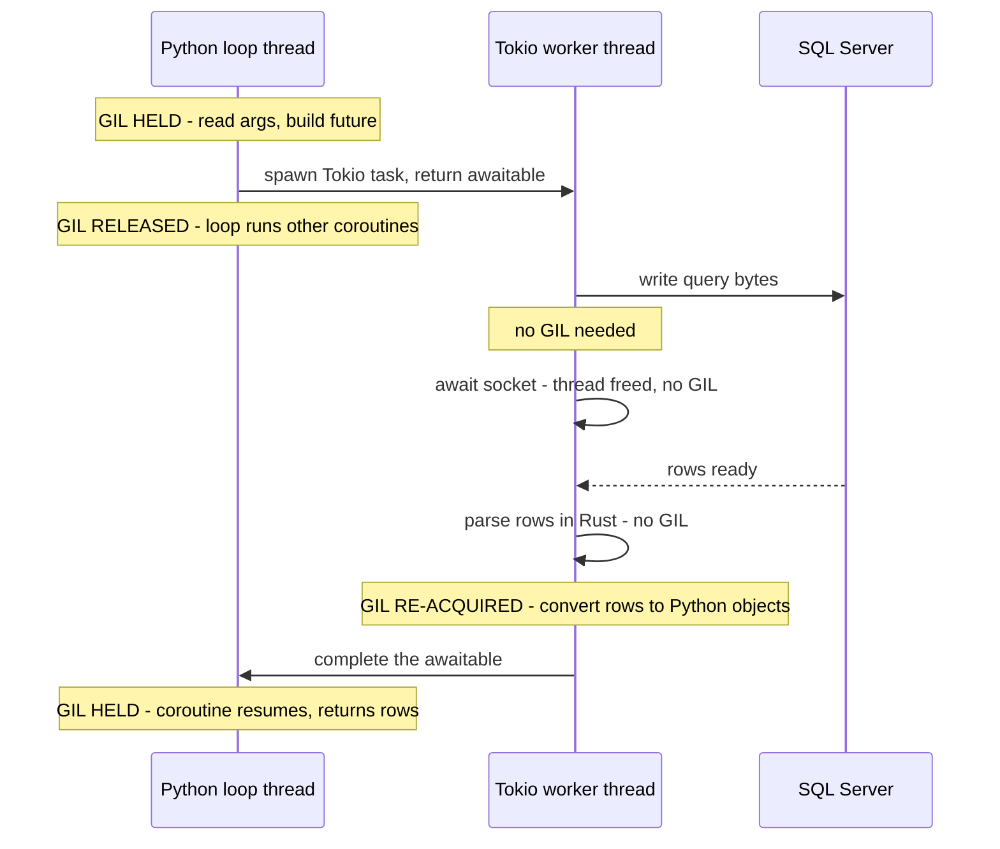

**One-line takeaways:**
- **In Rust:** a task lives the whole time; a thread is grabbed only to send bytes and parse rows, never during the wait.
- **In Python:** same, plus the query runs on a **Tokio worker thread — not** the Python loop thread, so the loop stays free.
- **GIL:** taken only at the in/out boundaries, released for the entire network round-trip — that release is what makes concurrency real.

### 7.6 How PyO3 bridges the schedulers (and where it briefly blocks)

PyO3 has to connect **two different concurrency worlds**: Python's single-threaded cooperative `asyncio` loop, and Tokio's multi-threaded work-stealing pool. Every crossing of that boundary is where the GIL and any momentary blocking occur.

#### The two schedulers PyO3 connects

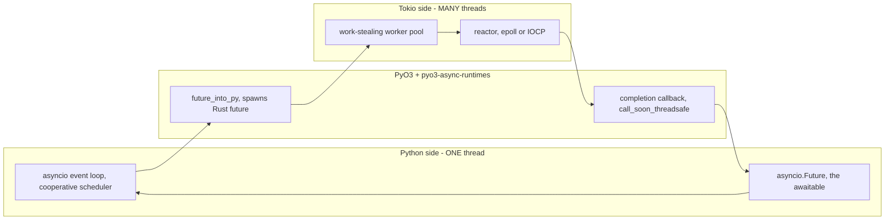

#### Step-by-step: threads, tasks, and GIL at each crossing

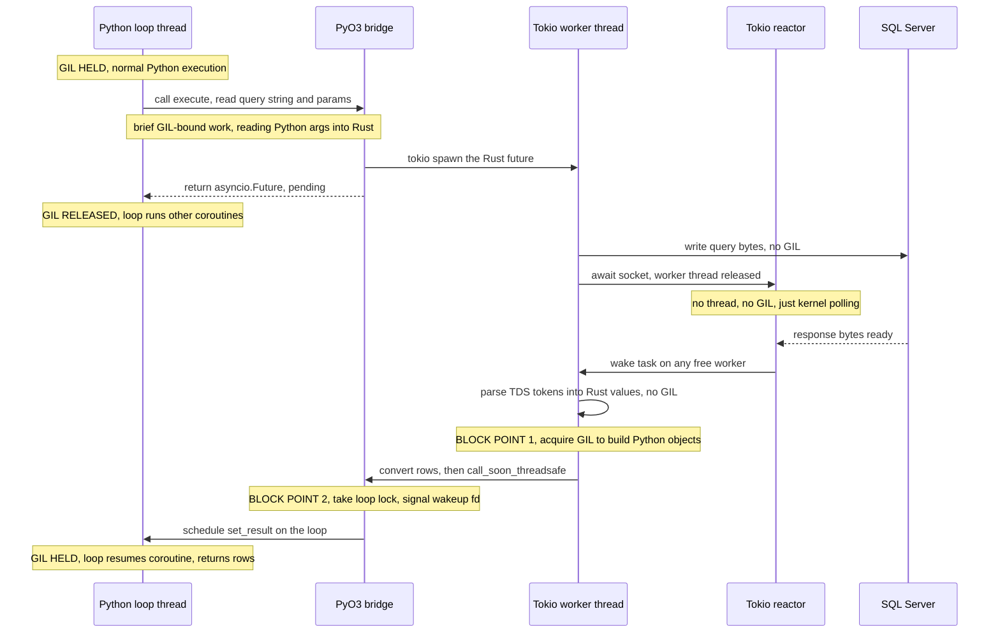

#### Where does momentary blocking actually happen?

| #   | Point                                                         | Layer (control)             | Who blocks                 | On what                                                    | Typical duration              |
| --- | ------------------------------------------------------------- | --------------------------- | -------------------------- | ---------------------------------------------------------- | ----------------------------- |
| A   | **Enter `execute()`** — read query/params from Python         | **PyO3** (Rust holding GIL) | Python loop thread         | Holds GIL while marshalling args into Rust                 | microseconds                  |
| B   | **Network round-trip**                                        | **Rust / Tokio**            | nobody                     | —                                                          | the whole query (no blocking) |
| C   | **TDS parsing (Rust values)**                                 | **Rust**                    | Tokio worker               | pure Rust, no GIL                                          | depends on rows               |
| D   | **Block Point 1: `Python::with_gil`** to build result objects | **PyO3**                    | Tokio worker               | Must **acquire the GIL**; waits if another thread holds it | microseconds if uncontended   |
| E   | **Materialize result rows → Python objects**                  | **PyO3**                    | whichever thread holds GIL | GIL held for the whole conversion                          | scales with result size       |
| F   | **Block Point 2: `call_soon_threadsafe`**                     | **PyO3** (bridge)           | Tokio worker               | Takes the event loop's internal lock + writes wakeup byte  | sub-microsecond               |
| G   | **Resume coroutine, return**                                  | **Python**                  | Python loop thread         | Holds GIL as normal                                        | microseconds                  |

Control starts in **PyO3** (A), crosses fully into **Rust/Tokio** for the expensive part (B–C), returns to **PyO3** at the boundary to build objects and wake the loop (D–F), and finally lands back in **Python** (G).

#### Two kinds of "blocking" — only one matters

| Kind                                      | What it is                                                        | Impact                                                                              |
| ----------------------------------------- | ----------------------------------------------------------------- | ----------------------------------------------------------------------------------- |
| **Network blocking** (the expensive one)  | Waiting on SQL Server                                             | ❌ **Never happens** — no thread, no GIL parked.                                     |
| **GIL boundary blocking** (the cheap one) | Brief GIL acquire/release at the in/out edges (points A, D, F, G) | ✅ Happens, but **microsecond-scale** and unavoidable for any Python↔native binding. |

**Yes, there is momentary blocking — but only at the GIL boundaries, measured in microseconds, never during the query itself.**

#### The GIL is a lock on objects, not on a code layer

A common misconception is "the GIL is held only when a thread runs Python code." The real rule is broader:

> **Any thread must hold the GIL whenever it creates, reads, mutates, or changes the refcount of a Python object — even a native Rust/Tokio thread.**

| Activity                                               | Holds GIL? | Why                                                          |
| ------------------------------------------------------ | ---------- | ------------------------------------------------------------ |
| Running Python bytecode                                | ✅ Yes      | Touches Python objects                                       |
| **Rust code building a `PyList` / `PyLong` via PyO3**  | ✅ **Yes**  | Calls the CPython C-API to allocate objects + bump refcounts |
| Pure Rust logic (parse TDS bytes into `i64`, `String`) | ❌ No       | No Python object involved                                    |
| Network wait / socket I/O                              | ❌ No       | No Python object involved                                    |

So result materialization happens "in PyO3" because PyO3 is the only thing that can translate Rust values into Python objects — and that translation must hold the GIL, not because we are "in Python," but because **building Python objects touches the CPython object heap**:

```rust
// Running on a Tokio worker thread (native Rust, NO GIL yet)
let rows: Vec<RustRow> = client.execute(...).await?;   // pure Rust, no GIL

Python::with_gil(|py| {              // worker ACQUIRES the GIL here (may wait briefly)
    let list = PyList::empty(py);
    for r in rows {
        list.append(r.into_py(py))?; // building Python objects -> needs GIL
    }
    Ok(list.into())
})                                   // GIL RELEASED when this block ends
```

**Mental model:** the GIL is a lock on the **Python object heap**, not a lock on "Python code." Any thread — Python or Rust — that touches that heap must hold it.

#### The one place to watch: result materialization (point E)

This is the **only** GIL section whose cost scales with data size:

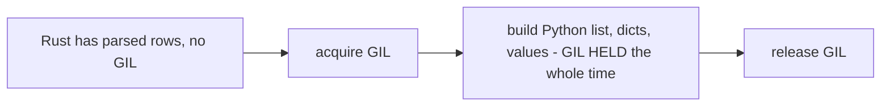

- For a small result, negligible. For a **huge result set** (e.g. 1M rows), the conversion holds the GIL long enough to **momentarily stall other coroutines**, because only one thread can build Python objects at a time.
- This does **not** break concurrency of the *queries* (they already overlapped during the network phase) — it only **serializes the final row-materialization**.
- Mitigations if it ever matters: **stream/fetch in chunks** (convert a batch at a time, yielding between batches) or expose `fetchmany()` so the app pulls rows incrementally instead of one giant conversion.

---

## 8. Today vs. true async: what must change in pycore

### 8.1 The current (blocking) model

On the Rust path, `mssql-py-core` bridges with `runtime.block_on(...)` inside `py.detach()` (GIL released). Each `cursor.execute()` **blocks the calling Python thread** until the query completes — this is *not* true async. (The default DDBC/ODBC path is likewise synchronous; see [§2](#2-problem-statement--goals).)

**Today (blocking):**


**Proposed (true async):**

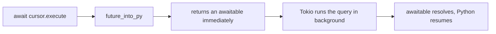

### 8.2 The changes

| Piece         | Today                                   | True async                                                |
| ------------- | --------------------------------------- | --------------------------------------------------------- |
| Tokio runtime | one `Runtime::new()` **per connection** | **one shared** multi-thread runtime for the whole process |
| Call style    | `runtime.block_on(...)`                 | `future_into_py(...)` returns an awaitable                |
| Python thread | **blocked** during query                | **free** — the loop keeps running                         |
| API           | `def execute`                           | `async def execute`                                       |

### 8.3 The three things pycore must get right

1. **One shared Tokio runtime** (not per-connection). Created once (e.g. via `pyo3_async_runtimes::tokio::get_runtime()`) and used by every connection. This lets tasks from different connections share the worker pool and overlap.
2. **GIL discipline.** Hold the GIL only at the **boundaries** — reading the query string in, and converting result rows out. During the network wait and TDS parsing, the GIL is **released**, so other Python coroutines run. The bridge acquires the GIL only when it needs to wake the awaitable.
3. **The statement handle.** A prepared-statement handle is just a server-side `i32` that SQL Server owns. Hold it as a plain integer field on the cursor and send it back on the next `sp_execute`, always on the **same connection** that created it. No thread affinity, no locking — the bridge never needs to touch it specially.

---

## 9. End-to-end walkthrough between Python and Rust

What happens on `await cursor.execute("SELECT ...")` in the true-async Python design:

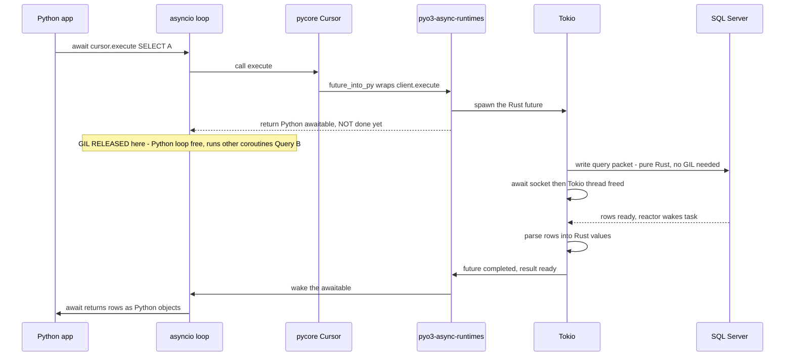

**Step by step:**
1. `await cursor.execute()` calls into pycore. Instead of blocking, pycore wraps the Rust async work with `future_into_py(...)` and **immediately returns a Python awaitable**.
2. The actual query is **spawned onto the shared Tokio runtime**. The bridge links "this Python awaitable" to "this Tokio task."
3. **Python's asyncio loop is now free** — it runs your other coroutines (e.g., Query B on the other connection).
4. Tokio does the real work exactly as in the native-Rust case: send packet → yield on `.await` → reactor wakes it when SQL Server replies → parse rows. **No Python thread and no Tokio thread is parked during the network wait.**
5. When the Rust future finishes, the bridge **wakes the Python awaitable** (via asyncio's thread-safe callback), and `await` returns with the results converted to Python objects.

---

## 10. Rollout plan

### Delivery: experimental namespace first

- Ship the async API behind an **experimental / opt-in surface** (e.g. an `aio` submodule such as `mssql_python.aio`, or dedicated async classes) so it lands without affecting sync users.
- Optionally gate the native build with a **Cargo feature** (e.g. `async`) during early iterations.
- Promote to **default-available** (not default-*on*; the sync API stays) once the success criteria in [§2](#2-problem-statement--goals) are met and the API is stable.

### Versioning & deprecation

- The async API is **additive** — no breaking changes to existing sync signatures — so it ships in a **minor** release.
- If shared internals change shape (e.g. consolidating to one Tokio runtime), keep sync behavior identical and note any observable change in the changelog.
- No sync APIs are deprecated by this work. If that ever changes, follow a standard **deprecate → warn (one minor cycle) → remove (next major)** policy.

### Documentation & migration

- Add an **async quickstart** (connect, `await cursor.execute`, `async for` / `fetch`), with a note that concurrency scales with connections (use a pool).
- Provide a **migration guide** for asyncio users currently using `run_in_executor`, showing the before/after.
- Document the **one-shared-runtime** model and the result-materialization caveat ([§7.6](#76-how-pyo3-bridges-the-schedulers-and-where-it-briefly-blocks)) for large result sets.
- Cross-link this design doc from the `mssql-py-core` README.

---

## 11. Appendix

Reference material on how the async model works underneath the Python bindings. The main design is in sections 1–10; this background explains the native-Rust foundation those sections build on.

### 11.1 How async works in native Rust (mssql-tds)

The core `TdsClient` in `mssql-tds` is **fully async, built on Tokio**. A native Rust app gets true async out of the box — no bridges, no blocking.

#### 11.1.1 The lifecycle of a query

One query moves through four phases. **Only phases 1 and 4 use a thread** — the long network wait in phase 3 uses no thread at all.

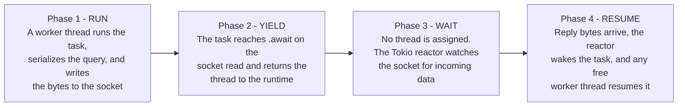

**In words:**
1. **Who sends the query?** The task itself calls `client.execute()`, which serializes a `SqlBatch`/RPC and writes bytes to the socket. There is no separate "sender thread."
2. **Nobody is parked.** The instant the task hits `.await` on the socket read, it **releases the worker thread**. The thread goes and runs other tasks.
3. **Who receives the results?** The **Tokio reactor** (built on the OS's epoll/IOCP) watches the socket. When SQL Server sends bytes back, the reactor **wakes the matching task**, and *any free worker thread* resumes it to parse the token stream.
4. The query may be **sent by one thread and have its results parsed by a different thread** — that is normal and fine on the default multi-threaded runtime.

#### 11.1.2 Example Walkthrough: Two connections, two cursors (Async)

Each connection is its **own TCP socket** and its **own `TdsClient`**. Held as `Arc<Mutex<TdsClient>>` and driven as two tasks. **async main** launches Task A and Task B; each task writes its query to its own SQL Server socket, then parks; the Tokio Reactor watches both sockets and wakes whichever task's reply arrives first.

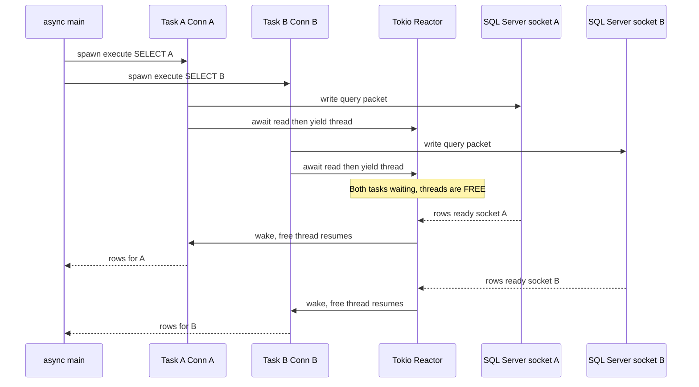

Both connections run genuinely in parallel — separate sockets, separate tasks — even on a single-threaded runtime, because the *waiting* is overlapped.

**What the participants are:**

| Participant                 | What it actually is                                                                                                                                                                                                      |
| --------------------------- | ------------------------------------------------------------------------------------------------------------------------------------------------------------------------------------------------------------------------ |
| **async main**              | Your program's entry point — the top-level `async fn main` on the Tokio runtime. It launches both queries with `tokio::spawn` and waits for both (`tokio::join!`). It drives; it doesn't do the query work itself.       |
| **Task A**                  | The lightweight future for the first query, running on **Connection A**. It owns "send SELECT A, await the reply, parse rows." A unit of work, not a thread.                                                             |
| **Task B**                  | The same for the second query on **Connection B** — an independent future. A and B share no lock, so they run concurrently.                                                                                              |
| **Tokio Reactor**           | The runtime's I/O watcher, built on the OS's `epoll` (Linux) / `IOCP` (Windows). It monitors the sockets and **wakes the specific task** when its bytes arrive — this is what lets a task sleep with no thread assigned. |
| **SQL Server socket A / B** | The two **TCP connections** to SQL Server, one per `TdsClient`. Separate byte pipes, so queries A and B travel and return in parallel.                                                                                   |

#### 11.1.3 What the Rust app looks like

```rust
#[tokio::main]
async fn main() -> TdsResult<()> {
    // Two independent connections = two sockets = true parallelism
    let conn_a = Arc::new(Mutex::new(provider.create_client(ctx_a, &ds_a, None).await?));
    let conn_b = Arc::new(Mutex::new(provider.create_client(ctx_b, &ds_b, None).await?));

    // Spawn two tasks — they run concurrently, no dedicated threads
    let a = tokio::spawn({
        let c = conn_a.clone();
        async move {
            let mut client = c.lock().await;
            client.execute("SELECT * FROM A".into(), Some(30), None).await
            // ... read rows ...
        }
    });
    let b = tokio::spawn({
        let c = conn_b.clone();
        async move {
            let mut client = c.lock().await;
            client.execute("SELECT * FROM B".into(), Some(30), None).await
        }
    });

    // Both run at the same time; join waits for both
    let (ra, rb) = tokio::join!(a, b);
    ra??; rb??;
    Ok(())
}
```

### 11.2 Concurrency model: connections vs. cursors

There is very little locking, and that is by design.

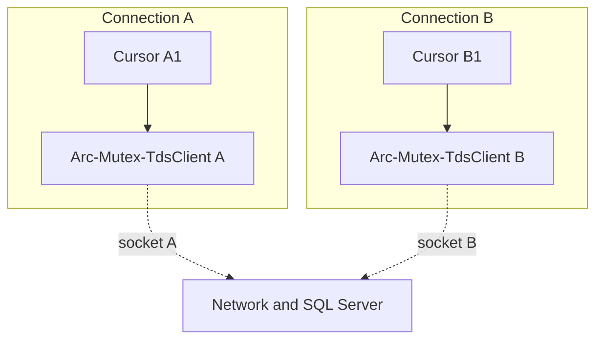

- The `Mutex` only serializes access **within a single connection**, because one TCP socket can carry **one request at a time** (MARS — Multiple Active Result Sets — is parsed at login but **not yet implemented**).
- **Across connections there is NO shared lock.** A and B never wait on each other.
- **Parallelism scales with the number of connections, NOT the number of cursors.**

| Scenario                                           | Result                                                                                                          |
| -------------------------------------------------- | --------------------------------------------------------------------------------------------------------------- |
| **One cursor per connection** (2 conns, 2 cursors) | ✅ Zero contention — fully parallel                                                                              |
| **Two cursors on one connection**                  | ⚠️ Serialized — the 2nd cursor waits on that connection's `Mutex` until the 1st finishes (they share one socket) |
| **N independent connections**                      | ✅ N-way parallelism                                                                                             |

> **Rule of thumb:** Want *N* parallel queries → use *N* connections (a connection pool).

---

*This document reflects the async architecture of the `mssql-tds` core and the design direction for true-async Python bindings in `mssql-py-core`.*
