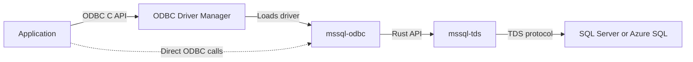

<!--
User-facing introduction to the mssql-odbc crate: what the driver is, how to
obtain it, and how to build and test it. Keep detailed configuration,
behavior, migration notes, and diagnostics in docs/driver-guide.md; development
test procedures in docs/testing.md; deliberate departures from msodbcsql in
docs/parity-deviations.md; and engineering contracts in
.github/instructions/mssql-odbc.instructions.md.
-->

# mssql-odbc

`mssql-odbc` is a cross-platform ODBC 3.x driver for Microsoft SQL Server and
Azure SQL, written in Rust and built on
[mssql-tds](https://github.com/microsoft/mssql-rs/blob/main/mssql-tds/README.md).
It exposes the native ODBC C API as a shared library that applications load
through the platform's ODBC Driver Manager or call directly.

> [!IMPORTANT]
> The driver is alpha software under active development. It is being validated
> as an opt-in backend for
> [mssql-python](https://github.com/microsoft/mssql-python), but it is not yet a
> complete, general-purpose replacement for Microsoft ODBC Driver 18 for SQL
> Server.

## Distribution

The driver is included in
[`mssql-python-rs`](https://pypi.org/project/mssql-python-rs/), the native
runtime used by `mssql-python`. See the PyPI release page for the current
version and available Windows, macOS, and Linux wheels.

This crate is not published independently to crates.io. Build it from this
workspace when developing or testing the ODBC library directly.

## Architecture

Applications call the ODBC C API; the driver translates those calls into
`mssql-tds` operations, which communicate with SQL Server over TDS.



## Platform artifacts

| Platform | Driver Manager | Library |
|---|---|---|
| Windows | Windows ODBC Driver Manager | `mssqlodbc.dll` |
| macOS | unixODBC | `mssqlodbc.dylib` |
| Linux | unixODBC | `mssqlodbc.so` |

## Build from source

Install the repository's pinned Rust toolchain and a native linker. Linux
builds need OpenSSL development libraries and `pkg-config` (for example,
`libssl-dev` and `pkg-config` on Debian/Ubuntu). The C++ end-to-end tests also
need unixODBC development headers on Linux/macOS, CMake, and a C++17 compiler.

Default-feature macOS builds require macOS 10.15 or later (11.0 or later on
Apple Silicon). Set `MACOSX_DEPLOYMENT_TARGET=10.15` or later for x86_64 builds
to meet the Network.framework requirement.

From the repository root:

```bash
cargo build -p mssqlodbc
bash mssql-odbc/scripts/finalize-artifact.sh debug
```

On Windows, use PowerShell:

```powershell
cargo build -p mssqlodbc
./mssql-odbc/scripts/finalize-artifact.ps1 -BuildProfile debug
```

For an optimized build, add `--release` to `cargo build` and pass `release` to
the finalization script. The script prints the artifact path under the
workspace Cargo target directory.

## Configuration and compatibility

The [driver guide](https://github.com/microsoft/mssql-rs/blob/main/mssql-odbc/docs/driver-guide.md)
covers connection defaults, timeouts, parameter streaming, descriptors,
character encoding, migration notes, and tracing. See the
[parity registry](https://github.com/microsoft/mssql-rs/blob/main/mssql-odbc/docs/parity-deviations.md)
for deliberate differences from Microsoft ODBC Driver for SQL Server.

## Test

Run the Rust unit tests from the repository root:

```bash
cargo nextest run -p mssqlodbc --lib
```

The C++ end-to-end suite loads the built library through the platform's ODBC
Driver Manager:

```bash
bash mssql-odbc/tests/e2e/run_e2e.sh
```

On Windows:

```powershell
./mssql-odbc/tests/e2e/run_e2e.ps1
```

See the [end-to-end guide](https://github.com/microsoft/mssql-rs/blob/main/mssql-odbc/tests/e2e/README.md)
for server configuration and comparison testing, and the
[development test guide](https://github.com/microsoft/mssql-rs/blob/main/mssql-odbc/docs/testing.md)
for stack-budget and Miri checks.

## Contributing

Start with the repository
[contribution guide](https://github.com/microsoft/mssql-rs/blob/main/CONTRIBUTING.md)
and the
[ODBC engineering guidelines](https://github.com/microsoft/mssql-rs/blob/main/.github/instructions/mssql-odbc.instructions.md).
Report security vulnerabilities according to the
[security policy](https://github.com/microsoft/mssql-rs/blob/main/SECURITY.md).

## License

Licensed under the [MIT License](https://github.com/microsoft/mssql-rs/blob/main/LICENSE).
