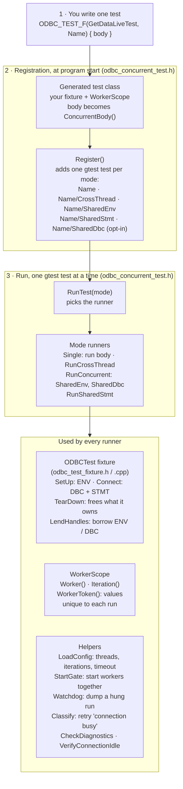
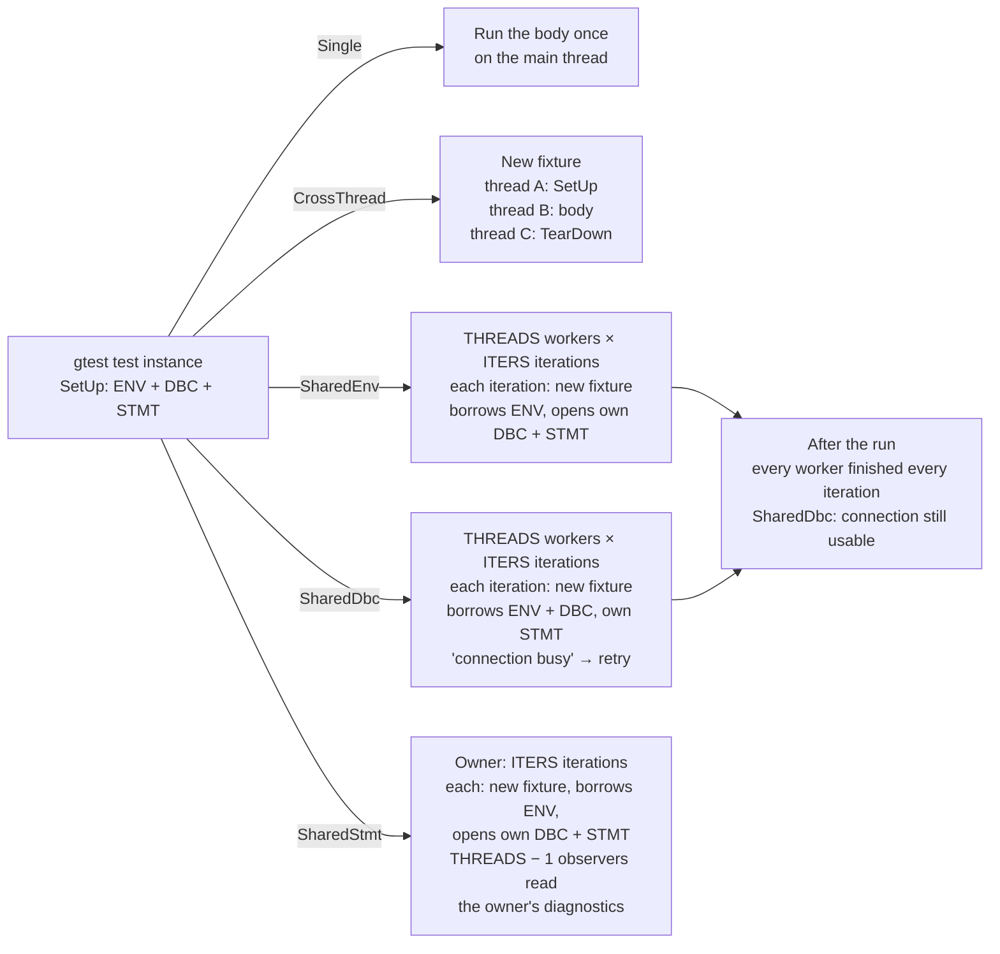

# Multithreaded Testing Plan

Concurrent ODBC use must not crash, deadlock, corrupt data, leak diagnostics
across handles, or leave a connection busy. PRs run every test single-threaded
plus small concurrent smoke runs; nightly and weekly runs hunt races.

## Approach

- **Shared-body tests (default).** A behavioral test is written once with
  `ODBC_TEST_F` in its API-group file, such as `get_data_test.cpp`, and also
  runs across threads. No second copy to drift.
- **Multithreaded-only scenarios** in `tests/e2e/tests/multithreaded_tests/`,
  for what has no single-threaded form: handle churn, races on one STMT, a
  shared APD, connect races, and cancel.

Separate copies drifted from the single-threaded suite (a fixed bug was
re-filed from stale expectations); running three GetData test bodies under
`SharedDbc` found AB#49225 without new test logic.

## Example

Converting a test changes only the macro:

```cpp
#include "odbc_concurrent_test.h"

// Before: runs once, on the main thread.
TEST_F(GetDataLiveTest, ReadsAnInt) { /* same body */ }

// After: same body, also run across threads.
ODBC_TEST_F(GetDataLiveTest, ReadsAnInt) {
    ASSERT_SQL_OK(ExecDirect("SELECT CAST(42 AS INT)"), SQL_HANDLE_STMT, stmt_);
    ASSERT_SQL_OK(SQLFetch(stmt_), SQL_HANDLE_STMT, stmt_);
    SQLINTEGER value = 0;
    ASSERT_SQL_OK(SQLGetData(stmt_, 1, SQL_C_SLONG, &value, 0, nullptr),
                  SQL_HANDLE_STMT, stmt_);
    EXPECT_EQ(42, value);
    SQLCloseCursor(stmt_);
}
```

The macro registers these gtest tests itself at program start; the file only
has to be built by an `add_odbc_test` target, as existing test files are:

```text
GetDataLiveTest.ReadsAnInt              exactly as TEST_F
GetDataLiveTest.ReadsAnInt/CrossThread  SetUp, body, TearDown on three threads
GetDataLiveTest.ReadsAnInt/SharedEnv    THREADS x ITERS runs sharing one ENV
GetDataLiveTest.ReadsAnInt/SharedStmt   observers read the STMT's diagnostics
```

Every run of that body expects 42, so a result delivered to the wrong
connection would still pass. Derive the expected value from the run instead:

```cpp
ODBC_TEST_F(GetDataLiveTest, EachRunReadsItsOwnValue) {
    const std::string token = WorkerToken("getdata");  // e.g. "getdata-w2-i7"
    ASSERT_SQL_OK(ExecDirect("SELECT CAST('" + token + "' AS VARCHAR(64))"),
                  SQL_HANDLE_STMT, stmt_);
    ASSERT_SQL_OK(SQLFetch(stmt_), SQL_HANDLE_STMT, stmt_);
    EXPECT_EQ(token, GetChar(1));  // another worker's row cannot match
    SQLCloseCursor(stmt_);
}
```

`/SharedDbc` is opt-in:

```cpp
ODBC_TEST_F_MODES(GetDataLiveTest, EachRunReadsItsOwnValue,
                  odbc_concurrency::kAllModes) { /* same body */ }
```

## Modes

| Mode | What runs | Pass condition | Not for |
|---|---|---|---|
| `Single` | The body once, on the main thread | As `TEST_F` | - |
| `CrossThread` | SetUp, body, and TearDown on three different threads | As `TEST_F`; catches thread affinity (handles move between threads in pools, async runtimes, and finalizers) | - |
| `SharedEnv` | `THREADS` workers x `ITERS` runs; shared ENV, own DBC and STMT | Every run passes | Tests that change ENV, pooling, or process state; connect, disconnect, or driver-load tests; fixed-name permanent objects; reliance on `HasFatalFailure()` |
| `SharedDbc` (opt-in via `ODBC_TEST_F_MODES` with `kAllModes`) | `THREADS` workers x `ITERS` runs; shared DBC, own STMT | Only `HY000` connection busy may fail, and is retried; the connection is idle afterward | As `SharedEnv`, plus connection-attribute or transaction changes, shared temp-object names, bodies unsafe to rerun |
| `SharedStmt` | Owner runs the body `ITERS` times; `THREADS - 1` observers read its STMT and DBC diagnostics | Owner as `Single`; observers read in every iteration; every record well formed | Bodies that free or replace `stmt_` or `dbc_` |

- gtest keeps one result per test, not per thread. `SharedEnv` and `SharedDbc`
  therefore capture each run's failures on its own thread (and `SharedDbc`
  classifies busy errors), so one worker's failure or skip cannot stop another,
  and `HasFatalFailure()` in the body does not see them. They are re-reported
  with their original file and line. `SharedStmt` observers hand their first
  error to the main thread, which reports it after joining.
- `SharedStmt` observers call only `SQLGetDiagRec` and `SQLGetDiagField`. Every
  other call clears the owner's diagnostics, and an idle `SQLCancel` also
  aborts msodbcsql's open cursor. Cross-thread cancel gets its own test
  ([Deferred](#deferred)).
- There is no mode that runs the whole body on one shared STMT or descriptor.
  Bound buffers live on each body's stack, and even without bindings a STMT
  holds one cursor:

  ```text
  thread 1: SQLExecDirect("SELECT 'mine-1'")
  thread 2: SQLExecDirect("SELECT 'mine-2'")   replaces thread 1's results
  thread 1: SQLFetch + SQLGetData              reads "mine-2" (test fails, driver is right)
  thread 2: SQLFetch                           SQL_NO_DATA (thread 1 consumed the row)
  ```

  Shared-STMT and descriptor races are scenarios 8 and 9, which check
  invariants instead of values. `SharedDbc` is unaffected: each worker owns its
  STMT.

## Architecture

At program start the macro registers one gtest test per mode; at run time each
test hands its body to the runner for its mode.



How each runner uses the handles the gtest test instance allocated in its own
SetUp:



Each run in a concurrent mode is one fresh fixture (`CrossThread` borrows
nothing and allocates all its own handles).

**Threads and iterations.** `MSSQL_ODBC_MT_THREADS` is how many threads run at
once; `MSSQL_ODBC_MT_ITERS` is how many times each runs the body, one after
another. With `THREADS=3`, `ITERS=2`:

| Mode | `THREADS=3` means | Body runs | `Worker()`, `Iteration()` |
|---|---|---|---|
| `Single` | ignored | 1 | 0, 0 |
| `CrossThread` | ignored (always 3 threads, all alive, taking turns) | 1 | 0, 0 |
| `SharedEnv`, `SharedDbc` | 3 workers in parallel | 3 × 2 = 6, at most 3 at once | (0..2, 0..1) |
| `SharedStmt` | 1 owner + 2 observers | 2, one after another | (0, 0..1) |

Measured on `RunUniqueValuesSurviveEveryRetrievalPath`:

```text
[SharedEnv]: threads=3 iterations=2
[SharedEnv] completed: iterations=6 conflicts=0 elapsed_ms=77
[SharedStmt]: observers=2 iterations=2
[SharedStmt] completed: iterations=2 diagnostic_reads=1473 elapsed_ms=44
```

Threads create contention; iterations repeat it, so a narrow race window gets
more chances to be hit. AB#49225 reproduced reliably at 8x20 but not at 4x2.

## Running and debugging

| Setting | Default | Meaning |
|---|---|---|
| `MSSQL_ODBC_MT_THREADS` | 2 | Threads running at once |
| `MSSQL_ODBC_MT_ITERS` | 1 | Runs of the body per thread |
| `MSSQL_ODBC_MT_TIMEOUT_SECONDS` | 300 | Hang watchdog per test |
| `MSSQL_ODBC_MT_DUMP_DIR` | working directory | Where the watchdog writes a Windows minidump |

Select variants with a gtest filter, on the command line or through
`GTEST_FILTER` (which also reaches every executable under `ctest` and
`run_e2e`). Match the mode suffixes, not every `/`: `TEST_P` names contain `/`
too.

```bash
# Single-threaded only
./get_data_test --gtest_filter='-*/CrossThread:*/SharedEnv:*/SharedStmt:*/SharedDbc'

# Multithreaded only, at stress size
MSSQL_ODBC_MT_THREADS=8 MSSQL_ODBC_MT_ITERS=20 \
  ./get_data_test --gtest_filter='*/CrossThread:*/SharedEnv:*/SharedStmt:*/SharedDbc'
```

- Failures name their run, e.g. `SharedEnv worker=2 iteration=7` or
  `CrossThread body thread`. The first failure stops all workers.
- On a hang the watchdog prints each worker's completed iterations, then
  writes a minidump of every thread and exits with 124 on Windows, or calls
  `abort()` for a core dump elsewhere. It leaves a process alone when a
  debugger is attached (detected on Windows, Linux, and macOS) or when it
  cannot tell.
- To tell a race from a plain bug, filter one variant and set
  `MSSQL_ODBC_MT_THREADS=1 MSSQL_ODBC_MT_ITERS=1`.
- Use a conditional breakpoint such as `Worker()==3` when several workers run
  the body. Avoid `--gtest_break_on_failure` with `SharedDbc`: it also breaks
  on the busy failures the harness retries.

## Driver and Driver Manager facts

Measured 2026-10-08 on both drivers unless noted.

- A non-MARS connection serves one STMT at a time; another STMT gets `HY000`
  "Connection is busy".
- `SQLDriverConnect` holds the DBC mutex across connection setup (driver
  source; scenario 10 relies on it).
- `SQLDisconnect` frees child STMTs and can race an in-flight child call: a
  known lifetime bug, not a test scenario.
- `SQLCancel` is not implemented (AB#47083) beyond abandoning
  data-at-execution. A cross-thread cancel waits for the running call (1.7 s
  for a 2 s `WAITFOR`); msodbcsql returns in 1 ms and the call fails `HY008`.
- **The Windows Driver Manager serializes calls per handle.** A second call on
  a busy STMT, or on a descriptor associated with it, waits; only `SQLCancel`
  bypasses the lock. Calls on another STMT, the DBC, or an unassociated
  descriptor proceed. So on Windows only `SharedDbc` and `SQLCancel` reach the
  driver concurrently; same-handle races need unixODBC.
- **unixODBC `Threading`:** 0 none, 1 per handle, 2 per DBC, 3 global (which
  also locks `SQLCancel`). unixODBC master defaults to 0 when odbcinst.ini does
  not set it; `run_e2e.sh` must set it explicitly.
- Every non-diagnostic call clears the handle's diagnostics, including an idle
  `SQLCancel`, `SQLGetStmtAttr`, and `SQLNumResultCols`.
- An idle `SQLCancel` leaves an open cursor alone in this driver, as ODBC 3.5
  specifies; msodbcsql aborts it (next call `HY010`).

## Scenarios

### Shared-body (API-group files)

1. **Typed payload integrity** (`SharedEnv`): fetch every SQL Server type,
   including `sql_variant`, legacy LOBs, XML, optional JSON, and max-length
   values, with worker-, iteration-, and row-specific values. Stream
   max-length values in small `SQLGetData` chunks; every truncated chunk fills
   the buffer, even when that splits a UTF-8 character (checked only under a
   UTF-8 client encoding), and the indicator counts down or is `SQL_NO_TOTAL`.
   Covered for character targets from `varchar(max)`, `varchar(n)`, `text`,
   `nvarchar(max)`, `nvarchar(n)`, `ntext`, and `xml`, and for binary targets
   from `varbinary(max)` and `binary(n)`, which have no terminator and so fill
   all of `BufferLength`. Edge cases: NULL and empty values, length probes,
   abandoned partial reads, mid-row cursor close, surrogate pairs across
   chunks, typed-to-character conversions, multiple results, and long row
   streams. `vector` waits for a fetch contract.
2. **Parameters** (`SharedEnv`): prepared reuse and rebinding across C and SQL
   types, data-at-execution (including cancel of a partial stream), column- and
   row-wise arrays with statuses and ignored sets, output and return-value
   parameters, and parameterized errors that stay on their STMT. TVPs, `vector`
   and UDT parameters, and output or data-at-execution parameters in arrays wait
   for driver support.
3. **Shared DBC** (`SharedDbc`): opt in the eligible tests from 1 and 2 once
   AB#49263 runs the mode nightly only. Array DML stays out until a busy retry
   cannot duplicate rows.
4. **Shared STMT diagnostics** (`SharedStmt`): every converted test, especially
   those that post warnings and errors.
5. **Thread handoff** (`CrossThread`): every converted test.
6. **Diagnostics isolation** (`SharedEnv`, `SharedDbc`): distinct concurrent
   errors appear only on their own handle and clear on successful reuse.

### Multithreaded-only (`tests/multithreaded_tests/`)

Purpose-built workloads using the same settings, start gate, and watchdog.

7. **Handle churn:** threads allocate ENV/DBC/STMT trees, connect, query,
   disconnect, and free; every iteration completes.
8. **One STMT shared across threads** (nightly only). Values are checkable only
   when threads do not execute or fetch.
   - **8a. Unbound races (build first):** threads race `SQLExecDirect`,
     `SQLExecute`, `SQLFetch`, `SQLGetData`, `SQLMoreResults`, `SQLCloseCursor`,
     `SQLNumResultCols`, and `SQLRowCount` with call-local buffers only, so the
     test process stays memory-safe.
   - **8b. Binding and descriptor races:** 8a plus `SQLBindCol`,
     `SQLBindParameter`, `SQLFreeStmt(SQL_UNBIND / SQL_RESET_PARAMS)`,
     `SQLSetStmtAttr`, and updates and `SQLCopyDesc` on the STMT's own APD and
     ARD. Buffers outlive every thread.
   - **8a/8b checks:** one column shape for every query; self-checking values
     (a worker/row token with a checksum) so torn or mixed reads fail; only
     success, `SQL_NO_DATA`, `HY010`, `24000`, or `HY000` busy; afterwards
     `SQLFreeStmt` with `SQL_CLOSE`, `SQL_UNBIND`, and `SQL_RESET_PARAMS`, then a
     known query must return exact values and the connection must be idle. A
     missing record after `SQL_ERROR` is tolerated here only, since another
     thread can clear it.
   - **8c. Read-only metadata:** one thread executes (or prepares) a fixed
     query; then all threads repeatedly call `SQLNumResultCols`,
     `SQLDescribeCol`, `SQLColAttribute`, `SQLDescribeParam`, `SQLNumParams`,
     and `SQLGetStmtAttr`, and every answer must match exactly. Afterwards one
     `SQLFetch` returns the first row. No diagnostic checks.
9. **Shared explicit APD:** STMTs on one DBC share an APD with read-only input
   buffers; every execute delivers the bound values, busy retried. Not a shared
   ARD, where concurrent fetches write the same buffers by design.
10. **Same-DBC connect race:** two `SQLDriverConnect` calls on one disconnected
    DBC give one success and one state error (`HY010` or Driver Manager); the
    DBC stays usable. Debug and release builds; Rust-driver robustness, not
    parity.

Scenarios 8 and 9 reach the driver concurrently only on unixODBC
`Threading=0`, which is also the ThreadSanitizer target.

## Stress Profiles

| Profile | Driver | Threads x iterations | Runs | Platforms |
|---|---|---|---|---|
| PR | both | 2 x 1 | `Single`, `CrossThread`, `SharedEnv` | Windows, Linux |
| Nightly | mssql-odbc | 8 x 20 | All concurrent modes, scenarios 7-10 | Windows, unixODBC `Threading=0` |
| Nightly | msodbcsql | 2 x 1 | All concurrent modes | Windows, Linux |
| Weekly soak | mssql-odbc | 16 x 50 or time-bound | Same as nightly | Windows, unixODBC `Threading=0` |

Measured on `get_data_test` with 16 converted tests (48 concurrent variants),
local SQL Server:

| Run | msodbcsql | mssql-odbc |
|---|---|---|
| Single-threaded, all tests | 6 s | 6.5 s |
| Concurrent variants at 2 x 1 | 2.4 s | 2.0 s |
| Concurrent variants at 16 x 50 | 72-74 s | 79-87 s |

- 16 x 50 costs about 5-6 s per converted test, mostly `SharedEnv` connecting
  on every run. For about 700 converted tests that extrapolates to roughly an
  hour per driver per platform, so it is weekly. 8 x 20 is a fifth of that and
  reproduced AB#49225.
- msodbcsql is the reference: its runs check that tests suit concurrent modes,
  not its thread safety.
- PRs do not hunt races; their smoke run catches tests unfit for concurrency
  (fixed object names, process-wide settings) in the PR that adds them.
- Register each executable twice in CTest, filtered to single-threaded and
  concurrent variants, so concurrency failures do not hide parity results.
  Shard executables across parallel jobs.
- Until AB#49263 adds those filters, every registered variant runs in PR CI, so
  no test opts into `SharedDbc` (AB#49225 would fail it intermittently).
- Nightly failures need a named triage owner.

## Validation

- Compare independent-connection outcomes with msodbcsql; compare shared-handle
  scenarios by invariants, not interleavings.
- Sanitizer builds must instrument both the Rust driver and the C++ harness.
- Hangs produce dumps automatically. Crashes do not on Windows by default: gtest
  turns off Windows Error Reporting when it catches exceptions
  (`SetErrorMode(SEM_NOGPFAULTERRORBOX)`), so nightly runs with
  `--gtest_catch_exceptions=0` and WER LocalDumps; Linux enables core dumps.
- msodbcsql has failed or exited without a result a few times at 8 x 20 or more
  (one `0xC0000409` in 41 runs; a chunk-fill failure and a silent exit in about
  16 runs at 16 x 50), none reproducible on demand. Dumps will tell a harness
  bug from a reference-driver one.

## Known failures

- AB#49225: on a shared DBC, a concurrent execute sometimes fails with `HY000`
  "No active TDS client" instead of the busy error. Reproduced at 8x20 with the
  GetData pilot tests opted into `SharedDbc` locally.
- Divergence, not a bug: msodbcsql aborts an open cursor on an idle `SQLCancel`;
  ODBC 3.5 says it has no effect. Assert the spec in AB#49224.
- Fixed: AB#49220 (empty `IMAGE` read as NULL), by PR #700; AB#49219 (`run_e2e`
  auto-detect used `sa` with no password), in this PR.

## Migration

Tracked under AB#49256:

1. **AB#49257 (this PR):** the harness with all five modes; the
   `get_data_test.cpp` pilot (five converted tests, one worker-token test, twelve
   chunk-fill tests); empty-value, NULL, and parameterized-`THROW` tests.
2. **AB#49263:** CTest split, PR filter, nightly and weekly profiles, dumps.
3. **AB#49260:** fetch and GetData suites, plus worker-token tests.
4. **AB#49258:** parameter and execution suites, plus worker-token tests.
5. **AB#49262:** diagnostics, descriptor, metadata, and attribute suites;
   scenario 6.
6. **AB#49261:** scenarios 7 and 10.
7. **AB#49259:** scenarios 8a, 8b, 8c, and 9 under ThreadSanitizer.

## Deferred

- **Cross-thread cancel** (AB#49224, after AB#49222 and AB#49223 implement
  `SQLCancel`): `multithreaded_tests/cancel_test.cpp`.
  - A server-side delay keeps the call running: `WAITFOR` in `SQLExecDirect`
    and `SQLExecute`, `SELECT 1; WAITFOR ...; SELECT 2` in `SQLMoreResults`,
    and a row lock held by a second connection for `SQLFetch`.
  - Cancel at +300 ms. `SQLCancel` returns within 1 s; the call fails `HY008`
    or completes correctly; the cancel posts no records; STMT and DBC stay
    usable.
  - A cancel just before execute must not leak into that or the next
    execution; a cancel after completion leaves the cursor as it was (skip
    msodbcsql, which aborts it).
  - Add `SQLCancel` to scenario 8b. On unixODBC run at `Threading` 0-2.
- **Disconnect or free during use:** add to 8b once handle lifetimes are
  reference-counted or generation-checked.
- **Async execution and MARS:** once the driver supports them.
