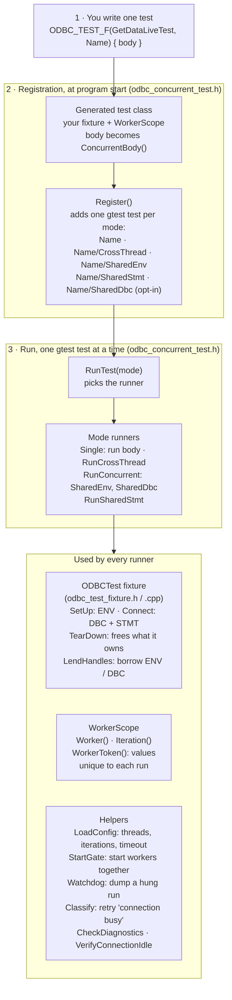

# Multithreaded Testing Plan

Concurrent ODBC use must not crash, deadlock, corrupt data, leak diagnostics
across handles, or leave a connection busy. PRs run every test single-threaded
plus a small Windows `SharedDbc` smoke run; nightly and weekly runs hunt races,
and multithreaded-only scenarios run weekly only.

## Approach

- **Shared-body tests (default).** A behavioral test is written once with
  `ODBC_TEST_F` in its API-group file, such as `get_data_test.cpp`, and also
  runs across threads. Separate multithreaded copies drifted from the
  single-threaded suite; the shared bodies found AB#49225 without new test
  logic.
- **Multithreaded-only scenarios** in `tests/e2e/tests/multithreaded_tests/`,
  for what has no single-threaded form: handle churn, faults and cancels under
  load, pooling, thread scale, a long haul, and races on one STMT. They run in
  the weekly stress profile only.

## Example

Converting a test changes only the macro:

```cpp
#include "odbc_concurrent_test.h"

// Before: TEST_F(GetDataLiveTest, ReadsAnInt) { /* same body */ }
ODBC_TEST_F(GetDataLiveTest, ReadsAnInt) {
    ASSERT_SQL_OK(ExecDirect("SELECT CAST(42 AS INT)"), SQL_HANDLE_STMT, stmt_);
    ASSERT_SQL_OK(SQLFetch(stmt_), SQL_HANDLE_STMT, stmt_);
    SQLINTEGER value = 0;
    ASSERT_SQL_OK(SQLGetData(stmt_, 1, SQL_C_SLONG, &value, 0, nullptr),
                  SQL_HANDLE_STMT, stmt_);
    EXPECT_EQ(42, value);
    SQLCloseCursor(stmt_);
}
```

The macro registers `Name` (exactly as `TEST_F`) plus `Name/CrossThread`,
`Name/SharedEnv`, and `Name/SharedStmt`; the file only has to be built by an
`add_odbc_test` target. A constant expected value would also pass if a result
reached the wrong connection, so derive it from the run:

```cpp
ODBC_TEST_F(GetDataLiveTest, EachRunReadsItsOwnValue) {
    const std::string token = WorkerToken("getdata");  // e.g. "getdata-w2-i7"
    ASSERT_SQL_OK(ExecDirect("SELECT CAST('" + token + "' AS VARCHAR(64))"),
                  SQL_HANDLE_STMT, stmt_);
    ASSERT_SQL_OK(SQLFetch(stmt_), SQL_HANDLE_STMT, stmt_);
    EXPECT_EQ(token, GetChar(1));  // another worker's row cannot match
    SQLCloseCursor(stmt_);
}
```

`/SharedDbc` is opt-in: `ODBC_TEST_F_MODES(Fixture, Name, odbc_concurrency::kAllModes)`.

## Modes

| Mode | What runs | Pass condition | Not for |
|---|---|---|---|
| `Single` | The body once, on the main thread | As `TEST_F` | - |
| `CrossThread` | SetUp, body, and TearDown on three different threads | As `TEST_F`; catches thread affinity | - |
| `SharedEnv` | `THREADS` workers x `ITERS` runs; shared ENV, own DBC and STMT | Every run passes | Tests that change ENV, pooling, or process state; connect, disconnect, or driver-load tests; fixed-name permanent objects; reliance on `HasFatalFailure()` |
| `SharedDbc` (opt-in) | `THREADS` workers x `ITERS` runs; shared DBC, own STMT | Only `HY000` connection busy may fail, and is retried; the connection is idle afterward | As `SharedEnv`, plus connection-attribute or transaction changes, shared temp-object names (`#temp` included), connection-level diagnostics, bodies unsafe to rerun or that hold the connection for seconds |
| `SharedStmt` | Owner runs the body `ITERS` times; `THREADS - 1` observers read its STMT and DBC diagnostics | Owner as `Single`; every record observers read is well formed | Bodies that free or replace `stmt_` or `dbc_` |

- `SharedEnv` and `SharedDbc` capture each run's failures on its own thread
  and re-report them with their original file and line, so one worker cannot
  stop another and `HasFatalFailure()` in the body does not see them.
- A `SharedDbc` attempt stops at its first busy or fatal failure, even inside a
  fixture helper such as `ODBCTest::ExecDirect`, and reruns the body from the
  start after a random backoff (1 ms doubling to 256 ms; a fixed 1 ms wait
  livelocked many-statement bodies). Retries stop at 80% of
  `MSSQL_ODBC_MT_TIMEOUT_SECONDS`, so a starved run fails with its last busy
  error before the watchdog fires. Bodies the Debug driver cannot finish at
  8 x 20 leave the mode out. `SKIP_MSODBCSQL_IN_MODE(mode)` skips only the
  msodbcsql leg.
- `SharedStmt` observers call only `SQLGetDiagRec` and `SQLGetDiagField`; any
  other call clears the owner's diagnostics. Bodies that cancel an idle
  statement use `CancelIdleStatement()`, which keeps observers out during
  `SQLCancel` (see Driver and Driver Manager facts).
- No mode runs a whole body on one shared STMT: a STMT holds one cursor, so
  concurrent bodies would consume each other's results even with a correct
  driver. Shared-STMT and descriptor races are scenario 15, which checks
  invariants instead of values.

## Architecture

At program start the macro registers one gtest test per mode; at run time each
test hands its body to the runner for its mode. Each concurrent run is a fresh
fixture that borrows the coordinator's ENV (and DBC in `SharedDbc`).



With `THREADS=3`, `ITERS=2`:

| Mode | `THREADS=3` means | Body runs | `Worker()`, `Iteration()` |
|---|---|---|---|
| `Single` | ignored | 1 | 0, 0 |
| `CrossThread` | ignored (3 threads taking turns) | 1 | 0, 0 |
| `SharedEnv`, `SharedDbc` | 3 workers in parallel | 6, at most 3 at once | (0..2, 0..1) |
| `SharedStmt` | 1 owner + 2 observers | 2, one after another | (0, 0..1) |

Threads create contention; iterations repeat it. AB#49225 reproduced reliably
at 8 x 20 but not at 4 x 2.

## Running and debugging

| Setting | Default | Meaning |
|---|---|---|
| `MSSQL_ODBC_MT_THREADS` | 2 | Threads running at once |
| `MSSQL_ODBC_MT_ITERS` | 1 | Runs of the body per thread |
| `MSSQL_ODBC_MT_TIMEOUT_SECONDS` | 300 | Hang watchdog for each phase: fixture `SetUp`, the run, fixture `TearDown` |
| `MSSQL_ODBC_MT_DUMP_DIR` | working directory | Where Windows minidumps go (hang, and in stress runs a crash or `abort()`) |
| `MSSQL_ODBC_MT_SKIP_MODES` | none | Comma-separated modes reported as skipped, e.g. `SharedDbc`; an unknown name fails every concurrent variant |
| `MSSQL_ODBC_MT_GDB` | 0 | Unix: `1` runs each `<name>_mt` entry under gdb, which prints every thread's stack if the process dies |
| `MSSQL_ODBC_MT_TERMINATE_UNDER_DEBUGGER` | 0 | `1` lets the watchdog end a traced process; set with `MSSQL_ODBC_MT_GDB` |

ctest runs each converted executable as `<name>` (single-threaded tests) and
`<name>_mt` (the concurrent variants, label `mt`), so a concurrency failure
never hides a parity verdict. CMake registers the pair for any source with an
`ODBC_TEST_F` or `ODBC_TEST_F_MODES` line. An MT-only executable registered
with `add_odbc_mt_only_test` gets just `<name>_mt` and reads the settings
itself; it is labelled `mt_weekly`, which only the weekly profile runs. Linux
and macOS build `<name>_mt` entries only with `ODBC_E2E_CONCURRENT=ON` (the
stress profiles set it; Windows builds them by default). Entries pass `--gtest_filter`, which overrides
`GTEST_FILTER`, so select by entry:

```bash
ctest -R '^get_data_test$'       # single-threaded only
ctest -L mt                      # every concurrent variant
./run_e2e.sh --mt-profile=nightly                       # 8 x 20, only <name>_mt
./run_e2e.ps1 -MtProfile weekly -CompareWithMsodbcsql   # 16 x 25, Windows

# One executable by hand (match mode suffixes: TEST_P names contain "/" too)
MSSQL_ODBC_MT_THREADS=8 MSSQL_ODBC_MT_ITERS=20 \
  ./get_data_test --gtest_filter='*/CrossThread:*/SharedEnv:*/SharedStmt:*/SharedDbc'
```

- Failures name their run, e.g. `SharedEnv worker=2 iteration=7`. The first
  failure stops all workers.
- On a hang the watchdog prints each worker's progress, then writes a minidump
  and exits 124 on Windows, or calls `abort()` elsewhere. It leaves a process
  alone under a debugger (or when it cannot tell) unless
  `MSSQL_ODBC_MT_TERMINATE_UNDER_DEBUGGER=1`.
- To tell a race from a plain bug, filter one variant at
  `MSSQL_ODBC_MT_THREADS=1 MSSQL_ODBC_MT_ITERS=1`.
- Break on `Worker()==3` rather than `--gtest_break_on_failure`, which also
  breaks on `SharedDbc`'s retried busy failures.

## Driver and Driver Manager facts

Measured on both drivers unless noted.

- A non-MARS connection serves one STMT at a time; another STMT gets `HY000`
  "Connection is busy".
- `SQLCancel` interrupts a running execute, fetch, `SQLGetData`,
  `SQLMoreResults`, `SQLPutData`, or final `SQLParamData` from another thread
  with `HY008` (msodbcsql's `SQLMoreResults` returns `SQL_NO_DATA`;
  [parity registry](parity-deviations.md) entry 27).
  `multithreaded_tests/cancel_test.cpp` covers each.
- An idle `SQLCancel` closes the cursor and releases the connection (AB#49386);
  every close abandons a pending response with ATTENTION (AB#49495). The driver
  returns `01S05`, which both Driver Managers suppress.
- Every non-diagnostic call, including an idle `SQLCancel`, clears the handle's
  diagnostics; a cross-thread `SQLCancel` preserves the interrupted call's.
- **The Windows Driver Manager serializes calls per handle.** A second call on
  a busy STMT, or on a descriptor associated with it, waits; only `SQLCancel`
  bypasses the lock. So an idle `SQLCancel` can overlap a STMT diagnostic read
  that holds msodbcsql's `csStmt`; msodbcsql then takes its cross-thread path
  and skips the cursor close (37 of 300 `SharedStmt` runs without the
  `CancelIdleStatement()` gate, 0 of 300 with it).
- **The Windows Driver Manager deadlocks on explicit descriptors.**
  `SQLSetStmtAttr` on a STMT with an explicit descriptor (`odbc32!LockDescStmt`)
  and a concurrent `SQLGetDiagField` on that STMT or its DBC (`EnterDbcCS`)
  hang forever, on both drivers. Such tests use `kExplicitDescriptorModes`,
  without `SharedStmt`.
- **unixODBC `Threading`:** 0 none, 1 per handle, 2 per DBC, 3 global (which
  also locks `SQLCancel`). The runners set 1 for both legs. No level protects a
  handle's diagnostic list in released unixODBC (2.3.14 and earlier): every
  call frees it before taking the handle lock, so a `SharedStmt` observer can
  follow a freed record ([unixODBC #243](https://github.com/lurcher/unixODBC/issues/243),
  fixed on master in `ea454e49`, unreleased). With 2.3.9 it crashed or
  returned garbage SQLSTATEs in every PR-profile run; a master build passed 8
  of 8. Until CI uses a fixed build (AB#49575), Unix profiles skip
  `/SharedStmt`, and #758 leaves two GetData streaming tests unregistered
  there. `MSSQL_ODBC_MT_SKIP_MODES=none` opts back in.
- **Effect on the modes:** with either Driver Manager, calls on one handle
  never reach the driver concurrently, except `SQLCancel`. `SharedDbc` reaches
  it concurrently through STMTs on one DBC; `SharedStmt` only through its DBC
  diagnostic reads, so it checks crashes, malformed records, and wrong-thread
  access, not same-STMT races.

## Scenarios

### Shared-body (API-group files)

1. **Typed payload integrity** (`SharedEnv`): every SQL Server type, including
   `sql_variant`, legacy LOBs, XML, optional JSON, and max-length values, with
   per-run values. Max-length values stream in small `SQLGetData` chunks, each
   truncated chunk filling the buffer (splitting a UTF-8 character if needed)
   with a counting-down or `SQL_NO_TOTAL` indicator. Edge cases: NULL and
   empty values, length probes, abandoned partial reads, mid-row close,
   surrogate pairs across chunks, typed-to-character conversions, multiple
   results, long row streams. `vector` waits for a fetch contract.
2. **Parameters** (`SharedEnv`): prepared reuse and rebinding, data-at-execution
   (including cancel of a partial stream), row- and column-wise arrays with
   statuses, output and return-value parameters, parameterized errors that stay
   on their STMT. TVPs, `vector`, UDTs, and output or data-at-execution
   parameters in arrays wait for driver support.
3. **Shared DBC** (`SharedDbc`): the eligible tests from 1 and 2. Array DML
   stays out until a busy retry cannot duplicate rows.
4. **Shared STMT diagnostics** (`SharedStmt`): every converted test.
5. **Thread handoff** (`CrossThread`): every converted test.
6. **Diagnostics isolation** (`SharedEnv`, `SharedDbc`): concurrent errors
   appear only on their own handle and clear on successful reuse.

### Multithreaded-only (`tests/multithreaded_tests/`)

Purpose-built workloads using the same settings, start gate, and watchdog.
They register with `add_odbc_mt_only_test`, so only the weekly stress profile
runs them. Each checks exact per-run results (a worker token) and recovery,
not only the absence of a crash. Each ENV runs all its connections on one
Tokio worker thread, so one slow, failed, or cancelled connection could stall
or corrupt the others; the highest-value scenarios check that it cannot. All
run against a real SQL Server; a mock TDS server is only for exact protocol
sequences.

Ordered by value; the backlog is done top-down.

| # | Scenario | Checks | Value | Needs | Status |
|---|---|---|---|---|---|
| 7 | **Handle churn** (`handle_lifecycle_test.cpp`) | Threads allocate, connect, query, disconnect, and free ENV/DBC/STMT trees, on private ENVs and on one shared ENV: 20 rounds, 8,000 trees per test weekly. On the shared ENV, THREADS / 4 spinner threads allocate, set an attribute on, and free STMTs on their own connections throughout (DBC and ENV allocations reach the driver only at connect through a Driver Manager), so handle registration overlaps the churn. Thread and handle (fd) counts after the last round match those after round 0. | Catches runtime, socket, and thread leaks that successful API calls hide; a leaked ENV runtime fails it | - | Implemented (AB#49261) |
| 8 | **Killed or stalled connection under load** (`fault_recovery_test.cpp`) | THREADS - 1 workers query nonstop on the shared ENV while a victim on that ENV is faulted. Killed: an admin connection `KILL`s it, alternately idle and mid-`WAITFOR`; an idle victim recovers (new `connect_time`) and returns its token, an executing one fails within 10 s and frees cleanly. Stalled: the victim reads 8 MB through `TcpPauseProxy`, which holds the response mid-value for 15 s without closing; the read stays blocked, then delivers every byte. Healthy workers never fail or wait over 8 s between queries. | One dead connection must not stall or break the others sharing its runtime; covers Idle Connection Resiliency under load | `VIEW SERVER STATE`, `ALTER ANY CONNECTION`; `ODBC_TEST_SERVER` for the stall proxy | Implemented (AB#49261) |
| 9 | **Timeout and cancel churn** (`fault_recovery_test.cpp`) | Each worker keeps a connection and in turn times out a `WAITFOR` (`HYT00`), has another thread cancel one once the server shows it running (`HY008`), cancels a data-at-execution stream, or has another thread cancel a 20,000-row read at a random point (before send, mid-execute, mid-fetch, between fetches, or after the last row; any valid outcome); then selects its token on the same STMT. Every fault runs at any profile size; counts return. | Recovery paths most likely to leave a connection busy or leak results, diagnostics, or tasks | `VIEW SERVER STATE` | Implemented (AB#49261) |
| 10 | **Failed-connect churn** (`handle_lifecycle_test.cpp`) | Four in five logins fail - unknown login, unknown database, refused port, a listener that never answers (1 s login timeout) - interleaved with real logins on private and shared ENVs. Each reports its SQLSTATE in bounded time; counts return. | Partly built connections are a common leak and hang source; real logins must be unaffected | - | Implemented (AB#49261) |
| 11 | **Pooled reuse under load** | Driver Manager pooling with the reset `connection_pool_test.cpp` checks single-threaded. A borrower never sees the previous one's SET options, temp tables, transaction, or database; reuse is proven (same SPID), or the test passes trivially. | Session state leaking between borrowers is a correctness and security bug | DM pooling on both platforms | Backlog |
| 12 | **Thread scale and mixed workloads** | 8-10 at 128 and 512 threads on one ENV; short queries alongside LOB streams and parameter arrays, each worker making progress. | Starvation and deadlock on the ENV's single runtime worker | Configuration of 8-10 plus a mixed workload | Backlog |
| 13 | **Process-global authentication caches** | Concurrent connects through Entra and MSQA authentication. | Their credential and context caches are process-wide | Credentials in the stress pipeline | Blocked |
| 14 | **Long haul** (AB#49795) | Random operations from 7-12 (LOB stream, parameter array, catalog call, prepare and execute, cancel, reconnect, kill) for hours, against a server with injected latency. Tokens checked; thread, handle, socket, and memory counts plateau. | Slow leaks and rare interleavings that bounded runs miss | Separate weekly job | Backlog |
| 15 | **One STMT, or one explicit APD, shared across threads** | Races on one STMT (execute, fetch, `SQLGetData`, `SQLMoreResults`, close, bindings, attributes, its descriptors) and read-only metadata calls; or STMTs on one DBC sharing an APD with read-only buffers. Only success, `SQL_NO_DATA`, `HY010`, `24000`, busy, or `HY008`; self-checking values; a reset STMT returns exact values afterwards. | Memory safety at the FFI boundary. Ranked low: apps rarely do this, handle mutexes serialize it, and failures are often ambiguous | Direct driver loading (Driver Managers serialize same-handle calls); ThreadSanitizer (AB#49259) | Backlog |
| 16 | **Disconnect or free during use** | `SQLDisconnect` or `SQLFreeHandle` racing an in-flight call on a child or the same handle. | Applications reach it through timeout cleanup and finalizers; a known crash class | Reference-counted or generation-checked handle lifetimes | Blocked |
| 17 | **Tracing toggled under load** | Tracing switched on and off while other threads run queries. | Process-wide state changed mid-call | - | Backlog |

- The `KILL` and the deterministic cancel wait until the server shows the
  request running, so they do not depend on sleeps. The random cancel covers
  the other timings: its delay spans 0-120% of that connection's measured
  uncancelled read. At 16 x 50 it ended as completed 242, mid-execute 8,
  mid-fetch 135, and closed cursor 215 on mssql-odbc.
- The stall limit (8 s against a 15 s hold) sits above agent noise: on a
  16-core dev box with a local server, healthy queries occasionally took 2-5 s
  on both drivers with no fault at all (a victim that only slept), and the
  server showed them running, not waiting. Blocking the ENV runtime's worker
  on a stalled read (a mutation) made healthy queries wait 40 s with a 3 s
  hold, and hung the run past its watchdog with a 15 s hold.
- Scenarios pick each run's case from its index across all rounds, and add
  rounds when needed, so every case runs even at the msodbcsql leg's 2 x 1.
- msodbcsql recovers a killed idle connection only once its socket has seen the
  reset (a request sent earlier fails with `08S01`), so 8 waits 1 s after the
  `KILL`, as `session_recovery_test.cpp` does.
- In 10, Windows retries a refused TCP connect for about 2 s, longer than the
  1 s login timeout, so both drivers end at the timeout: mssql-odbc reports
  only `HYT00`, msodbcsql reports `08001`, `HYT00`, `08001`. Elsewhere a
  refused connect fails at once. msodbcsql also lists `28000` before an
  unknown database's `42000`. The test accepts the expected state in any
  record. The first-record difference is undecided, so it is not in
  [parity-deviations.md](parity-deviations.md).
- Not tested end to end: two connects racing on one DBC. The driver's unit test
  `connect_on_connected_dbc_fails_without_poisoning_it` covers its guard
  (`HY010`, the live connection kept). The Windows Driver Manager rejects the
  second call with `08002` before the driver sees it. unixODBC 2.3.9 releases
  its lock mid-connect when it switches a new DBC from level 3 to the driver's
  `Threading` (`dbc_change_thread_support`), so both calls connect and the
  process then hangs or crashes on both drivers (measured in CI).

### Priorities

Converted suites are a cheap regression net, not a race hunt: the fetch and
GetData suites passed at 16 x 50 with nothing found. `SharedEnv` workers share
only the ENV's runtime, the handle registry, and one-time settings;
`SharedStmt` reaches the driver only through DBC diagnostics; `CrossThread`
finds only thread affinity; and a local server keeps race windows small. The
one driver race found so far, AB#49225, came from `SharedDbc`. Order of effort:

1. `SharedDbc` opt-ins (scenario 3; fetch and GetData with AB#49260,
   parameters and execution with AB#49258).
2. The multithreaded-only backlog, top-down from scenario 11.

## Stress Profiles

| Profile | Where | Driver | Threads x iterations | Modes run | Retries |
|---|---|---|---|---|---|
| PR | validation pipeline, every PR | both | 2 x 1 | Windows: `SharedDbc` only; Linux, macOS: none (not built) | 3 |
| Nightly (temporary) | `.pipeline/odbc-stress-pipeline.yml`, Mon-Sat 02:00 UTC | mssql-odbc | 8 x 20 | all; unixODBC skips `SharedStmt` | 0 |
| Weekly | same, Sun 02:00 UTC | mssql-odbc | 16 x 25 | same as nightly | 0 |
| Nightly, weekly | same, Windows leg | msodbcsql | 2 x 1 | same as nightly | 0 |

- Stress legs: Windows x64 (Debug driver, Windows DM), Ubuntu 24.04 and
  Alpine 3.21 (release drops, unixODBC `Threading=1`). They run only the
  `<name>_mt` entries. Entries labelled `mt_weekly` (every multithreaded-only
  entry) run only in the weekly profile. A variable already set in the
  environment overrides the profile.
- Each leg builds once, then runs four parallel jobs (fetch, parameters,
  metadata, and the remaining suites), each on its own agent and SQL Server;
  see the Windows
  [prebuilt runner commands](../tests/e2e/README.md#windows-stress-jobs). The
  groups' regexes are shared by all three legs (`odbc-stress-pipeline.yml`),
  and the remaining-suites group is their complement, so a newly converted
  suite is still run. Jobs allow 240 minutes weekly and 120 nightly; each ctest
  entry still has 60. Run serially at 16 x 50, the Linux weekly needed about 280 minutes
  (build 188696, cancelled at 240); split, its largest group (parameters) has
  about 90 minutes of tests.
- Weekly is 16 x 25, not 16 x 50: once the fetch and parameter suites ran in
  every mode (#756, #780), 16 x 50 needed about 5,300 s for
  `get_data_test_mt` and 4,500 s for `param_conversions_test_mt`, past the
  3,600 s per-entry limit (build 189118). Run time scales with threads x
  iterations, so 16 x 25 halves it and keeps the 16-thread width that
  separates weekly from nightly; iterations mostly repeat interleavings.
- Nightly flushes out obvious races while suites convert. It started
  2026-10-28; remove its schedule once its findings are fixed (target
  mid-November). PR and weekly remain. Nightly failures need a named triage
  owner.
- PRs do not hunt races. They run only `/SharedDbc`, only on Windows, where
  2 x 1 catches opt-ins unfit for concurrency (fixed object names,
  process-wide settings) in the PR that adds them; every mode on macOS cost up
  to 48 minutes (build 188193). Run a new test's `_mt` entry locally in every
  mode before review.
- msodbcsql's stress leg checks that tests suit the modes, not its thread
  safety.
- Cost, Windows, local server, Debug driver: 16 x 50 costs about 5 s per
  converted test, mostly `SharedEnv` connects. The fetch and GetData suites
  (AB#49260, 1,547 variants) take about 50 s (mssql-odbc) and 72 s (msodbcsql)
  at 2 x 1, 13 minutes at 8 x 20, and 33 minutes at 16 x 50 before their
  `SharedDbc` opt-ins. `handle_lifecycle_test_mt` and `fault_recovery_test_mt`
  take about 90 s and 160 s on mssql-odbc at 16 x 50.

## Validation and evidence

- Compare independent-connection outcomes with msodbcsql; compare shared-handle
  scenarios by invariants, not interleavings. Sanitizer builds instrument both
  the Rust driver and the C++ harness.
- **Windows:** ctest's job object kills a crashing test before Windows Error
  Reporting can dump it, so stress runs set `GTEST_CATCH_EXCEPTIONS=0` and
  `MSSQL_ODBC_MT_DUMP_DIR`, and the harness writes minidumps on a crash,
  `abort()`, or hang. They are published as `OdbcMtDumps_Windows_*` with the
  driver, the `<name>_mt` executables, and their PDBs. `__fastfail` exits
  (`/GS`, a Rust abort) leave only `0xC0000409`.
- **Unix:** stress runs start each `<name>_mt` entry under gdb
  (`run_mt_test.sh`), which prints every thread's stack on a crash, `abort()`,
  or watchdog timeout. The stress drops keep the driver's symbols.
- **Assertion failures leave no dump.** Rerun the stress pipeline with
  `driverTrace` on for Rust driver traces (`OdbcDriverTraces_*`); scheduled
  runs keep it off because tracing changes timing.
- **Agent load:** every stress leg samples CPU, run queue, memory, and
  `sqlservr` or container CPU once a second (`OdbcLoad_*`), to tell agent
  starvation from a driver delay.
- An entry whose variants are all skipped exits 77, so it reports as skipped,
  not passed.
- msodbcsql has failed or exited without a result a few times at 8 x 20 and
  above (one `0xC0000409` in 41 runs; two in about 16 runs at 16 x 50), none
  reproducible; dumps will tell a harness bug from a reference-driver one.
- `check/msodbcsql_types_check.cpp` fails the build where `msodbcsql.h` is
  found and disagrees with `include/odbc_sql_server_types.h`.

## Migration

Tracked under AB#49256:

1. **AB#49257 (PR #709, merged):** the harness with all five modes and the
   `get_data_test.cpp` pilot.
2. **AB#49263 (PR #750, merged):** CTest split, PR filter, nightly and weekly
   profiles, crash and hang evidence, `msodbcsql.h` type check. PR #778 skips
   unixODBC `/SharedStmt` in PR runs until AB#49575.
3. **AB#49260 (PR #756, merged):** every `TEST_F` in the fetch and GetData
   suites, with worker-token tests; 356 of 400 also in `SharedDbc`. Each file
   records its exclusions (ENV ODBC-version fixtures, explicit-descriptor
   tests, `#temp` and session-state bodies, three that starve on the Debug
   driver, msodbcsql-only `SQLCloseCursor` busy behavior).
4. **AB#49258 (PR #780, merged):** every test in the parameter and execution
   suites (431), with worker-token tests; 315 also in `SharedDbc`. Plus the
   remaining `cancel_test.cpp` cases: cancel just before execute, a fetch
   blocked by another connection's row lock, and `SQLGetData` blocked
   mid-PLP.
5. **AB#49262:** diagnostics, descriptor, metadata, and attribute suites;
   scenario 6.
6. **AB#49261 (PR #796):** scenarios 7-10, and the driver's same-DBC connect
   guard (unit test).
7. **AB#49795:** scenario 14.
8. **AB#49259:** scenario 15 under ThreadSanitizer.
9. Not yet tracked: scenarios 11-13, 16, and 17.

## Deferred

- **Disconnect or free during use:** scenario 16, once handle lifetimes are
  reference-counted or generation-checked.
- **Async execution and MARS:** once the driver supports them.
