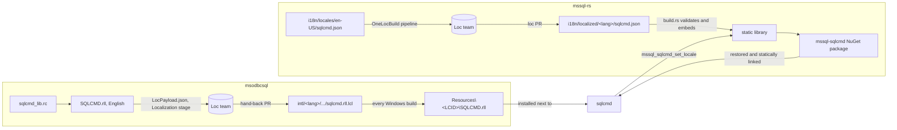

# Localization

This guide explains, end to end, how sqlcmd's text is translated: the two
sources of text, how each reaches the translators and comes back, how the
translations travel in the `mssql-sqlcmd` NuGet package and native sqlcmd, how
one language is chosen at run time, and what has to happen before users see
translated text.

## The two sources of text

When native (ODBC) sqlcmd runs `sqlcmd diagnose`, what it prints comes from two
places, each with its own translations:

| Text | Example | English source | Translations |
|---|---|---|---|
| Native sqlcmd's own messages (C++, msodbcsql repository) | `Sqlcmd: Error: diagnose : --depth needs a value; ...`, the usage text, `Msg 18456, Level 14, State 1` | `Sql/utils/sqlcmd/common/resource/sqlcmd_lib.rc`, compiled into the resource DLL `SQLCMD.rll` | `intl/<lang>/Loc/sql/lcl/sqlcmd.rll.lcl`, one file per language |
| This crate's text (the diagnose text report) | `Connection input      PASSED`, `Outcome:   passed (exit code 0: ...)` | `i18n/locales/en-US/sqlcmd.json` (the message catalog) | `i18n/localized/<lang>/sqlcmd.json` |

In both, code refers to a message by its id (a resource number such as 111, or a
catalog id such as `diagnose.check.connection_input`) and gets the text in the
current language; translators never edit code. Both are translated into the same
13 languages: `cs-CZ`, `de-DE`, `es-ES`, `fr-FR`, `it-IT`, `ja-JP`, `ko-KR`,
`pl-PL`, `pt-BR`, `ru-RU`, `tr-TR`, `zh-CN` and `zh-TW`.

## Native sqlcmd's messages (msodbcsql)

1. A developer adds an English string to `sqlcmd_lib.rc`, with its id in
   `sqlcmd_lib.h`.
2. The **Localization** stage of the msodbcsql build puts the English
   `SQLCMD.rll`, the list of its strings (`SQLCMD.rll.lcg`) and
   **`LocPayload.json`** in the `LocalizationFiles` artifact. `LocPayload.json`
   tells the localization team which files to translate, into which languages.
3. The localization team translates new and changed strings and opens a
   hand-back pull request that updates the `.lcl` files.
4. Every Windows build applies each language's `.lcl` file to the English
   `SQLCMD.rll`, producing `Resources\<LCID>\SQLCMD.rll` (`1031` German, `1041`
   Japanese, ...). A string with no translation yet stays English in that
   language's DLL.

Native sqlcmd on Linux and macOS ships only English resources.

## This crate's text (mssql-rs)

1. Every human-readable sentence of the text report is a message in
   `i18n/locales/en-US/sqlcmd.json`, with a stable dotted id, the English text
   and named `{placeholders}`. The format is the one go-sqlcmd uses (`language`,
   `messages[] {id, message, translation, placeholders}`), so the same
   localization tooling (the JSON parser, `i18n/P306PairNamesToProcess.lss`)
   handles it.
2. `.pipeline/OneBranch/MssqlSqlcmdLocBuild.yml` runs the `OneLocBuild@2` task
   when the en-US catalog changes on `main`, and weekly. It sends the catalog
   for translation into the languages of `i18n/LocProject.json`.
3. Translations come back as a pull request that adds or updates
   `i18n/localized/<lang>/sqlcmd.json`. Do not edit those files by hand.
4. When the crate is compiled, `build.rs` reads every catalog, validates it, and
   generates static tables compiled into the library, plus a `qps-ploc`
   pseudo-locale for testing.

`build.rs` fails the build for content defects: a wrong `language`, duplicate
ids, placeholders that do not match English. It only warns, without failing,
for what a localization drop can get wrong in passing: a folder that is not one
of the 13 languages (skipped), an id en-US no longer has (skipped), and a
translation that changed the leading or trailing spacing or punctuation a
message is joined with (kept). A unit test keeps the `Languages` of
`LocProject.json` equal to the locales the build embeds.

## How the translations travel

This crate's translations are **inside the compiled library**: there are no
language files to install and nothing is read from disk at run time.

1. The official build compiles the crate for every runtime (`win-x64`,
   `win-x86`, `win-arm64`, `linux-x64`, `linux-arm64`, `linux-musl-x64`,
   `linux-musl-arm64`, `osx-x64`, `osx-arm64`). Each compile runs `build.rs`, so
   each static library carries all 13 translations and English, about 630 KB in
   all for the x64 library.
2. The NuGet package holds `include/mssql_sqlcmd.h` and, per runtime,
   `runtimes/<rid>/native/` with the static library and
   `native-static-libs.txt`.
3. Native sqlcmd restores the package and links the library statically, so the
   translations become part of the sqlcmd binary.

Native sqlcmd's own translations, by contrast, are separate files
(`Resources\<LCID>\SQLCMD.rll`) that the installer puts next to `sqlcmd.exe`.

## Choosing the language at run time

On Windows, when sqlcmd starts:

1. It reads the user's display language (`GetUserDefaultUILanguage`); Hong Kong
   (3076) is taken as Traditional Chinese (1028).
2. It loads `Resources\<LCID>\SQLCMD.rll`, falling back to English when that
   language has no translation.
3. It reads the LCID from the folder of the `SQLCMD.rll` it actually loaded
   (`Resources\1031\SQLCMD.rll` is 1031; the English fallback is 1033) and
   passes it to this crate with `mssql_sqlcmd_set_locale`.
4. The crate maps the LCID to a catalog (1031 is `de-DE`; 1034 and 3082 are
   `es-ES`; 2052 is `zh-CN`; 1028 is `zh-TW`) and renders the text report in it.

So the report is always in the same language as sqlcmd's own messages. A
language outside the 13 (Danish, 1030, for example, where the build ships an
English copy of `SQLCMD.rll`) gives English everywhere;
`mssql_sqlcmd_set_locale` then returns `MSSQL_SQLCMD_INVALID_ARGUMENT` but still
selects English, and native sqlcmd ignores the return value. A message without a
translation falls back to English on its own, so a partly translated catalog
never breaks the output.

On Linux and macOS native sqlcmd passes 1033, so the report is English like the
rest of sqlcmd, whatever `LANG` says.

A host that never calls `mssql_sqlcmd_set_locale` gets the locale from
`SQLCMD_LANG`, `LC_ALL`, `LC_MESSAGES`, then `LANG`, and on Windows finally
`GetUserDefaultUILanguage()`. Values may be BCP-47 (`de-DE`), POSIX
(`de_DE.UTF-8`) or an LCID in decimal or hex (`1031`, `0x0407`). Another region
of a translated language takes its translation (`es-MX` is `es-ES`, `zh-HK` is
`zh-TW`, `pt` is `pt-BR`). Locale selection is process-wide.

| Machine | `SQLCMD.rll` loaded | Crate locale | Text report |
|---|---|---|---|
| Windows, German | `Resources\1031` | `de-DE` | German |
| Windows, Spanish (3082) | `Resources\3082` | `es-ES` | Spanish |
| Windows, Hong Kong (3076) | `Resources\1028` | `zh-TW` | Traditional Chinese |
| Windows, Danish | `Resources\1030` (English copy) or the English fallback | `en-US` | English |
| Linux, `LANG=de_DE.UTF-8` | `en_US` | `en-US` | English |

## What is and is not localized

Localized: every sentence of the **text report** (headers, check names,
statuses, details, findings, the outcome, skip reasons, limitations, the
sharing warning, and sqlcmd's own `Sqlcmd: Error: ... : ...` line around a
driver message).

Not localized:

- The **JSON report** (`--format json`) is for tools: its prose
  (`exitCategory.meaning`, `checks[].detail`, findings, errors, limitations,
  the specialist note and `sharingWarning`) is always the canonical en-US text.
- JSON keys, enum and status values, check and depth ids, codes and exit codes.
- Text from SQL Server, the operating system or `mssql-tds`, which arrives in
  its own language.
- The ODBC driver's wording the error lines reuse (`TCP Provider: ...`,
  `Named Pipes Provider: ...`, SNI's errors, the driver's summaries, in text and
  in `errors[].text`): it stays the en-US driver's, verbatim, in every locale.

Existing formatter strings are being moved to the catalog incrementally; only
catalog-backed messages are localized today.

## Adding or changing a message

1. Add the message to `i18n/locales/en-US/sqlcmd.json` (insert it; keep the
   file's order and trailing newline), with its id, English text and
   placeholders, and render it through the catalog in code.
2. Check that nothing bypasses the catalog: run with `SQLCMD_LANG=qps-ploc`.
   Every catalog string is wrapped in `[!!! ... !!!]`; any plain English left in
   the text report is not catalog-routed.
3. Merge to `main`. The localization pipeline sends the change for translation;
   until the translations come back, that message shows in English.

## Before users see translated text

Merging the code makes translation possible; the localization teams and the
packaging make it happen. Until each step below is done, users see English,
never broken output.

### This crate (mssql-rs)

1. **Set up the localization pipeline.** The OneLocBuild extension is already
   installed in the Azure DevOps organization that runs the mssql-rs pipelines.
   Still to do:
   - install the OneLocBuild GitHub App on `microsoft/mssql-rs`, which opens the
     localization pull request, as for go-sqlcmd (or give the task a GitHub
     token through `gitHubPatVariable`);
   - create the pipeline from `.pipeline/OneBranch/MssqlSqlcmdLocBuild.yml`;
   - confirm with the localization team the language set and the package feed
     for `dependencyPackageSource`. The file names the feed go-sqlcmd uses, which
     is in another Azure DevOps organization, so this pipeline's
     `System.AccessToken` may not be able to read it.
2. **First run:** queue it with `createPullRequest` set to false to check that
   the catalog is extracted, then run it normally.
3. **Merge the localization pull request** that adds
   `i18n/localized/<lang>/sqlcmd.json`. CI compiles the crate, which validates
   every catalog; look for `cargo:warning`s from `build.rs` in the build output.
4. **Release a new `mssql-sqlcmd` version** after that merge, so the package
   carries the translations (see the
   [maintainer guide](../../docs/mssql-sqlcmd-release-management.md)).

### Native sqlcmd (msodbcsql repository)

5. **Send `SQLCMD.rll` for translation.** `LocPayload.json` must list
   `SQLCMD.rll` for the 13 languages, and the localization team must know that
   sqlcmd strings are now part of the hand-off. `SQLCMD.rll` used to be built
   and localized but not handed off, so its newest strings, the diagnose
   messages among them, have never been translated.
6. **Merge the hand-back pull request** that updates
   `intl/<lang>/Loc/sql/lcl/sqlcmd.rll.lcl`.
7. **Move native sqlcmd to the release from step 4** (the version of the
   package it pins) and turn the library on in its build.
8. **Ship the translated resources on Windows.** Every Windows build produces
   `Resources\<LCID>\SQLCMD.rll`, but the sqlcmd installer project in the
   msodbcsql repository installs only `Resources\1033`. The package that ships
   native sqlcmd on Windows must install every `Resources\<LCID>` folder next to
   `sqlcmd.exe`. Without them sqlcmd loads English and passes 1033 to this crate,
   so both halves stay English whatever the display language.

### Verify

9. On Windows with a translated display language, German for example:
   `sqlcmd -?` and sqlcmd's own errors are in German, `sqlcmd diagnose` prints
   its text report in German, and `sqlcmd diagnose --format json` is English.
   With a language outside the 13 (Danish), everything is English. On Linux and
   macOS everything is English.

The two sides can land at different times. Until both are translated, a user may
see their language in native messages and English in the report, or the
reverse; never broken output.

## Keeping translations current

- A new or changed catalog message: merge it to `main`. The pipeline sends it
  (when the en-US catalog changes, and weekly), the next localization pull
  request brings it back, and the next release ships it. Until then it is
  English.
- A new native string: add it to `sqlcmd_lib.rc`; the next localization hand-off
  of the msodbcsql build sends it.
- Never edit `i18n/localized/` or the `.lcl` files by hand.

## Later: Linux and macOS

Native sqlcmd ships only English resources on Linux and macOS and passes 1033, so
the report is English there. To translate sqlcmd on Linux and macOS, native
sqlcmd has to ship translated resources there and pass their language. This
crate needs no change: its catalogs are already in every runtime's library, and
it follows `SQLCMD_LANG`, `LC_ALL`, `LC_MESSAGES` and `LANG` when the host does
not set a locale.