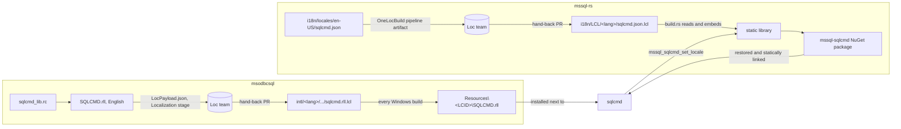

# Localization

This guide explains, end to end, how sqlcmd's text is translated: the two
sources of text, how each reaches the translators and comes back, how the
translations travel in the `mssql-sqlcmd` NuGet package and native sqlcmd, how
one language is chosen at run time, and what has to happen before users see
translated text.

## The two sources of text

When native (ODBC) sqlcmd runs `sqlcmd diagnose`, what it prints comes from two
places, each with its own translations:

| Text | Example | English source | Translations |
|---|---|---|---|
| Native sqlcmd's own messages (C++, msodbcsql repository) | `Sqlcmd: Error: diagnose : --depth needs a value; ...`, the usage text, `Msg 18456, Level 14, State 1` | `Sql/utils/sqlcmd/common/resource/sqlcmd_lib.rc`, compiled into the resource DLL `SQLCMD.rll` | `intl/<lang>/Loc/sql/lcl/sqlcmd.rll.lcl`, one file per language |
| This crate's text (the diagnose reports' prose, text and JSON) | `Connection input      PASSED`, `Outcome:   passed (exit code 0: ...)` | `i18n/locales/en-US/sqlcmd.json` (the message catalog) | `i18n/LCL/<lang>/sqlcmd.json.lcl`, one file per language |

In both, code refers to a message by its id (a resource number such as 111, or a
catalog id such as `diagnose.check.connection_input`) and gets the text in the
current language; translators never edit code. Both are translated into the same
10 languages, the ones sqlcmd's Windows installer ships: `de-DE`, `es-ES`,
`fr-FR`, `it-IT`, `ja-JP`, `ko-KR`, `pt-BR`, `ru-RU`, `zh-CN` and `zh-TW`. (The
msodbcsql repository also has Czech, Polish and Turkish translations of
`SQLCMD.rll`, which the installer does not ship; sqlcmd, and so the report, is
English there.)

## Native sqlcmd's messages (msodbcsql)

1. A developer adds an English string to `sqlcmd_lib.rc`, with its id in
   `sqlcmd_lib.h`.
2. The **Localization** stage of the msodbcsql build puts the English
   `SQLCMD.rll`, the list of its strings (`SQLCMD.rll.lcg`) and
   **`LocPayload.json`** in the `LocalizationFiles` artifact. `LocPayload.json`
   tells the localization team which files to translate, into which languages.
3. The localization team translates new and changed strings and opens a
   hand-back pull request that updates the `.lcl` files.
4. Every Windows build applies each language's `.lcl` file to the English
   `SQLCMD.rll`, producing `Resources\<LCID>\SQLCMD.rll` (`1031` German, `1041`
   Japanese, ...). A string with no translation yet stays English in that
   language's DLL.

Native sqlcmd on Linux and macOS ships only English resources.

## This crate's text (mssql-rs)

One pull request per round of translations, as in the msodbcsql repository:

1. A developer merges an English string: every human-readable sentence of the
   diagnose reports is a message in `i18n/locales/en-US/sqlcmd.json`, with a
   stable dotted id, the English text and named `{placeholders}`. The format is
   the one go-sqlcmd uses (`language`, `messages[] {id, message, translation,
   placeholders}`), so the same localization tooling (the JSON parser,
   `i18n/P306PairNamesToProcess.lss`) handles it.
2. `.pipeline/OneBranch/MssqlSqlcmdLocBuild.yml` (pipeline 2360) runs the
   `OneLocBuild@2` task when the en-US catalog changes on `main`, and weekly.
   It publishes the `drop_Localization_OneLocBuild` artifact (`sqlcmd.json`, the
   generated `.lcg` listing every message, and `LocPayload.json`) for
   translation into the languages of `i18n/LocProject.json`. It never opens a
   pull request.
3. The localization team translates and opens **one** hand-back pull request
   that adds or updates `i18n/LCL/<lang>/sqlcmd.json.lcl`, one file per
   language. Do not edit these files by hand.
4. Once that is merged, compiling the crate runs `build.rs`, which reads the
   `.lcl` files directly and compiles the translations into the library as
   static tables, plus a `qps-ploc` pseudo-locale for testing.
5. A new `mssql-sqlcmd` NuGet release carries them, and the msodbcsql
   repository moves native sqlcmd to that release.

A `.lcl` file names each string by its position in the en-US catalog
(`messages[N].translation`) and records the English it was translated from.
`build.rs` uses a translation only while that English is still the message at
position N and the translation has the same `{placeholders}`. A stale
translation (the English was reworded, moved or removed since), one with other
placeholders, a string not translated yet and a missing `.lcl` file all leave
English, with a `cargo:warning` naming them (one for all missing files); a
translation that changed the leading or trailing spacing or punctuation a
message is joined with is kept, and named too. None of these fails the build:
only defects in the en-US catalog itself do (duplicate ids, placeholder
metadata that does not match the text). A unit test keeps the `Languages` of
`LocProject.json` equal to the locales the build embeds.

## How the translations travel

This crate's translations are **inside the compiled library**: there are no
language files to install and nothing is read from disk at run time.

1. The official build compiles the crate for every runtime (`win-x64`,
   `win-x86`, `win-arm64`, `linux-x64`, `linux-arm64`, `linux-musl-x64`,
   `linux-musl-arm64`, `osx-x64`, `osx-arm64`). Each compile runs `build.rs`, so
   each static library carries all 10 translations and English.
2. The NuGet package holds `include/mssql_sqlcmd.h` and, per runtime,
   `runtimes/<rid>/native/` with the static library and
   `native-static-libs.txt`.
3. Native sqlcmd restores the package and links the library statically, so the
   translations become part of the sqlcmd binary.

Native sqlcmd's own translations, by contrast, are separate files
(`Resources\<LCID>\SQLCMD.rll`) that the installer puts next to `sqlcmd.exe`.

## Choosing the language at run time

On Windows, when sqlcmd starts:

1. It reads the user's display language (`GetUserDefaultUILanguage`); Hong Kong
   (3076) is taken as Traditional Chinese (1028).
2. It loads `Resources\<LCID>\SQLCMD.rll`, falling back to English when that
   language has no translation.
3. It reads the LCID from the folder of the `SQLCMD.rll` it actually loaded
   (`Resources\1031\SQLCMD.rll` is 1031; the English fallback is 1033) and
   passes it to this crate with `mssql_sqlcmd_set_locale`.
4. The crate maps the LCID to a catalog (1031 is `de-DE`; 1034 and 3082 are
   `es-ES`; 2052 is `zh-CN`; 1028 is `zh-TW`) and renders the reports in it.

So the report is always in the same language as sqlcmd's own messages. A
language outside the 10 (Danish, 1030, where the build makes an English copy of
`SQLCMD.rll`, or Czech, 1029, whose `SQLCMD.rll` the installer does not ship)
gives English everywhere;
`mssql_sqlcmd_set_locale` then returns `MSSQL_SQLCMD_INVALID_ARGUMENT` but still
selects English, and native sqlcmd ignores the return value. A message without a
translation falls back to English on its own, so a partly translated catalog
never breaks the output.

On Linux and macOS native sqlcmd passes 1033, so the report is English like the
rest of sqlcmd, whatever `LANG` says.

A host that never calls `mssql_sqlcmd_set_locale` gets the locale from
`SQLCMD_LANG`, `LC_ALL`, `LC_MESSAGES`, then `LANG`, and on Windows finally
`GetUserDefaultUILanguage()`. Values may be BCP-47 (`de-DE`), POSIX
(`de_DE.UTF-8`) or an LCID in decimal or hex (`1031`, `0x0407`). Another region
of a translated language takes its translation (`es-MX` is `es-ES`, `zh-HK` is
`zh-TW`, `pt` is `pt-BR`). Locale selection is process-wide.

| Machine | `SQLCMD.rll` loaded | Crate locale | Reports |
|---|---|---|---|
| Windows, German | `Resources\1031` | `de-DE` | German |
| Windows, Spanish (3082) | `Resources\3082` | `es-ES` | Spanish |
| Windows, Hong Kong (3076) | `Resources\1028` | `zh-TW` | Traditional Chinese |
| Windows, Danish | `Resources\1030` (English copy) or the English fallback | `en-US` | English |
| Linux, `LANG=de_DE.UTF-8` | `en_US` | `en-US` | English |

## What is and is not localized

Localized, in the effective locale:

- every sentence of the **text report** (headers, check names, statuses,
  details, findings, the outcome, skip reasons, limitations, the sharing
  warning, and sqlcmd's own `Sqlcmd: Error: ... : ...` line around a driver
  message);
- the prose of the **JSON report** (`--format json`) that sqlcmd owns: the
  top-level `sharingWarning`, `exitCategory.meaning`, `checks[].detail`,
  `findings[].text`, `limitations`, `specialistDomain.note`, the wording of
  `client.osVersion`, and sqlcmd's own `errors[].message`.

Not localized:

- JSON keys, enum and status values, check and depth ids, codes, exit codes
  and `contractVersion`: tools match on these, in every locale.
- Text from SQL Server, the operating system or `mssql-tds`, which arrives in
  its own language (as `errors[].message` in JSON).
- The ODBC driver's wording the error lines reuse (`TCP Provider: ...`,
  `Named Pipes Provider: ...`, SNI's errors, the driver's summaries, in text and
  in `errors[].text`): it stays the en-US driver's, verbatim, in every locale.

Existing formatter strings are being moved to the catalog incrementally; only
catalog-backed messages are localized today.

## Adding or changing a message

1. Add the message at the **end** of `i18n/locales/en-US/sqlcmd.json` (keep
   the file's trailing newline), with its id, English text and placeholders,
   and render it through the catalog in code. The `.lcl` files name messages
   by position, so inserting or removing one in the middle makes every
   translation after it stale (English, with a build warning) until the next
   round.
2. Check that nothing bypasses the catalog: run with `SQLCMD_LANG=qps-ploc`.
   Every catalog string is wrapped in `[!!! ... !!!]`; any plain English left in
   sqlcmd's own prose is not catalog-routed.
3. Merge to `main`. The localization pipeline sends the change for translation;
   until the translations come back, that message shows in English.

## Before users see translated text

Merging the code makes translation possible; the localization teams and the
packaging make it happen. Until each step below is done, users see English,
never broken output.

### This crate (mssql-rs)

1. **Onboard with the localization team.** File a "Generic Onboarding" request
   at <https://aka.ms/NewLocalizationProject> for the repository, its
   `i18n/LocProject.json` and the 10 languages. Onboarding takes one to two
   weeks; after it, each round of translations takes a few business days.
   Changes to the set-up later go through <https://aka.ms/changelocconfig>.
2. **Grant the access the localization team needs:**
   - read access to the Azure DevOps project the pipeline runs in, for the
     team's service identity `Juno-dss-aad-multitenant-app-PROD`;
   - write access to `microsoft/mssql-rs` for the team's GitHub account
     `csigs` (team `celoc`), which opens the hand-back pull requests;
   - a branch-policy decision for those pull requests: let them bypass review,
     or have an owner approve each one, in order.
3. **Run the pipeline from GitHub.** `.pipeline/OneBranch/MssqlSqlcmdLocBuild.yml`
   must build `microsoft/mssql-rs` `main` through a GitHub service connection:
   OneLocBuild records the repository it built from as the source the
   translations return to. It pushes nothing and opens no pull request, so no
   GitHub token or app is needed. Its dependency package comes from
   `LocalizationFeed`, which the pipeline's own identity can read.
4. **First run:** the `drop_Localization_OneLocBuild` artifact must hold
   `LocPayload.json`, the catalog's `.lcg` (every message) and an output for
   each of the 10 languages.
5. **Merge each round's one pull request:** the localization team's hand-back
   of `i18n/LCL/<lang>/sqlcmd.json.lcl`. CI compiles the crate, which reads
   them; look for `cargo:warning`s from `build.rs` naming translations it left
   in English.
6. **Release a new `mssql-sqlcmd` version** after that merge, so the package
   carries the translations (see the
   [maintainer guide](../../docs/mssql-sqlcmd-release-management.md)).

### Native sqlcmd (msodbcsql repository)

7. **Send `SQLCMD.rll` for translation.** `LocPayload.json` must list
   `SQLCMD.rll` for the 10 languages, and the localization team must know that
   sqlcmd strings are now part of the hand-off. `SQLCMD.rll` used to be built
   and localized but not handed off, so its newest strings, the diagnose
   messages among them, have never been translated.
8. **Merge the hand-back pull request** that updates
   `intl/<lang>/Loc/sql/lcl/sqlcmd.rll.lcl`.
9. **Move native sqlcmd to the release from step 6** (the version of the
   package it pins) and turn the library on in its build.

The Windows installer (MsSqlCmdLnUtils) already installs
`Resources\<LCID>\SQLCMD.rll` for the 10 languages next to `sqlcmd.exe`.
### Verify

10. On Windows with a translated display language, German for example:
    `sqlcmd -?` and sqlcmd's own errors are in German, `sqlcmd diagnose` prints
    its text report in German, and `sqlcmd diagnose --format json` has German
    prose with the same keys, ids and codes as in English.
    With a language outside the 10 (Danish), everything is English. On Linux and
    macOS everything is English.

The two sides can land at different times. Until both are translated, a user may
see their language in native messages and English in the report, or the
reverse; never broken output.

## Keeping translations current

- A new or changed catalog message: merge it to `main` (a new one at the end
  of the catalog). The pipeline sends it (when the en-US catalog changes, and
  weekly), the next hand-back pull request brings it back, and the next
  release ships it. Until then it is English, and a changed one's old
  translation is skipped as stale.
- A new native string: add it to `sqlcmd_lib.rc`; the next localization hand-off
  of the msodbcsql build sends it.
- Never edit the `.lcl` files by hand.

## Later: Linux and macOS

Native sqlcmd ships only English resources on Linux and macOS and passes 1033, so
the report is English there. To translate sqlcmd on Linux and macOS, native
sqlcmd has to ship translated resources there and pass their language. This
crate needs no change: its catalogs are already in every runtime's library, and
it follows `SQLCMD_LANG`, `LC_ALL`, `LC_MESSAGES` and `LANG` when the host does
not set a locale.