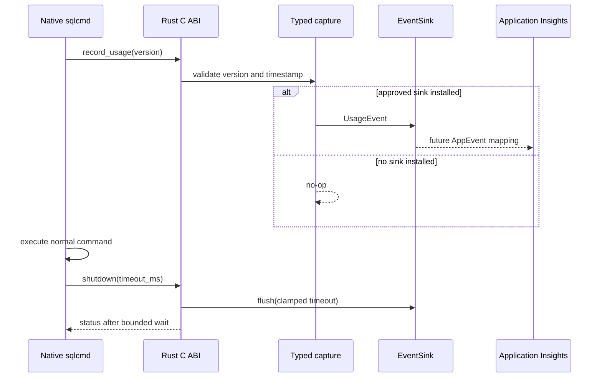
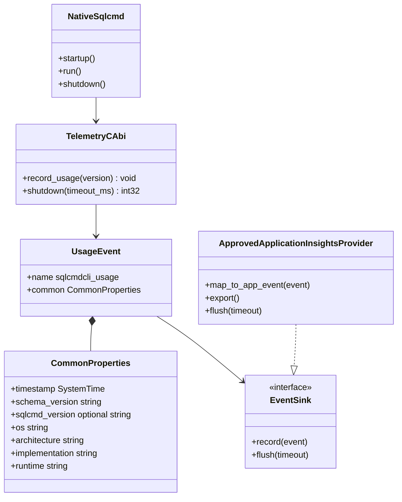

# sqlcmd Telemetry Architecture

## Status

`mssql-sqlcmd` captures one privacy-safe, discrete usage event behind an
exporter-independent sink. Native sqlcmd can call the stable C ABI now; when no
approved sink is installed, capture and shutdown are no-ops.

The production destination is:

```text
sqlcmd -> Application Insights -> DataX AllProducts -> Kusto
```

The approved Application Insights exporter and its authentication, batching,
retry, and shutdown implementation are not yet defined. This implementation
does not add OTLP, Geneva, ETW, Linux `user_events`, or a community Application
Insights exporter, and does not claim that any of those routes reaches DataX.

AllProducts does not process Application Insights `AppMetrics`, so usage is
preserved as a discrete event rather than a metric counter. OpenTelemetry has no
first-class custom-event signal. The future approved provider owns the explicit
conversion from the typed record to an Application Insights `AppEvent`.

## Architecture


The capture layer knows only the stable event name and typed common properties.
It does not know connection details, queries, exporter configuration, or DataX
credentials. The provider maps the record to one `AppEvent` with the documented
`sqlcmdcli_` keys.

## Native and Rust flow



Capture and shutdown never change command output, execution, or exit status.
Both C entry points catch Rust panics. Native sqlcmd treats every telemetry
status as fail-open.

## Components



## Event schema

### `sqlcmdcli_usage`

One record per native sqlcmd process usage. Event and property names use the
downstream `sqlcmdcli_` prefix.

| AppEvents property | Typed capture value |
|---|---|
| `sqlcmdcli_schema_version` | `1` |
| `sqlcmdcli_version` | Native sqlcmd version, when it passes validation |
| `sqlcmdcli_os` | Rust target operating-system identifier |
| `sqlcmdcli_arch` | Rust target architecture identifier |
| `sqlcmdcli_implementation` | `mssql-sqlcmd-rust` |
| `sqlcmdcli_runtime` | `native` |

The record also has a capture timestamp. The approved provider determines the
exact Application Insights timestamp field and serialization.

The version is omitted unless it is 1-64 ASCII bytes containing only letters,
digits, `.`, `-`, `+`, or `_`.

## Privacy rules

The API is typed and does not accept an arbitrary property map. It never
collects or exports:

- query text or results
- raw command-line arguments
- connection strings
- credentials or tokens
- server, host, IP, database, or user names
- filesystem paths
- raw error messages
- exit codes or outcome categories
- arbitrary free-form strings

No device identifier is captured. `devdeviceid` remains blocked until an
approved implementation or exact algorithm is available.

## C ABI

```c
void mssql_sqlcmd_telemetry_record_usage(
    MssqlSqlcmdText sqlcmd_version);

int32_t mssql_sqlcmd_telemetry_shutdown(
    uint32_t timeout_ms);
```

`sqlcmd_version.data` may be null; a null or empty value is omitted.

`mssql_sqlcmd_telemetry_record_usage` is thread-safe, catches panics, returns no
status, and is a no-op after shutdown starts.

`mssql_sqlcmd_telemetry_shutdown` is thread-safe and idempotent. Only the first
call starts a flush; concurrent or later calls return `MSSQL_SQLCMD_OK`
immediately. `timeout_ms` is milliseconds and is clamped to 1000. The function
returns:

- `MSSQL_SQLCMD_OK` when the flush completed, no provider is installed, or
  another shutdown call already started
- `MSSQL_SQLCMD_TELEMETRY_TIMEOUT` when the bounded wait expires
- `MSSQL_SQLCMD_INTERNAL_ERROR` when the provider fails or panics

The bounded wait is enforced outside the provider. A timed-out provider may
continue on its detached worker thread, but native sqlcmd does not wait longer
than the clamped timeout. Callers ignore the status for command behavior.

No provider configuration crosses this ABI. The future approved provider can be
added behind the Rust sink boundary without changing native lifecycle calls.

## What works now

- one native usage lifecycle call
- exact typed capture with an event timestamp
- stable event name and common properties
- privacy validation for the only caller-provided property
- in-memory sink tests observing the exact discrete record
- fail-open, no-op behavior when no provider is installed
- bounded, idempotent shutdown and flush boundary

## Remaining production onboarding

Before telemetry can leave the process, the owning team must confirm and
implement:

1. the approved Rust-compatible Application Insights provider
2. authentication and the target Application Insights resource
3. exact mapping of `UsageEvent` to `AppEvents`
4. batching, retry, timeout, and bounded provider shutdown behavior
5. DataX AllProducts onboarding and schema registration
6. Kusto database/table names, retention, access, and validated queries
7. the approved `devdeviceid` algorithm, if that property is required

After onboarding, operators view recent events in the target Application
Insights resource and query the onboarded AllProducts data in Kusto. Exact
resource names and Kusto table/query examples must be added only after the
onboarding details are confirmed.
