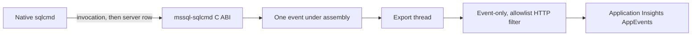

# sqlcmd usage telemetry

## Status

`mssql-sqlcmd` sends one privacy-safe `sqlcmdcli_usage` event per sqlcmd run to
Application Insights. Telemetry is off unless a destination exists and the user
has not opted out. It never changes sqlcmd's output, exit code, or the
connection's session settings, and it fails open: every error is ignored.

The field list is the one proposed to the privacy review. Nothing is final until
that review, notice and opt-out controls, retention, and the dependency approval
below are done.

## Controls

| Setting | Effect |
|---|---|
| `SQLCMD_TELEMETRY_OPTOUT=1` (or `true`, `yes`) | No event, no server query, and the device ID is neither read nor created. |
| `SQLCMD_TELEMETRY_CONNECTION_STRING` | The Application Insights connection string. Overrides the built-in one, which is used only when the variable is absent. A variable that is set to an empty, invalid or non-text value turns telemetry off; it does not fall back to the built-in one, and nothing else (the device ID, the server query) runs. |
| `SQLCMD_TELEMETRY_CONNECTION_STRING_DEFAULT` (build time) | A connection string compiled into the library. Without it, and without the variable, telemetry is off. |
| `SQLCMD_CALLER_TYPE` | The caller declares itself: `human`, `agent`, `pipeline` or `other_automation`. Not a telemetry switch; it only sets the caller category. |

`APPLICATIONINSIGHTS_CONNECTION_STRING` is deliberately not read: Azure App
Service and other hosts set it for their own applications, and sqlcmd must not
report into someone else's resource.

The connection string is not a secret on its own (an instrumentation key can
only write), but it is never logged or echoed.

## Data flow



1. After the command line is parsed, native sqlcmd records the invocation
   (`mssql_sqlcmd_telemetry_record_usage`): version, command, and how `--format`
   was given. The library adds the platform, the caller category, and the device
   ID, and keeps this as the base of the event.
2. On the first successful connection, native sqlcmd passes the server's row
   (`mssql_sqlcmd_telemetry_record_connection`). The library validates it, and
   starts sending the event on its own thread, so the network work overlaps what
   sqlcmd does next.
3. At exit (`mssql_sqlcmd_telemetry_shutdown`) the library sends the event if it
   was not sent yet (a run that never connected), and waits for it for at most
   one second.

The Rust `sqlcmd diagnose` path records its server row from its own session
probe, with the same functions.

The exporter maps an OpenTelemetry span event named `ai.custom` to an
Application Insights custom event when it carries `ai.customEvent.name`. It also
always creates a `RemoteDependency` envelope for the enclosing span; the HTTP
client removes that envelope from the compressed payload, and every remaining
event is checked against the allowlist below before it is sent. Tests inspect
the final request body.

## Event schema

Event name `sqlcmdcli_usage`. Keys are lowercase with the `sqlcmdcli_` prefix.
The event timestamp is the standard one.

| Property | Values | Source |
|---|---|---|
| `sqlcmdcli_version` | native sqlcmd's version: two to four numeric parts and an optional `-` or `+` suffix, e.g. `18.7.0001.1`, `18.5.1-preview.2`; anything else is omitted | native sqlcmd's version |
| `sqlcmdcli_os` | `windows`, `linux`, `macos`, `other` | client OS |
| `sqlcmdcli_arch` | `x86`, `x86_64`, `aarch64`, `other` | the sqlcmd binary's architecture |
| `sqlcmdcli_command` | `diagnose`; omitted for any other run | parsed command |
| `sqlcmdcli_format` | `json`, `unrecognized`, `missing`; omitted when `--format` was not given | parsed option |
| `sqlcmdcli_devdeviceid` | lowercase `8-4-4-4-12` GUID; omitted if it cannot be read or stored | shared Microsoft DeveloperTools ID |
| `sqlcmdcli_caller_type` | `human`, `agent`, `pipeline`, `other_automation`, `unknown` | the caller's declaration, else environment markers, below |
| `sqlcmdcli_engine_edition` | the documented integer, e.g. `2` Standard, `3` Enterprise, `4` Express, `5` SQL Database, `8` Managed Instance | `SERVERPROPERTY('EngineEdition')` |
| `sqlcmdcli_server_version` | e.g. `17.0.5015.4` | `SERVERPROPERTY('ProductVersion')` |
| `sqlcmdcli_server_os` | `windows`, `linux` | `@@VERSION` |
| `sqlcmdcli_server_platform` | `NT x64`, `NT INTEL X86`, `NT ARM64`, `Linux x64`, `Linux ARM64` (DacFx's labels) | `@@VERSION` |

A property whose value is unavailable, or does not validate against its set or
shape, is omitted; a server value is never forwarded verbatim. The HTTP filter
rejects the whole event if it carries an unknown key, a value outside its set,
or no `os` and `arch`, and removes the exporter's automatic tags.

There is no completion event, duration, or outcome, and nothing is sent about
the connection's success. A run that never connects still reports the
invocation properties.

### Server properties

The four server properties (engine edition, SQL Server version, server OS and
server platform) come from one `SELECT`, returned by
`mssql_sqlcmd_telemetry_server_info_query`. Native sqlcmd appends it to the
`SET TEXTSIZE` batch it already sends after login, only on the first connection
and only when telemetry is enabled, so it adds no round trip (measured about
2 ms against Azure SQL Database; a separate batch added about 196 ms). If the
combined batch fails, the plain `SET TEXTSIZE` is sent, as it would have been.
The Rust `diagnose` path adds the columns to its existing session probe, and
records the row after that check's timing is taken, so telemetry cannot change
the reported duration or clock offset. The query needs no permission beyond a
connection. The query text is defined once, in `server_info.rs`, and both
paths use it.

Platform and OS are read from `@@VERSION` because `xp_msver` is unavailable on
Azure SQL Database and `sys.dm_os_host_info` fails there; both stay omitted on
Azure SQL Database, as in DacFx. The architecture is the build's, the
parenthesized marker after the version number (`(X64)`, `(Intel X86)`,
`(ARM64)`), not the `<X64>` after the OS name, so a 32-bit instance on 64-bit
Windows reads as `NT INTEL X86`, as `xp_msver` reports it. Only the OS family is
sent, not its version, which would need `sys.dm_os_host_info` and a server
permission.

### Caller category

A caller can declare what it is with `SQLCMD_CALLER_TYPE` set to `human`,
`agent`, `pipeline` or `other_automation` (any case). A declaration wins over
everything below; any other value is ignored.

Without a declaration, detection uses DacFx's AI-agent environment markers, so
a caller DacFx or SqlPackage sees as an agent is one here. Any one of them is
enough:

1. `AI_AGENT=github_copilot_vscode_agent`
2. `CLAUDE_CODE_CHILD_SESSION=1`
3. `CODEX_THREAD_ID` or `CODEX_SESSION_ID` set
4. `GEMINI_CLI=1`
5. `CLAUDECODE=1`
6. `COPILOT_AGENT=1`

Any of these makes `agent`. Otherwise one of DacFx's CI markers (`TF_BUILD`,
`AGENT_JOBNAME`, `SYSTEM_COLLECTIONURI`, `GITHUB_ACTION`, `GITHUB_ACTIONS`,
`GITLAB_CI`, `JENKINS_URL`, `CIRCLECI`, `CODEBUILD_BUILD_ID`) makes `pipeline`,
and anything else is `unknown`. DacFx also counts `AWS_REGION` and
`AWS_DEFAULT_REGION` as AWS CodeBuild; they are left out here because they are
set on most AWS machines, not only in builds.
The absence of a marker does not mean a human: without a declaration sqlcmd
never reports `human`. Only the category is sent, never a raw environment
value or which agent it is.

### Device ID

The ID is the shared Microsoft DeveloperTools device ID: on Windows the
`deviceid` value of `HKCU\SOFTWARE\Microsoft\DeveloperTools` (64-bit view); on
macOS `~/Library/Application Support/Microsoft/DeveloperTools/deviceid`; on
Linux `$XDG_CACHE_HOME/Microsoft/DeveloperTools/deviceid` when `XDG_CACHE_HOME`
is set, else `~/.cache/Microsoft/DeveloperTools/deviceid`. An existing
recognized ID is reused;
a missing one is generated (a random version 4 UUID) and stored. A value that is
present but unreadable or unrecognized is never overwritten. If it cannot be
read or stored, the property is omitted. When telemetry is off, the ID is not
touched. Two first runs at the same moment end up with the same ID: on macOS and
Linux the ID is written to a file of its own and linked into place, which fails
if the ID file exists, and the loser reads the winner's; on Windows first runs
take a named mutex, and the value is read back after it is written. A first run
that cannot take the mutex within two seconds does not create the ID, and the
event goes without it. A tool that
writes the shared ID without that mutex can still race on Windows; the
read-back reports the value that survives. The ID is end-user pseudonymized
information and is sent as the GUID, not hashed.

## Privacy contract

The API is typed and does not accept an arbitrary property map. It never
collects or exports:

- query text or results
- raw command-line arguments or unrecognized command tokens
- connection strings, credentials, or tokens
- server, host, IP, database, or user names
- filesystem paths
- raw error messages
- arbitrary free-form strings
- hardware identifiers

## Failure behavior and latency

Every step is best effort; failures are only debug tracing and never write to
sqlcmd's output. Rust panics are caught at the C boundary. The HTTP client uses
two-second connect and request timeouts, and the process waits at most one
second at exit. When the destination is unreachable, a run therefore ends up to
one second later than it would without telemetry, which is the worst case a
firewalled or offline machine sees; when the event is sent early enough, the wait
is hidden behind the work sqlcmd does after connecting.

On Windows the console control handler (Ctrl+C in non-interactive mode, console
close) sends the event before ending the process. On Linux and macOS the signal
handlers do not flush: an event for a run ended by a signal is lost.

The event is exported at once by its own thread, using a simple exporter: the
span ends, the event is sent on that thread, and the provider is shut down, so
nothing waits on a batch timer in a long interactive session. A transport
failure, a failure in the filter, a response that does not match what was sent,
and a rejection by the service (a 4xx or 5xx status, or a partial response that
rejected the event) are all recorded as a failure, because the SDK's shutdown
does not hand the export result back. The exporter retries throttling and server
errors with a backoff; the bounded wait then ends first, and that is reported as
a timeout, not as success. An all-filtered or malformed request is an error, not
a synthetic success. A
partial-ingestion response is checked against the request first (item counts,
and that every error index is present, unique and in range) before its indices
are translated back to the original batch; a response that does not add up is
an error and is never taken as an acceptance.

Recording and shutdown are ordered by one lock: a call admitted before shutdown
is sent by it, and a call after it is not recorded. Shutdown takes that lock
with a bounded wait, because it can run on the Windows console-control thread
while another thread holds it. It is not async-signal-safe (it takes locks,
allocates and spawns a thread), so it must never be called from a POSIX signal
handler, which is why the Linux and macOS handlers do not flush.

The SDK reads `OTEL_*` environment variables for its defaults. The provider sets
an empty resource, an always-on sampler and an event limit itself, so ambient
tracing configuration can neither add identifiers to the event nor switch it
off.

## C ABI

```c
void    mssql_sqlcmd_telemetry_record_usage(MssqlSqlcmdText sqlcmd_version,
                                            int32_t command, int32_t format);
int32_t mssql_sqlcmd_telemetry_enabled(void);
const char* mssql_sqlcmd_telemetry_server_info_query(void);
int32_t mssql_sqlcmd_telemetry_record_connection(const MssqlSqlcmdServerInfo* info);
int32_t mssql_sqlcmd_telemetry_shutdown(uint32_t timeout_ms);
```

`command` is `MSSQL_SQLCMD_COMMAND_*` and `format` is `MSSQL_SQLCMD_FORMAT_*`;
an unknown value means "not given". The usage call is a no-op unless telemetry
is enabled, and the first call wins. The first `record_connection` call wins.
`shutdown` returns `0` when completed, off, or already started; `6` when the
bounded wait expires; and `3` on failure or a caught panic. All are fail-open.

## Dependency review

The transport uses `opentelemetry`, `opentelemetry_sdk`,
`opentelemetry-application-insights`, `opentelemetry-http`, reqwest with the
repository's native-TLS convention, and `uuid` for the device ID. The Application
Insights exporter is a community crate that states it is not an official
Microsoft product, so shipping approval for it remains an owning-team decision.
The implementation is validated with in-memory HTTP clients, unit tests, and
runs of the real native sqlcmd; it does not claim live DataX delivery.
