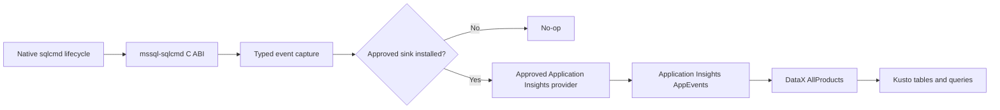
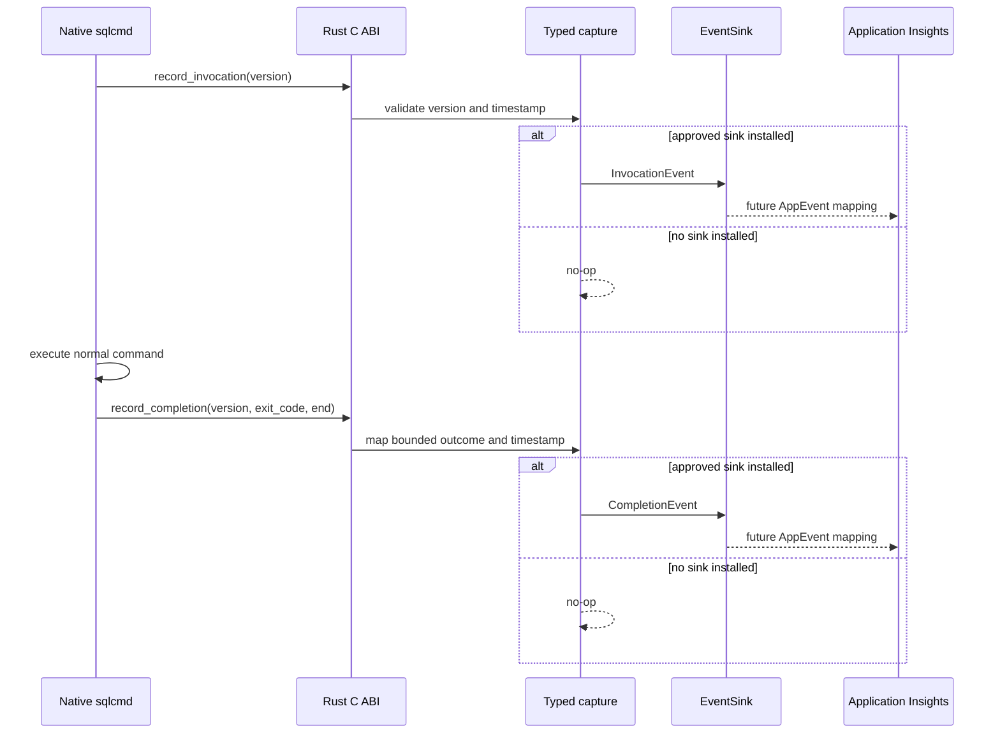
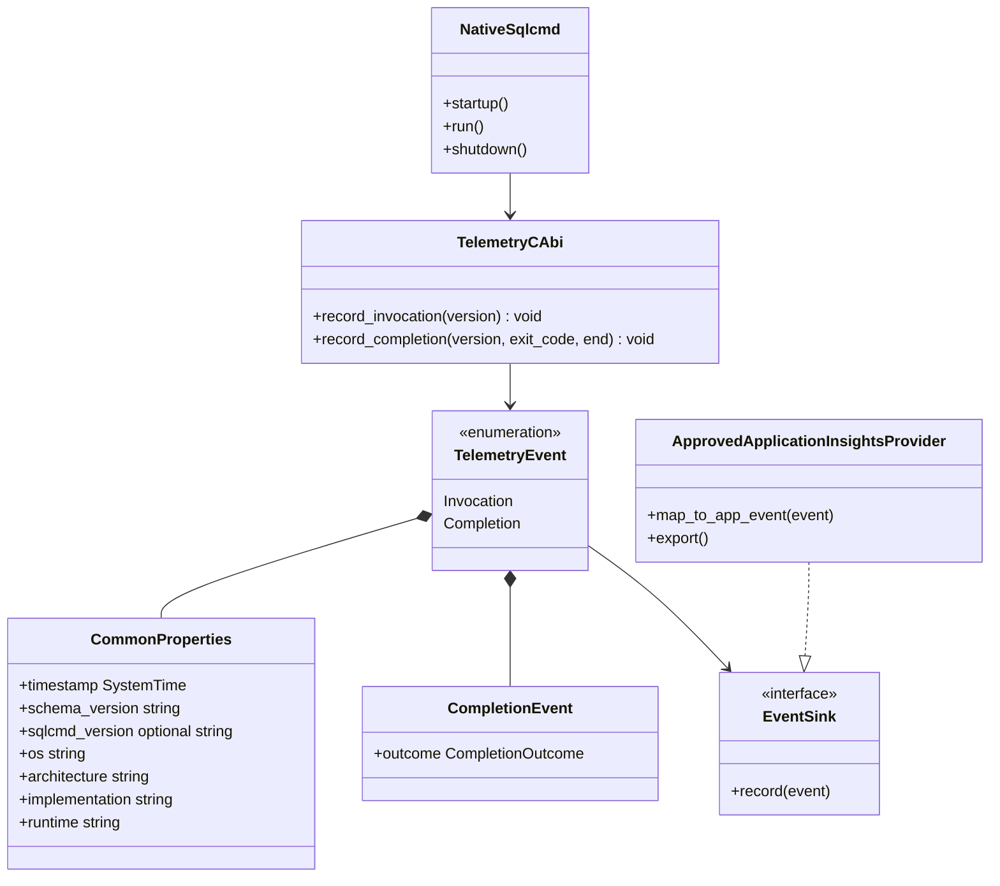

# sqlcmd Telemetry Architecture

## Status

`mssql-sqlcmd` captures privacy-safe, discrete invocation and completion event
records behind an exporter-independent sink boundary. Native sqlcmd can call
the stable C ABI now; when no approved sink is installed, capture is a no-op.

The production destination is:

```text
sqlcmd -> Application Insights -> DataX AllProducts -> Kusto
```

The approved Application Insights exporter and its authentication, batching,
retry, and shutdown behavior are not yet defined. This implementation does not
add OTLP, Geneva, ETW, Linux `user_events`, or a community Application Insights
exporter, and does not claim that any of those routes reaches DataX.

AllProducts does not process Application Insights `AppMetrics`, so invocation
and completion are preserved as discrete events rather than primary metric
counters. OpenTelemetry has no first-class custom-event signal. The future
approved provider owns the explicit conversion from these typed records to
Application Insights `AppEvents`.

## Architecture



The capture layer knows only stable event names, typed properties, and bounded
outcomes. It does not know connection details, queries, exporter configuration,
or DataX credentials. The provider layer must map each record to one `AppEvent`
with the documented `sqlcmdcli_` keys.

## Native and Rust flow



Capture never changes command output, execution, or exit status. The C boundary
catches Rust panics. The approved provider must also contain its own failures
and must not materially delay normal shutdown.

## Components



## Event schema

Event names and property keys use the downstream `sqlcmdcli_` prefix.

### `sqlcmdcli_invocation`

One record when native sqlcmd starts an invocation.

### `sqlcmdcli_completion`

One record when native sqlcmd has a final process outcome. It adds
`sqlcmdcli_outcome`, one of:

- `succeeded`
- `failed`
- `canceled`
- `invalid_invocation`
- `unknown`

The raw exit code is not exported.

### Common properties

| AppEvents property | Typed capture value |
|---|---|
| `sqlcmdcli_schema_version` | `1` |
| `sqlcmdcli_version` | Native sqlcmd version, when it passes validation |
| `sqlcmdcli_os` | Rust target operating-system identifier |
| `sqlcmdcli_arch` | Rust target architecture identifier |
| `sqlcmdcli_implementation` | `mssql-sqlcmd-rust` |
| `sqlcmdcli_runtime` | `native` |

Each record also has a capture timestamp. The approved provider determines the
exact Application Insights timestamp field and serialization.

The version is omitted unless it is 1-64 ASCII bytes containing only letters,
digits, `.`, `-`, `+`, or `_`.

## Privacy rules

The API is typed and does not accept an arbitrary property map. It never
collects or exports:

- query text or results
- raw command-line arguments
- connection strings
- credentials or tokens
- server, host, IP, database, or user names
- filesystem paths
- raw error messages
- arbitrary free-form strings

No device identifier is captured. `devdeviceid` remains blocked until an
approved implementation or exact algorithm is available.

## C ABI

```c
void mssql_sqlcmd_telemetry_record_invocation(
    MssqlSqlcmdText sqlcmd_version);

void mssql_sqlcmd_telemetry_record_completion(
    MssqlSqlcmdText sqlcmd_version,
    int32_t exit_code,
    int32_t end);
```

`sqlcmd_version.data` may be null; a null or empty value is omitted. Completion
uses the existing run-end constants:

- `MSSQL_SQLCMD_RUN_FINISHED`
- `MSSQL_SQLCMD_RUN_CANCELED`
- `MSSQL_SQLCMD_RUN_INVALID_INVOCATION`

No provider configuration crosses this ABI yet. The future approved provider
can be added behind the Rust sink boundary without changing native lifecycle
calls.

## What works now

- native invocation and completion lifecycle calls
- exact typed capture with event timestamps
- stable event names, common properties, and bounded outcomes
- privacy validation for the only caller-provided property
- in-memory sink tests observing exact discrete records
- fail-open, no-op behavior when no provider is installed

## Remaining production onboarding

Before telemetry can leave the process, the owning team must confirm and
implement:

1. the approved Rust-compatible Application Insights provider
2. authentication and the target Application Insights resource
3. exact mapping of `TelemetryEvent` to `AppEvents`
4. batching, retry, timeout, and bounded shutdown behavior
5. DataX AllProducts onboarding and schema registration
6. Kusto database/table names, retention, access, and validated queries
7. the approved `devdeviceid` algorithm, if that property is required

After onboarding, operators view recent events in the target Application
Insights resource and query the onboarded AllProducts data in Kusto. Exact
resource names and Kusto table/query examples must be added only after the
onboarding details are confirmed.
